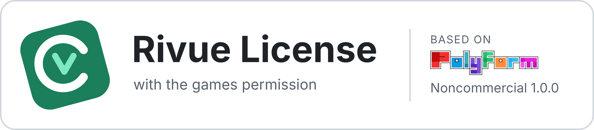

# Rivue license

Copyright (c) 2025-2026 linhisreal (ThisisLinh)

Required Notice: Copyright (c) 2025-2026 linhisreal (https://github.com/linhisreal/Rivue)

Rivue is licensed under the PolyForm Noncommercial License 1.0.0, with one additional
permission for games and the clarifications below. All of it is below.

## In short

- You may use, copy, fork, port and change Rivue for noncommercial purposes, closed source or
  open.
- You may make money from a game you build with Rivue, and be paid to build one for someone
  else, if the game credits Rivue as described below.
- You must keep the "Required Notice" line above and this license (or its URL) with every copy,
  changed or not.
- You may not make money from Rivue itself: not by selling it, a fork, port or translation of
  it, a framework or tool made from it, copies of a game's project files that contain it, or
  paid services built around it outside game work.

This summary is not the license. The terms below are. Where the summary and the terms differ,
the terms apply.

## Additional permission: games

In addition to the PolyForm Noncommercial License, the licensor grants you permission to:

1. use Rivue, changed or unchanged, in a game and earn money from players of that game, for
   example through game passes, developer products, Premium payouts, paid access, in-game
   purchases, sponsorships or ads; and
2. be paid to build, change or maintain a game that uses Rivue for someone else.

Doing so does not count against the license's limit to noncommercial purposes, as long as you
meet every condition in this section.

**What counts as a game.** A game is interactive entertainment whose main purpose is to be
played: a Roblox experience, or a game on another platform. Software whose main purpose is
something else does not become a game by adding game-like features such as levels, points,
avatars or minigames. That includes shopping, payments, fitness, productivity, education,
social networking, dating and business tools, and any development tool.

**Where the money comes from.** The money must come from players playing the game. This
permission does not cover selling or charging for copies of a game's place file, model,
source code or project, including copyable or uncopylocked versions of the game, or selling
the game as a template, kit or starting point for other projects.

**Credit.** The game must credit Rivue, for example "UI built with Rivue
(github.com/linhisreal/Rivue)", in at least one of these places:

- the game's public description, in text that's shown without extra purchases; or
- an in-game credits screen that any player can open for free from the main menu or the
  settings, in text that's as easy to read as the rest of that screen.

**Changes of ownership.** These licenses are not transferred. When a game that uses Rivue is
sold, given or otherwise passed to a new owner, the new owner gets their own license directly
from the licensor by agreeing to these terms, and may use this permission for that game while
they meet its conditions.

## What stays noncommercial

The permission above does not cover, and the PolyForm Noncommercial License does not allow, any
of the following when done for money or any other commercial advantage:

- selling, licensing, renting or charging for access to Rivue, or to a fork, port, translation
  into another language or changed version of it;
- selling or charging for any framework, library, UI kit, component pack, template, starter
  place, model, plugin, package or other development tool that contains Rivue's code or is
  derived from it;
- selling access to a place, model, file or project that contains Rivue's code and can be
  copied, such as a paid uncopylocked place;
- using Rivue in software that isn't a game, as defined above, including apps and websites with
  game-like features;
- being paid for installing, integrating, configuring, customizing, supporting or consulting on
  Rivue, or for building software with it, except the game work allowed above;
- presenting Rivue's code, or a framework derived from it, as your own work.

## Forks and derived works

Forks, ports, translations into other languages and other works based on Rivue stay under these
terms, and the Notices section of the PolyForm Noncommercial License applies to them. You may
not offer them under any other license, such as MIT or Apache, or say that they can be used for
purposes these terms don't allow. Anyone who gets a copy from you gets it under these terms, not
under any terms you add. Free and open forks, ports and frameworks built on Rivue are fine, as
long as they keep the "Required Notice" line and this license.

## Violations

Coming back into compliance under the Violations section of the PolyForm Noncommercial License
keeps your licenses going. It does not make the earlier use permitted. Practical steps to correct
a commercial use that wasn't allowed include stopping all sales, taking down copies offered for
sale, and no longer providing paid services that weren't allowed.

---

# PolyForm Noncommercial License 1.0.0

<https://polyformproject.org/licenses/noncommercial/1.0.0>

## Acceptance

In order to get any license under these terms, you must agree to them as both strict obligations and conditions to all your licenses.

## Copyright License

The licensor grants you a copyright license for the software to do everything you might do with the software that would otherwise infringe the licensor's copyright in it for any permitted purpose.  However, you may only distribute the software according to [Distribution License](#distribution-license) and make changes or new works based on the software according to [Changes and New Works License](#changes-and-new-works-license).

## Distribution License

The licensor grants you an additional copyright license to distribute copies of the software.  Your license to distribute covers distributing the software with changes and new works permitted by [Changes and New Works License](#changes-and-new-works-license).

## Notices

You must ensure that anyone who gets a copy of any part of the software from you also gets a copy of these terms or the URL for them above, as well as copies of any plain-text lines beginning with `Required Notice:` that the licensor provided with the software.  For example:

> Required Notice: Copyright Yoyodyne, Inc. (http://example.com)

## Changes and New Works License

The licensor grants you an additional copyright license to make changes and new works based on the software for any permitted purpose.

## Patent License

The licensor grants you a patent license for the software that covers patent claims the licensor can license, or becomes able to license, that you would infringe by using the software.

## Noncommercial Purposes

Any noncommercial purpose is a permitted purpose.

## Personal Uses

Personal use for research, experiment, and testing for the benefit of public knowledge, personal study, private entertainment, hobby projects, amateur pursuits, or religious observance, without any anticipated commercial application, is use for a permitted purpose.

## Noncommercial Organizations

Use by any charitable organization, educational institution, public research organization, public safety or health organization, environmental protection organization, or government institution is use for a permitted purpose regardless of the source of funding or obligations resulting from the funding.

## Fair Use

You may have "fair use" rights for the software under the law. These terms do not limit them.

## No Other Rights

These terms do not allow you to sublicense or transfer any of your licenses to anyone else, or prevent the licensor from granting licenses to anyone else.  These terms do not imply any other licenses.

## Patent Defense

If you make any written claim that the software infringes or contributes to infringement of any patent, your patent license for the software granted under these terms ends immediately. If your company makes such a claim, your patent license ends immediately for work on behalf of your company.

## Violations

The first time you are notified in writing that you have violated any of these terms, or done anything with the software not covered by your licenses, your licenses can nonetheless continue if you come into full compliance with these terms, and take practical steps to correct past violations, within 32 days of receiving notice.  Otherwise, all your licenses end immediately.

## No Liability

***As far as the law allows, the software comes as is, without any warranty or condition, and the licensor will not be liable to you for any damages arising out of these terms or the use or nature of the software, under any kind of legal claim.***

## Definitions

The **licensor** is the individual or entity offering these terms, and the **software** is the software the licensor makes available under these terms.

**You** refers to the individual or entity agreeing to these terms.

**Your company** is any legal entity, sole proprietorship, or other kind of organization that you work for, plus all organizations that have control over, are under the control of, or are under common control with that organization.  **Control** means ownership of substantially all the assets of an entity, or the power to direct its management and policies by vote, contract, or otherwise.  Control can be direct or indirect.

**Your licenses** are all the licenses granted to you for the software under these terms.

**Use** means anything you do with the software requiring one of your licenses.
