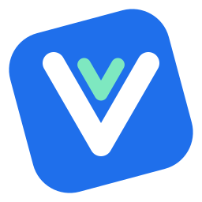
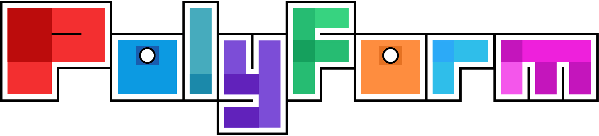

<p align="center">
  
</p>

<h1 align="center">Rivue</h1>

<p align="center">
  Vue 3's component model for Roblox UI, in Luau.
</p>

<p align="center">
  <a href="https://create.roblox.com/store/models?keyword=Rivue"></a>
  <a href="https://wally.run/package/linhisreal/rivue"></a>
  <a href="https://luau.org"></a>
  <a href="https://linhisreal.github.io/Rivue/"></a>
</p>

<p align="center">
  <a href="https://github.com/linhisreal/Rivue/actions/workflows/build.yml"></a>
</p>

Stop writing `label.Text = ...` by hand. Write what the screen should look like for the current
state, and Rivue keeps the Instances in sync: when a value changes, only the components that read
it re-render, and only the properties that changed get written.

```lua
local Rivue = require(game.ReplicatedStorage.Rivue)
local h = Rivue.h

local Counter = Rivue.defineComponent({
	name = "Counter",
	setup = function()
		local count = Rivue.ref(0)
		return {
			count = count,
			increment = function()
				count.value += 1
			end,
		}
	end,
	render = function(ctx)
		return h("TextButton", {
			Size = UDim2.fromOffset(200, 50),
			Text = `Clicked {ctx.count} times`,
			onClick = ctx.increment,
		})
	end,
})

Rivue.createApp(Counter):mountToPlayerGui(game.Players.LocalPlayer)
```

A bigger example with a text box, a keyed list and styles:
[TodoList](examples/components/TodoList.luau). More in [examples](examples).

Rivue is under active development, and the API can still change between releases. It runs in
LocalScripts. For client/server calls, the separate [RivueRemote](docs/api/remote.md) package adds
requests and events with rate limits.

## Why Rivue

If you know Vue, the API will look familiar: `ref`, `computed`, `watch`, and components with props,
emits, slots and provide/inject. There's a [cheat sheet](docs/VUE.md) for Vue users.

Reactivity is tracked per value, so when a parent re-renders, children whose props didn't change
are skipped without any `memo`.

It's built for Roblox UI, with style classes, `layout` and `flex` props in place of UIListLayout
boilerplate, and tweens, springs, `Transition` and `VirtualList` built in.

## Features

| | |
|---|---|
| Reactivity | `ref`, `reactive`, `computed`, `watch`, `watchEffect`, effect scopes, readonly and shallow variants |
| Components | `setup` + `render(ctx)`, validated props, emits, slots, provide/inject, every lifecycle hook |
| Styling | style classes per app or component; `layout`, `flex`, `cornerRadius`, `padding`, `stroke` props |
| Performance | keyed diffing, batched parent-first updates, `memo`, optional Instance pool |
| Built-ins | `Transition`, `TransitionGroup`, `KeepAlive`, `Teleport`, `Suspense`, `VirtualList`, async components |
| Roblox | tweens, springs, viewport and input-type composables, gamepad selection, attribute refs, tags |
| Studio | warnings that name the component chain, roots named after components, `app:printTree()` |
| Types | strict Luau with exported types like `Rivue.Ref<T>` and `Rivue.VNode` |

## Installation

Rivue is one ModuleScript (with a `runtime` folder inside). Put it in `ReplicatedStorage`.

**With Wally**, add it to your `wally.toml` and run `wally install`:

```toml
[dependencies]
Rivue = "linhisreal/rivue@2.57.0"
RivueRemote = "linhisreal/rivue-remote@2.57.0" # optional, for client/server calls
```

**With pesde**, run `pesde add linhisreal/rivue` (and `linhisreal/rivue_remote` if you want it).

**With Rojo**, add this repo as a git submodule and point your project at the package:

```json
"ReplicatedStorage": {
  "Rivue": { "$path": "vendor/Rivue/packages/rivue" }
}
```

**Without Rojo**, download `Rivue.rbxm` from the latest
[release](https://github.com/linhisreal/Rivue/releases) and drag it into `ReplicatedStorage`.
`Rivue.min.rbxm` is the same without comments, and `RivueRemote.rbxm` is the optional client/server
package.

## Docs

Read them at [linhisreal.github.io/Rivue](https://linhisreal.github.io/Rivue/), or start at the
[docs home](docs/README.md) here, which has an "I want to…" index.

[Guide](docs/GUIDE.md) · [Examples](examples) · [API reference](docs/API.md) ·
[Coming from Vue](docs/VUE.md) ·
[Coming from Roact, React-lua or Fusion](docs/COMING-FROM-REACT.md) · [DevTools](docs/DEVTOOLS.md) ·
[Architecture](docs/ARCHITECTURE.md)

## Contributing

Tools are pinned in `rokit.toml` ([Rokit](https://github.com/rojo-rbx/rokit)):

```sh
rokit install
lune setup                        # editor types for the Lune scripts
lune run test                     # all suites, without Studio
lune run check-docs               # links resolve and every API example runs
lune run build                    # the packages and the dev place, into build/
lune run version 2.57.0           # one version for every package
rojo serve                        # the dev place in Studio
```

CI also runs StyLua and luau-lsp, and checks the packages for Wally and pesde. Releases and
publishing: [docs/RELEASING.md](docs/RELEASING.md).

```
packages/rivue/            the UI framework                 Wally, pesde, Rivue.rbxm
packages/rivue-remote/     client/server calls              Wally, pesde, RivueRemote.rbxm
packages/rivue-devtools/   Studio plugin                    RivueDevTools.rbxm
dev/                       the dev place: test runner, demo app, examples, stress test
examples/                  example components, tested in tests/Examples.test.luau
tests/                     test suites; tests/offline is the Lune harness
docs/                      the Guide, API reference and docs site
default.project.json       the dev place (rojo serve)
pesde.toml                 the pesde workspace
```

## License

<a href="https://polyformproject.org/licenses/noncommercial/1.0.0"></a>

[PolyForm Noncommercial 1.0.0](LICENSE.md), with an extra permission for games. You can use, fork,
port and change Rivue, closed source or open, as long as you keep the credit notice. You can't
sell Rivue's code or use it commercially. Games built with Rivue may make money, if they credit
it. See [LICENSE](LICENSE.md) for the exact terms.

Games that use Rivue need a credit in the description or an in-game credits screen, for
example:

```
UI built with Rivue (github.com/linhisreal/Rivue)
```
