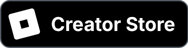
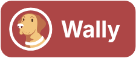
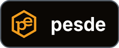
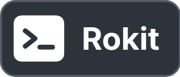
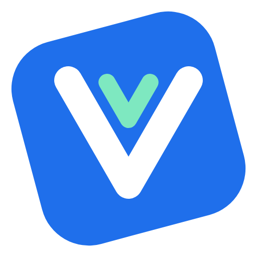
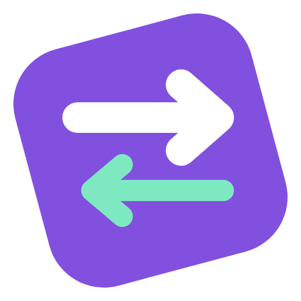
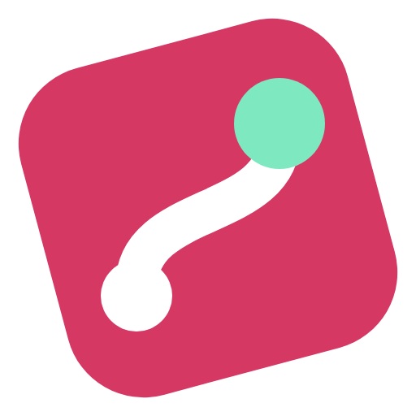
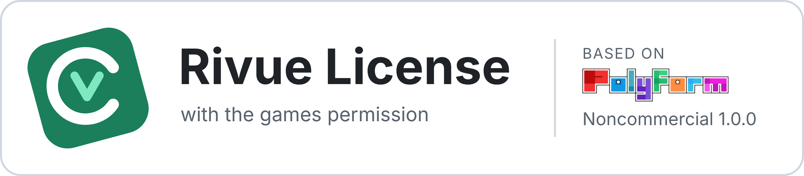

<p align="center">
  
</p>

<h1 align="center">Rivue</h1>

<p align="center">
  Vue 3's component model for Roblox UI, in Luau.
</p>

<p align="center">
  <a href="https://create.roblox.com/store/models?keyword=Rivue"></a>
  <a href="https://wally.run/package/linhisreal/rivue-ui"></a>
  <a href="https://pesde.dev/packages/linhisreal/rivue_ui"></a>
  <a href="rokit.toml"></a>
  <a href="https://luau.org"></a>
  <a href="docs/README.md"></a>
</p>

Write Roblox UI as Vue components. When state changes, Rivue re-renders the components that use it
and updates their Instances.

```lua
local Rivue = require(game.ReplicatedStorage.RivueUI)
local h = Rivue.h

local Counter = Rivue.defineComponent({
	name = "Counter",
	setup = function()
		local count = Rivue.ref(0)
		return {
			count = count,
			increment = function()
				count.value += 1
			end,
		}
	end,
	render = function(ctx)
		return h("TextButton", {
			Size = UDim2.fromOffset(200, 50),
			Text = `Clicked {ctx.count} times`,
			onClick = ctx.increment,
		})
	end,
})

Rivue.createApp(Counter):mountToPlayerGui(game.Players.LocalPlayer)
```

More in [examples](examples). Runs in LocalScripts. The API can still change between releases.

## Features

| | |
|---|---|
| Reactivity | `ref`, `reactive`, `computed`, `watch`, `watchEffect`, effect scopes, readonly/shallow variants |
| Components | `setup` + `render(ctx)`, props, emits, slots, provide/inject, all lifecycle hooks |
| Styling | style classes; `layout`, `flex`, `cornerRadius`, `padding`, `stroke` props |
| Built-ins | `Transition`, `TransitionGroup`, `KeepAlive`, `Teleport`, `Suspense`, `VirtualList`, `Dialog`, `ErrorBoundary`, `Row`/`Column`/`Spacer` |
| Roblox | tweens, springs, viewport/input composables, gamepad selection, attribute refs |
| Tooling | strict types, a DevTools plugin, `testing.render` |

Differences from Vue are in the [cheat sheet](docs/VUE.md).

## Packages

<table>
<tr><td width="72"></td>
<td>RivueUI: the framework.</td></tr>
<tr><td></td>
<td><a href="docs/api/remote.md">RivueRemote</a>: client/server calls, events and replicated state.</td></tr>
<tr><td></td>
<td><a href="docs/api/router.md">RivueRouter</a>: screens, history and guards, after Vue Router 4.</td></tr>
<tr><td></td>
<td><a href="docs/DEVTOOLS.md">RivueDevTools</a>: a Studio plugin for inspecting components.</td></tr>
</table>

## Installation

RivueUI is a ModuleScript with a `runtime` folder inside. Put it in `ReplicatedStorage`, and the
optional packages next to it.

**Wally:** add the packages to `wally.toml`, then run `wally install`.

```toml
[dependencies]
RivueUI = "linhisreal/rivue-ui@0.10.0-rc.1"
RivueRemote = "linhisreal/rivue-remote@0.8.0-beta.1" # optional, client/server calls
RivueRouter = "linhisreal/rivue-router@0.3.0-beta.1" # optional, screens and history
```

**pesde:** `pesde add linhisreal/rivue_ui`, plus `linhisreal/rivue_remote` or
`linhisreal/rivue_router` if you want them.

**Rojo:** add this repo as a git submodule and point your project at the package:

```json
"ReplicatedStorage": {
  "RivueUI": { "$path": "vendor/Rivue/packages/rivue-ui" }
}
```

**Studio:** download `RivueUI.rbxm` from the latest release and drag it into `ReplicatedStorage`.
The release also has `RivueUI.min.rbxm` (no comments), `RivueRemote.rbxm`, `RivueRouter.rbxm`, and
the `RivueDevTools.rbxm` plugin.

## Docs

[Docs home](docs/README.md) · [Guide](docs/GUIDE.md) · [API](docs/API.md) ·
[Coming from Vue](docs/VUE.md) · [Coming from React-lua or Fusion](docs/COMING-FROM-REACT.md) ·
[Architecture](docs/ARCHITECTURE.md)

## Contributing

```sh
rokit install
lune run test         # all suites, offline
lune run check-docs   # links and API examples
lune run build        # packages and the dev place into build/
rojo serve            # the dev place in Studio
```

`lune run version <package> <version>` bumps a package, and `lune run license` copies LICENSE.md
into each package. Releases: [docs/RELEASING.md](docs/RELEASING.md).

## License

<a href="LICENSE.md">

</a>

[PolyForm Noncommercial 1.0.0](LICENSE.md) with a games permission:

- Games made with Rivue can earn money, and you can be paid to build one or sell one.
- You can't make money from Rivue itself: selling it, a fork, a UI kit made from it, a game's
  project files, or paid services around it outside game work. Apps aren't games.
- Keep the license and credit notice. Forks stay under the same license.

Credit it in the game's description or an in-game credits screen any player can open, like
`UI built with Rivue by linhisreal`. [LICENSE](LICENSE.md) has the exact terms.
