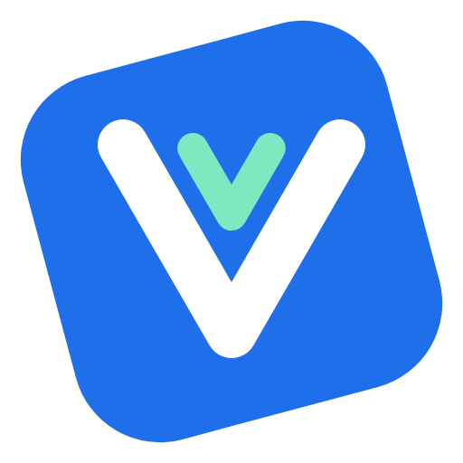
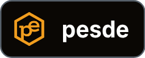
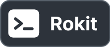

<p align="center">
  
</p>

<h1 align="center">Rivue</h1>

<p align="center">
  Vue 3's component model for Roblox UI, in Luau.
</p>

<p align="center">
  <a href="https://create.roblox.com/store/models?keyword=Rivue"></a>
  <a href="https://wally.run/package/linhisreal/rivue-ui"></a>
  <a href="https://pesde.dev/packages/linhisreal/rivue_ui"></a>
  <a href="rokit.toml"></a>
  <a href="https://luau.org"></a>
  <a href="docs/README.md"></a>
</p>

Rivue lets you describe a Roblox UI as components, the way Vue does on the web. You write what the
screen should show for the current state, and Rivue updates the Instances when that state changes.
Only the components that read a changed value re-render, and only the properties that changed are
written.

```lua
local Rivue = require(game.ReplicatedStorage.RivueUI)
local h = Rivue.h

local Counter = Rivue.defineComponent({
	name = "Counter",
	setup = function()
		local count = Rivue.ref(0)
		return {
			count = count,
			increment = function()
				count.value += 1
			end,
		}
	end,
	render = function(ctx)
		return h("TextButton", {
			Size = UDim2.fromOffset(200, 50),
			Text = `Clicked {ctx.count} times`,
			onClick = ctx.increment,
		})
	end,
})

Rivue.createApp(Counter):mountToPlayerGui(game.Players.LocalPlayer)
```

[TodoList](examples/components/TodoList.luau) is a bigger example, with a text box, a keyed list
and styles. The rest are in [examples](examples).

Rivue runs in LocalScripts. It's still young, so the API can change between releases.

## Why Rivue

Most of it will look familiar if you know Vue: `ref`, `computed`, `watch`, and components with
props, emits, slots and provide/inject. The [cheat sheet](docs/VUE.md) lists where Rivue differs.

Updates are tracked per value. When a parent re-renders, a child only re-renders if its props
changed, and you get that without `memo`.

It's built around Roblox UI. Colours and fonts go in style classes, the `layout` and `flex` props
replace most UIListLayout setup, and tweens, springs, `Transition` and `VirtualList` are included.

## Features

| | |
|---|---|
| Reactivity | `ref`, `reactive`, `computed`, `watch`, `watchEffect`, effect scopes, readonly and shallow variants |
| Components | `setup` + `render(ctx)`, validated props, emits, slots, provide/inject, every lifecycle hook |
| Styling | style classes per app or component; `layout`, `flex`, `cornerRadius`, `padding`, `stroke` props |
| Performance | keyed diffing, batched parent-first updates, `Rivue.bind` for properties that change every frame, `memo`, optional Instance pool |
| Built-ins | `Transition` with fade/slide/pop presets, `TransitionGroup`, `KeepAlive`, `Teleport`, `Suspense`, `VirtualList`, `Dialog`, `ErrorBoundary`, `Row`/`Column`/`Spacer`, `useAsync` |
| Roblox | tweens, springs, viewport and input-type composables, gamepad selection, attribute refs, tags |
| Studio | warnings that name the component chain, roots named after components, `app:printTree()`, a DevTools plugin, `testing.render` for tests |
| Types | strict Luau with exported types like `Rivue.Ref<T>` and `Rivue.VNode` |

## Packages

RivueUI is the framework, and everything above is part of it. The other packages are optional and
have their own versions, like Vue Router next to Vue.

<table>
<tr>
<td width="72"></td>
<td>RivueUI: components, state, styling, layout and the built-in components.</td>
</tr>
<tr>
<td></td>
<td><a href="docs/api/remote.md">RivueRemote</a>: client/server calls and events over RemoteEvents,
with payload checks and per-player rate limits.</td>
</tr>
<tr>
<td></td>
<td><a href="docs/api/router.md">RivueRouter</a>: screens with history, guards and nested routes,
following Vue Router 4.</td>
</tr>
<tr>
<td></td>
<td><a href="docs/DEVTOOLS.md">RivueDevTools</a>: a Studio plugin that shows each component's
props, state and renders during a playtest.</td>
</tr>
</table>

## Installation

Rivue is a ModuleScript with a `runtime` folder inside, and it goes in `ReplicatedStorage`. Install
it the same way as your other packages.

With Wally, add it to `wally.toml` and run `wally install`:

```toml
[dependencies]
RivueUI = "linhisreal/rivue-ui@0.9.0-rc.2"
RivueRemote = "linhisreal/rivue-remote@0.7.0-beta.1" # optional, for client/server calls
RivueRouter = "linhisreal/rivue-router@0.2.0-beta.1" # optional, for screens and back/forward
```

With pesde, run `pesde add linhisreal/rivue_ui`, plus `linhisreal/rivue_remote` or
`linhisreal/rivue_router` if you want them.

With Rojo, add this repo as a git submodule and point your project at the package:

```json
"ReplicatedStorage": {
  "RivueUI": { "$path": "vendor/Rivue/packages/rivue-ui" }
}
```

Without Rojo, download `RivueUI.rbxm` from the latest release on the repo's Releases page and drag
it into `ReplicatedStorage`. The release also has `RivueUI.min.rbxm` (the same code without
comments), and `RivueRemote.rbxm` and `RivueRouter.rbxm`, which go next to it.

## Docs

The [docs home](docs/README.md) has an "I want to…" table that points to the right page.

[Guide](docs/GUIDE.md) · [Examples](examples) · [API reference](docs/API.md) ·
[Coming from Vue](docs/VUE.md) ·
[Coming from React-lua or Fusion](docs/COMING-FROM-REACT.md) · [DevTools](docs/DEVTOOLS.md) ·
[Architecture](docs/ARCHITECTURE.md)

## Contributing

Tools are pinned in `rokit.toml` ([Rokit](https://github.com/rojo-rbx/rokit)):

```sh
rokit install
lune setup                        # editor types for the Lune scripts
lune run test                     # all suites, without Studio
lune run check-docs               # links resolve and every API example runs
lune run build                    # the packages and the dev place, into build/
lune run version rivue-ui 0.9.0-rc.3 # bump one package
rojo serve                        # the dev place in Studio
```

CI runs StyLua and luau-lsp, checks the packages for Wally and pesde, and runs every test suite a
second time inside a real Roblox server. How releases and publishing work is in
[docs/RELEASING.md](docs/RELEASING.md).

```
packages/rivue-ui/         the UI framework                 Wally, pesde, RivueUI.rbxm
packages/rivue-remote/     client/server calls              Wally, pesde, RivueRemote.rbxm
packages/rivue-router/     screens and history              Wally, pesde, RivueRouter.rbxm
packages/rivue-devtools/   Studio plugin                    RivueDevTools.rbxm
dev/                       the dev place: test runner, demo app, examples, stress test
examples/                  example components, tested in tests/Examples.test.luau
tests/                     test suites; tests/offline is the Lune harness
docs/                      the Guide, API reference and docs site
default.project.json       the dev place (rojo serve)
pesde.toml                 the pesde workspace
```

## License

<a href="LICENSE.md">

</a>

[PolyForm Noncommercial 1.0.0](LICENSE.md), with an extra permission for games. You can use, fork,
port and change Rivue, in closed or open source, as long as you keep the credit notice. Games built
with Rivue may make money, and you can be paid to build one. What you can't do is make money from
Rivue's code itself: selling it, a fork of it, or a framework or UI kit made from it.
[LICENSE](LICENSE.md) has the exact terms.

Credit Rivue in the game's description or an in-game credits screen, for example:

```
UI built with Rivue (github.com/linhisreal/Rivue)
```
