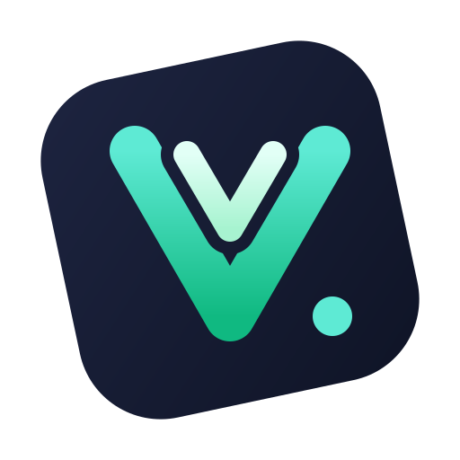

<p align="center">
  
</p>

<h1 align="center">Rivue</h1>

<p align="center">
  Vue 3's component model for Roblox UI, in Luau.
</p>

<p align="center">
  <a href="https://github.com/linhisreal/Rivue/actions/workflows/build.yml"></a>
  <a href="LICENSE.md"></a>
</p>

Describe your UI for the current state. When state changes, Rivue re-renders only the components
that read it and writes only the Instance properties that changed.

```lua
local Rivue = require(game.ReplicatedStorage.Rivue)
local h = Rivue.h

local Counter = Rivue.defineComponent({
	name = "Counter",
	setup = function()
		local count = Rivue.ref(0)
		return {
			count = count,
			increment = function()
				count.value += 1
			end,
		}
	end,
	render = function(ctx)
		return h("TextButton", {
			Size = UDim2.fromOffset(200, 50),
			Text = `Clicked {ctx.count} times`,
			onClick = ctx.increment,
		})
	end,
})

Rivue.createApp(Counter):mountToPlayerGui(game.Players.LocalPlayer)
```

A bigger example with a text box, a keyed list and styles:
[TodoList](examples/components/TodoList.luau). More in [examples](examples).

**Status:** Rivue is under active development and the API can still change between releases.
It runs in LocalScripts; `Rivue.Remote` also has a server half.

## Why Rivue

Roact and React-lua bring React's design to Roblox. Rivue brings Vue's. Both describe UI as a
tree of components, but they update it differently:

| | React way (Roact, React-lua) | Vue way (Rivue) |
|---|---|---|
| State | `setState` or hooks, re-run on every render | `ref` and `reactive`, created once in `setup` |
| What re-renders | the component and its children, unless you memoize | only components that read the changed value |
| Rules to follow | hook order, dependency arrays, stale closures | none: `setup` runs once, refs are plain values |
| Two-way input | value plus change handler, by hand | `model = "draft"` |
| Styling and layout | properties on each element | style classes, `layout` and `flex` props |

On top of that, Rivue ships what Roblox UI usually needs: `Transition`, `VirtualList`,
`KeepAlive`, tweens and springs, and a rate-limited `Remote`.

If you know React, Roact or React-lua will feel familiar, and they're more established. If you
know Vue, or want less re-rendering with less code, use Rivue. There's a
[Vue cheat sheet](docs/VUE.md).

## Features

| | |
|---|---|
| Reactivity | `ref`, `reactive`, `computed`, `watch`, `watchEffect`, effect scopes, readonly and shallow variants |
| Components | `setup` + `render(ctx)`, validated props, emits, slots, provide/inject, every lifecycle hook |
| Styling | style classes per app or component; `layout`, `flex`, `cornerRadius`, `padding`, `stroke` props |
| Performance | keyed diffing, batched parent-first updates, `memo`, optional Instance pool |
| Built-ins | `Transition`, `TransitionGroup`, `KeepAlive`, `Teleport`, `Suspense`, `VirtualList`, async components |
| Roblox | tweens, springs, viewport and input-type composables, gamepad selection, attribute refs, tags, `Remote` |
| Studio | warnings that name the component chain, roots named after components, `app:printTree()` |
| Types | strict Luau with exported types like `Rivue.Ref<T>` and `Rivue.VNode` |

## Installation

Rivue is a ModuleScript with a `runtime` folder. Put it in `ReplicatedStorage`.

**With Rojo**, add this repo as a git submodule and point your project at its
`rivue.project.json`:

```json
"ReplicatedStorage": {
  "Rivue": { "$path": "vendor/Rivue/rivue.project.json" }
}
```

**Without Rojo**, download `Rivue.rbxm` from the latest
[release](https://github.com/linhisreal/Rivue/releases) and drag it into `ReplicatedStorage`.
`Rivue.min.rbxm` is the same without comments.

## Docs

Start at the [docs home](docs/README.md), which has an "I want to…" index.

[Guide](docs/GUIDE.md) · [Examples](examples) · [API reference](docs/API.md) ·
[Coming from Vue](docs/VUE.md) · [Architecture](docs/ARCHITECTURE.md)

## Contributing

Tools are pinned in `rokit.toml` ([Rokit](https://github.com/rojo-rbx/rokit)):

```sh
rokit install
lune setup                        # editor types for the Lune scripts
lune run test                     # all suites, without Studio
lune run check-docs               # links resolve and every API example runs
lune run build                    # Rivue.rbxm and places, into build/
```

CI also runs StyLua and luau-lsp.

```
src/shared/Rivue/    the library
src/shared/Demo/     demo app, laid out as Guide chapter 10 recommends
src/client/          test place scripts (Demo, TestRunner, Stress)
tests/offline/       the Lune harness that runs tests outside Studio
```

## License

<a href="https://polyformproject.org/licenses/noncommercial/1.0.0"></a>

[PolyForm Noncommercial 1.0.0](LICENSE.md), with an extra permission for games. You can use, fork,
port and change Rivue, closed source or open, as long as you keep the credit notice. You can't
sell Rivue's code or use it commercially. Games built with Rivue may make money, if they credit
it. See [LICENSE](LICENSE.md) for the exact terms.

Games that use Rivue need a credit in the description or an in-game credits screen, for
example:

```
UI built with Rivue (github.com/linhisreal/Rivue)
```
