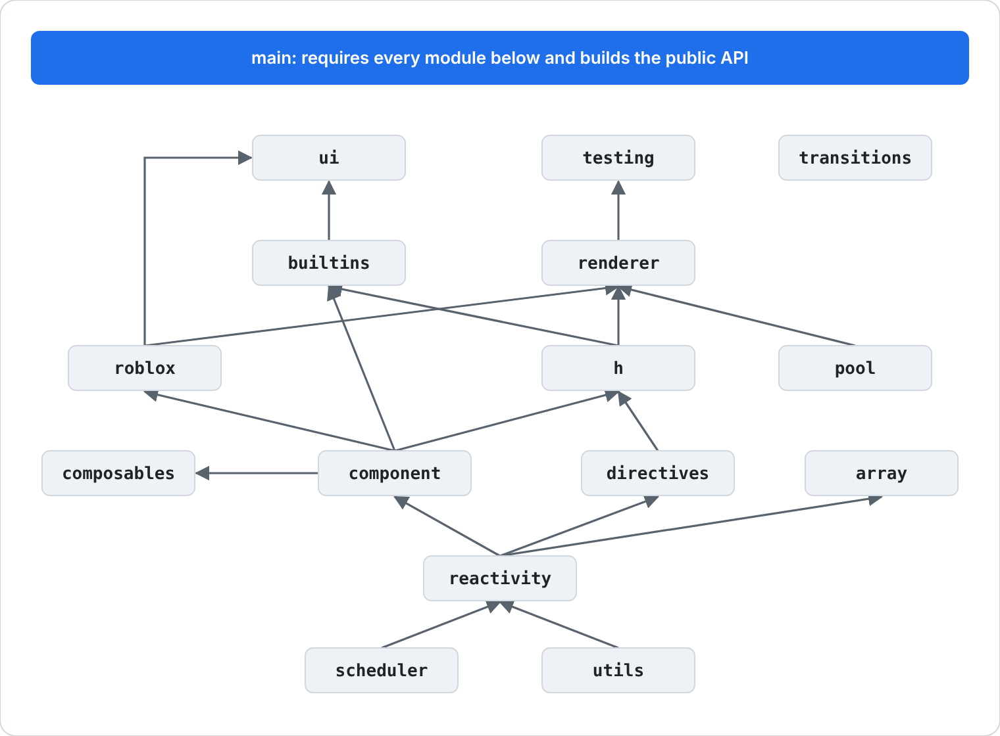
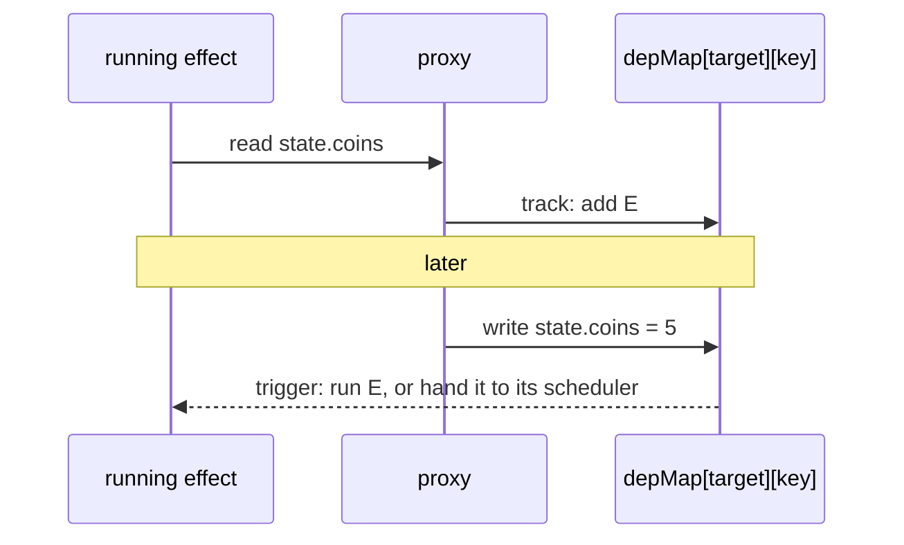
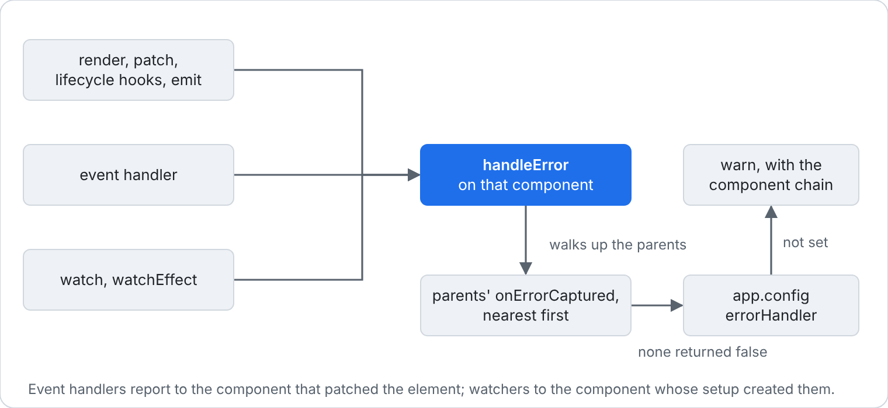
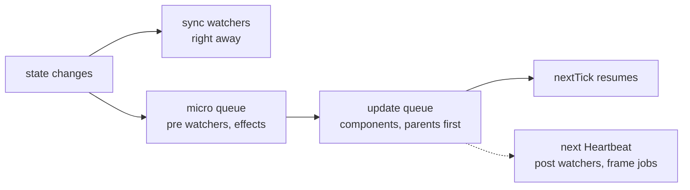
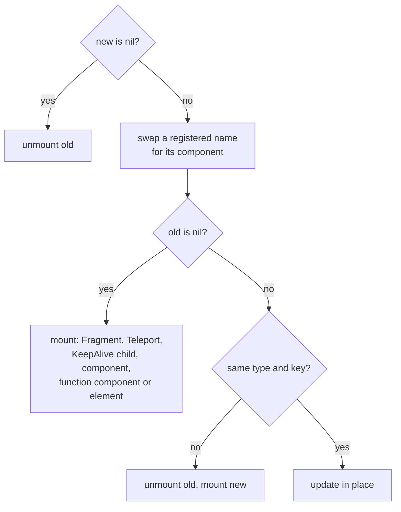
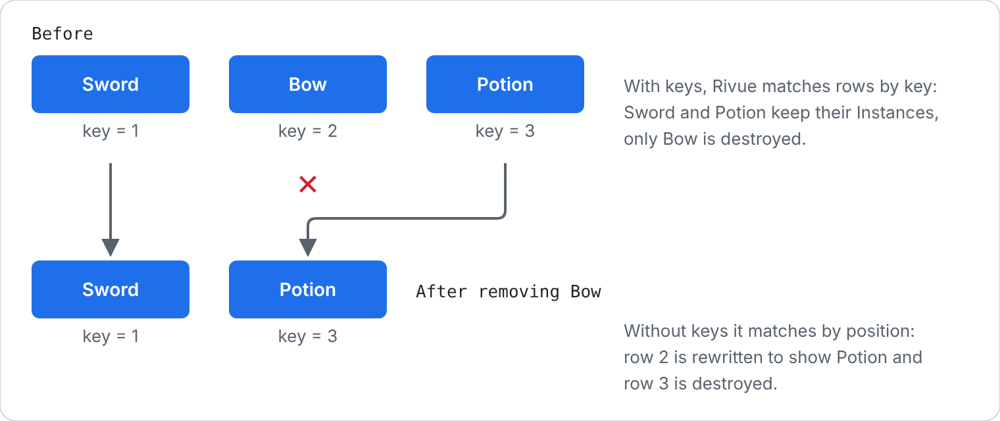
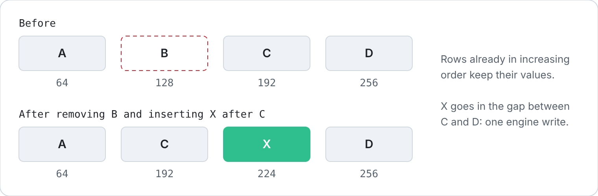
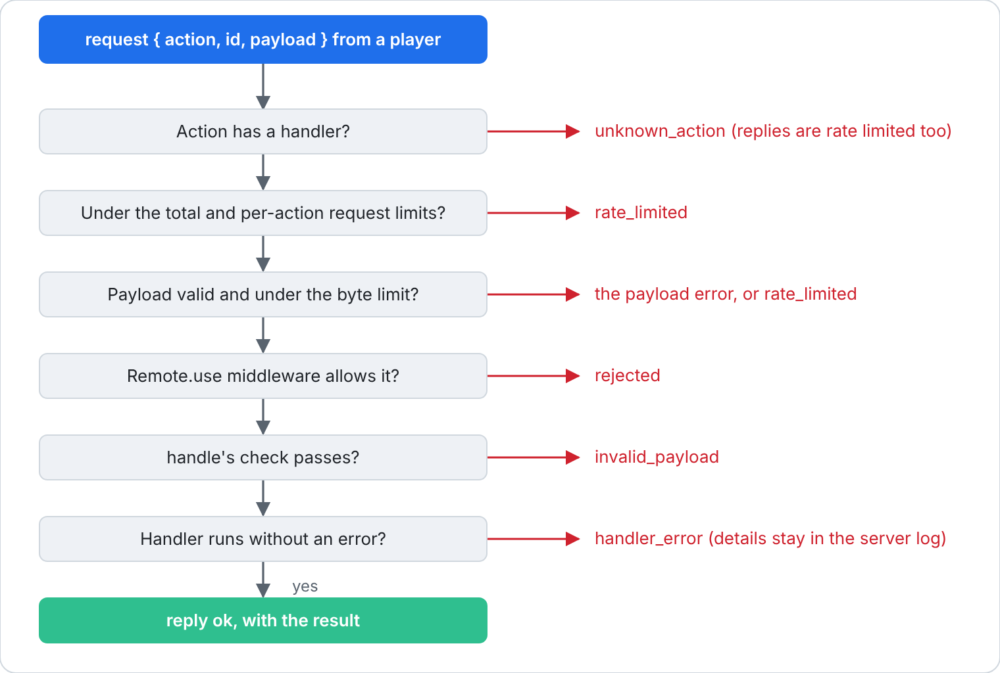
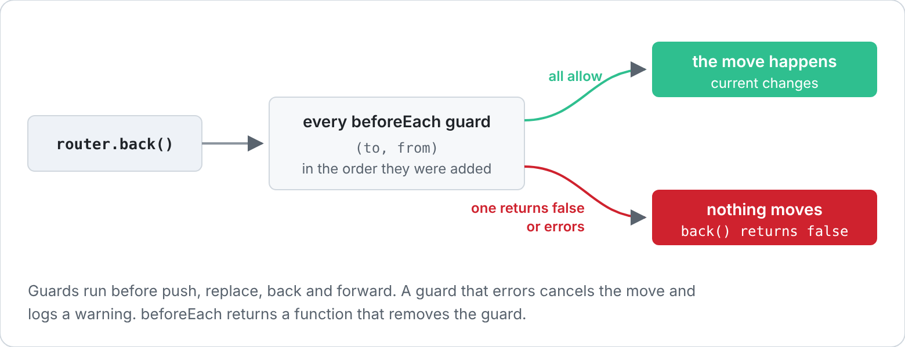

[Docs](README.md) › **Architecture**

# Architecture

For people changing Rivue itself. To use it, see the [API reference](API.md).

## Packages

| Package | Source | Depends on |
|---|---|---|
| RivueUI | `packages/rivue-ui/src` | nothing |
| RivueRemote | `packages/rivue-remote/src/init.luau` | nothing |
| RivueRouter | `packages/rivue-router/src/init.luau` | the game's RivueUI |
| RivueDevTools | `packages/rivue-devtools/src` | attributes RivueUI writes |

## Modules

`src/init.luau` returns `runtime/main`:

```
main.luau           public API; ties watch/effect to their component
types.luau          exported types
reactivity.luau     proxies, refs, computed, effects, watch, scopes
scheduler.luau      micro queue, frame queues, component update queue
array.luau          Rivue.array
h.luau              vnodes, slots, hFor/hIf, Fragment
component.luau      instances, props/attrs, emits, hooks, provide/inject, errors
renderer.luau       mount/patch/unmount, events, props, transitions, KeepAlive, Teleport, createApp
builtins.luau       Suspense, KeepAlive, Transition, TransitionGroup, VirtualList, ViewportModel
ui.luau             ErrorBoundary, Dialog, Row, Column, Spacer
transitions.luau    fade, slide and pop presets
directives.luau     directives and model helpers
composables.luau    useAttrs, useSlots, defineModel, useTheme, useStyles, useAsync
roblox.luau         attributeRef, useTag, RunService hooks, viewport/input/selection/tween/spring
pool.luau           Instance pool
testing.luau        Rivue.testing
utils.luau          debounce, throttle, helpers
debug.luau          logging, inspect, invariants
```

Requires go one way. Arrows point from a module to the ones that require it; `debug`, `types` and
implied edges are left out.



`builtins` never requires `renderer`; KeepAlive unmounts through `_keepAliveRenderer`, which the
renderer stores on the instance.

## Reactivity

`reactive(t)` returns an empty proxy whose metatable forwards to the raw table. `__index` tracks,
`__newindex` triggers, and `__iter`/`__len` track shape. Raw tables and proxies are cached in
weak-keyed maps, one proxy per table.

Dependencies live in `depMap[target][key]`:



- Adding or removing a key triggers `ITERATE_KEY`; array length changes trigger `LENGTH_KEY`.
- A `ref` has its own dep set, like Vue's `RefImpl`.
- Effects re-collect deps every run and don't re-trigger themselves, except render effects
  (`allowRecurse`), since a child can change parent state while mounting.
- Without a scheduler an effect is queued once on the micro queue. `effect.job` skips stopped
  effects.
- Computeds are lazy: a trigger marks them dirty and the getter runs on the next read. Getters run
  in `pcall` only up to 16 computeds deep, because Luau's ~200 C-call limit broke long chains.
- `watch` flushes by `"pre"` (micro queue), `"post"` (Heartbeat) or `"sync"`. Sync callback errors
  are caught. Paused watchers replay once on resume.
- Each component's `setup` runs in its own detached scope, stopped on unmount or if `setup` errors.

## Errors

`handleError` walks up the parents calling `onErrorCaptured` until one returns `false`, then
`app.config.errorHandler`, then warns.



Event handlers remember the component that patched them, and watchers the component whose `setup`
created them. `component.luau` gives `reactivity.luau` a reporter, since reactivity can't require
it. Watchers outside components only warn.

## Scheduler

- **Micro queue:** `queueJob`/`queueEffect`, deduped, flushed on `task.defer`. Jobs queued during
  a flush wait for the next.
- **Frame queues:** `"render"` (RenderStepped, Heartbeat on the server) and `"heartbeat"`, deduped,
  connected only while non-empty.
- **Update queue:** `queueUpdate({ id, run })`, deduped and sorted by uid so parents render first.
  A loop guard stops self-requeuing updates.

`nextTick` waits for all of it.



Roblox silently drops `task.defer` past 80 nested levels, which `pcall` can't catch. The
scheduler counts its depth and moves work to the next Heartbeat past 60.

## Rendering

### Vnodes

```lua
{ type, props, children, slots?, key, _uid, _owner? }
```

Fields the renderer adds while mounted, moved to the new vnode on patch:

| Field | Holds |
|-------|-------|
| `el` | the Instance |
| `_instance` | the component instance |
| `_conns`, `_handlers` | event connections and current handlers |
| `_bindings` | properties bound to a ref or `Rivue.bind()` |
| `_dirs` | directive state |
| `_touched` | props written, for pool resets |
| `_sugar` | generated UICorner etc. |
| `_tween` | running enter tween |
| `_fnTree` | function component output |
| `_teleportTarget` | Teleport target |
| `_keepAlive`, `_kept` | KeepAlive bookkeeping |
| `_transition` | transition config |

### patch(old, new, container)



- `h()` resolves local `components`; `patch` resolves `app:component()` names.
- Elements get props and children while detached and `Parent` last, so layout runs once.
  `onMounted`, directive `mounted`, template refs, `onActivated` and enter tweens wait for the
  outermost `patch`, children first.

### Elements

`setProp` order:

1. `__directives`
2. `on*`: alias (`onClick`), event, then property changed signal. Cached per ClassName.
3. `SUGAR_PROPS` (`cornerRadius`, `padding`, `stroke`, `layout`, `flex`, ...), each owning one
   generated child.
4. Properties, exact then PascalCase, cached per ClassName.
5. Otherwise a Studio warning.

- Events connect once and call `vnode._handlers`, so new closures are a table write.
- `class` merges component then app styles under the element's props before the shallow diff.
- `patchElement` skips on matching `memo`, resets removed props with `Pool.restoreDefaults`, and
  leaves a TextBox's typed text unless `Text` changes.
- `patchKeyedChildren` matches keys against old vnodes only, never the parent Instance, since
  another list may share it. Unkeyed children match by position.



#### LayoutOrder

After children patch under a `layout` prop or UI*Layout, `syncLayoutOrder` keeps the longest
increasing run and fills gaps for the rest. Values start 64 apart and renumber only when a gap
runs out, so single moves write one value.



Engine calls cost far more than Luau, so the renderer avoids reads, writes and `IsA` where it can.
`tests/offline/Performance.test.luau` fails if the engine call count goes up.

### Unmounting

- Components stop their render effect, run unmount hooks, then unmount the subtree. If a live
  KeepAlive caches them they're deactivated instead.
- Elements clear connections and directives. Without the pool, children unmount with
  `doRemove = false` and go with the root's `Destroy()`; with the pool each Instance is released.
  Leave transitions keep the Instance until the tween ends.

### Components

- `setup` runs in the instance's scope. With a `render` option, its table becomes setup state and
  `render` gets a context proxy: setup state (via `proxyRefs`), then props, then the setup context.
- The render effect is lazy and schedules an update job by uid. Deactivated components only mark
  dirty and catch up on activation.
- Props and attrs are `shallowReactive`. `propsUnchanged` compares shallowly first (new listener
  closures count as unchanged), and only changes are written through.
- Slots aren't reactive, so the renderer queues a re-render when slot content exists.

## RivueRemote

Requests are `{ action, id, payload }` on one RemoteEvent, replies go to that player on another.
`fire()` has no id.



- `send`/`sendAll` share one reliable and one unreliable RemoteEvent; a frame's sends to a player
  go as one message.
- `Remote.state` uses the same batches. Each state has a version, so clients keep the newest value
  whatever order the snapshot and updates arrive in. The snapshot is a reserved request.
- RivueUI is found lazily, the way the router does it, and is optional.

## RivueRouter

Requires the game's RivueUI; a second copy would track state separately.



- `redirect` resolves before guards.
- Each navigation takes a number; an older one returns `cancelled` when its guard resumes.
- A redirect during `back()`/`go()` becomes a push, since history hasn't moved yet.
- After guards: history, `currentRoute`, `afterEach`, scroll restore.
- Lazy components load between `beforeEnter` and `beforeResolve` and replace their marker.

## DevTools channel

With `app.config.devtools`, `app:mount()` adds a `RivueDevTools` Configuration tagged
`RivueDevToolsChannel`. `Rivue._devtools.event()` appends to its `RivueTimeline` attribute (last 50,
with sequence numbers), and `route()` sets `RivueRoute`. Both return immediately when no app has
devtools on.

## Tests

| Where | How |
|---|---|
| Studio | `dev/client/TestRunner.client.luau` |
| Lune | `lune run test` |
| Roblox server | `lune run cloud-test` ([setup](RELEASING.md#tests-in-roblox)) |

Lune bundles each suite with `tests/offline/prelude.luau`, a fake Roblox: stub Instances, a
virtual clock, service stand-ins and the 80-level `task.defer` limit. Extend it when a test needs
more. Bug fixes start with a failing test.
