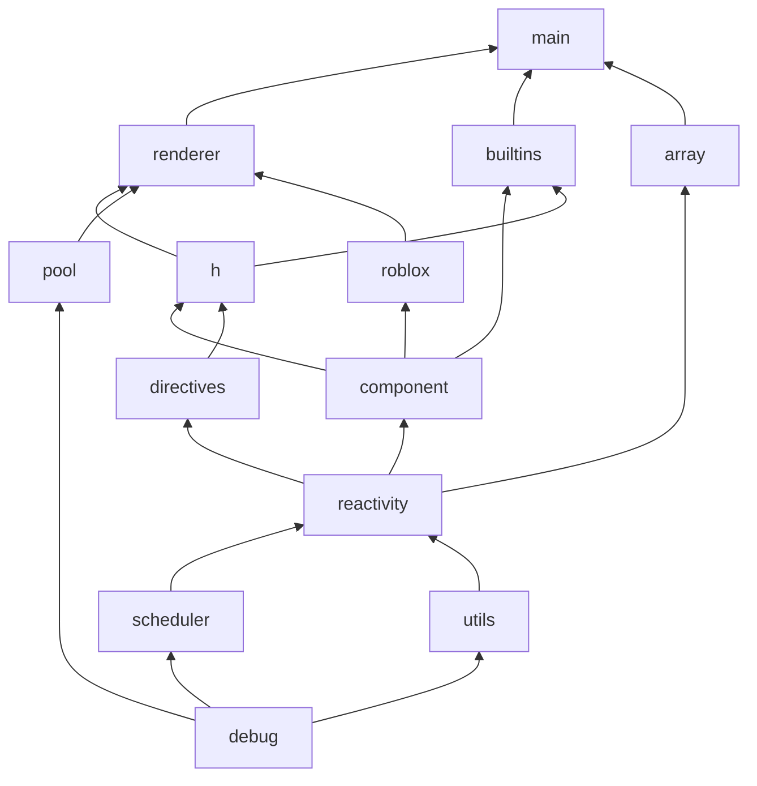
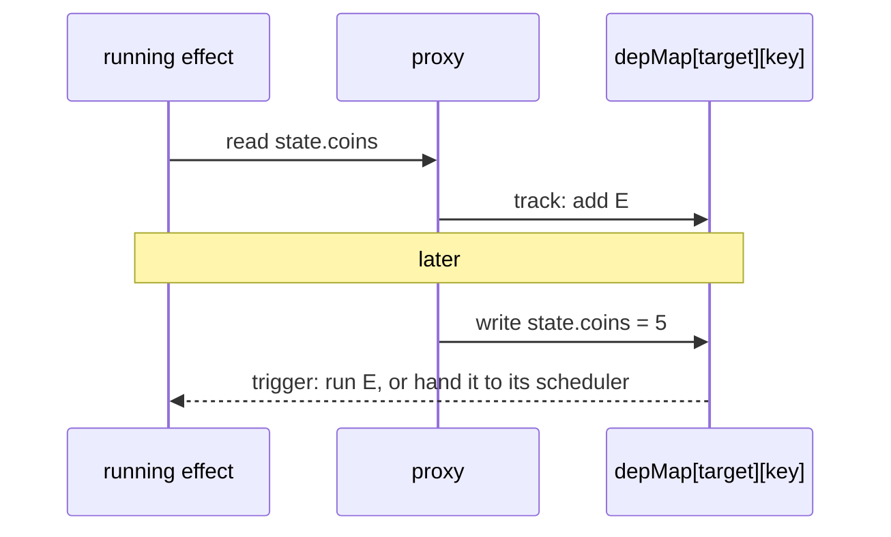
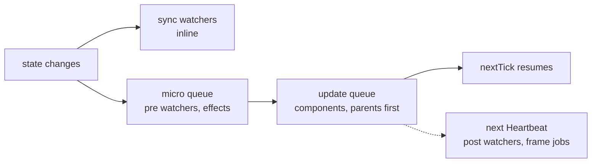
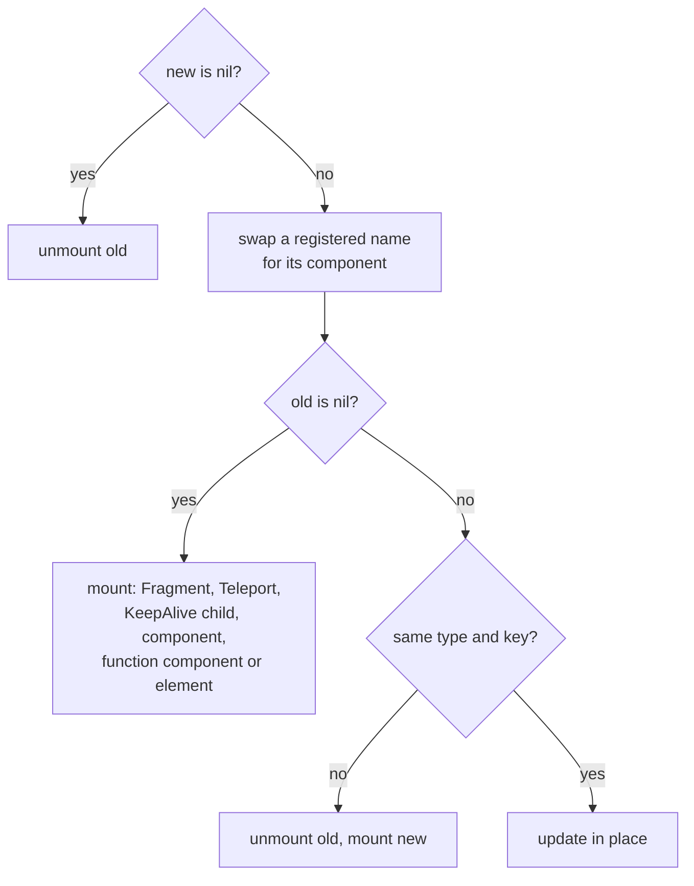

[Docs](README.md) › **Architecture**

# Architecture

This page is for people changing Rivue itself. If you only want to use it, the
[API reference](API.md) is the better read.

## Modules

The package's entry point, `src/init.luau`, just returns `runtime/main`. Everything else lives in
`runtime/`:

```
main.luau           puts the public API together, wraps watch/effect so they clean up
types.luau          shared exported types
reactivity.luau     proxies, refs, computed, effects, watch, effect scopes
scheduler.luau      micro queue, frame queues, component update queue
array.luau          Rivue.array: list edits that notify readers
h.luau              vnodes, slot splitting, hFor/hIf, Fragment
component.luau      component instances, props/attrs, emits, hooks, provide/inject
renderer.luau       mount/patch/unmount, events, props, transitions, KeepAlive, Teleport, createApp
builtins.luau       Suspense, KeepAlive, Transition, TransitionGroup, VirtualList, ViewportModel
directives.luau     directive registry, the built-in directives, v-model helpers
composables.luau    useAttrs, useSlots, defineModel, useTheme, useStyles
roblox.luau         attributeRef, useTag, RunService hooks, viewport/input/selection/tween/spring
pool.luau           Instance pool
utils.luau          debounce, throttle and small helpers
debug.luau          logging, inspect, invariants
```

Requires only point one way. In this picture an arrow goes from a module to the modules that
require it, so the leaves are at the bottom and `renderer` sits on top of almost everything:



`types` is left out of the picture because every module uses it and it uses nothing. One
deliberate gap: `builtins` never requires `renderer`. When KeepAlive needs to unmount something,
it goes through a field the renderer puts on the component instance, `_keepAliveRenderer`.

## Reactivity

`reactive(t)` hands back an empty table whose metatable forwards everything to the raw table.
Reads go through `__index`, which tracks them. Writes go through `__newindex`, which triggers.
`__iter` and `__len` track structural changes, so a loop over the table re-runs when keys are
added or removed. Raw tables, proxies and markers all live in weak-keyed maps, which means each
table gets one cached proxy, and both are collected together.

The bookkeeping is a two-level map:



Adding or removing a key also triggers `ITERATE_KEY`, and a change in array length triggers
`LENGTH_KEY`. A `ref` skips the map and keeps its own dep set, as Vue's `RefImpl` does, so reading
and writing `.value` costs one table lookup instead of two.

An effect throws its old dependencies away and collects them fresh on every run. If it writes
state it also reads, it doesn't re-trigger itself. Component render effects are the exception
(`allowRecurse`), because a child can change parent state while it mounts. When an effect has a
scheduler, `trigger` calls `scheduler(run)` instead of running it. Without one, the effect goes on
the micro queue, deduplicated. Its queued entry point, `effect.job`, skips effects that were
stopped in the meantime.

Computeds are lazy. A trigger only marks one dirty and passes the news on to its own dependents;
the getter runs the next time someone reads `.value`. Each getter runs inside a `pcall` up to 16
computeds deep, and directly past that. Luau allows about 200 nested C calls, and a `pcall` on
every level stopped chains at about 100 computeds. An error in a getter reaches whoever read the
value, as in Vue.

`watch` is an effect whose scheduler refreshes the watched value and then queues the callback
according to `flush`: `"pre"` on the micro queue, `"post"` on Heartbeat, `"sync"` inline. A sync
callback that errors is caught and reported, so it can't break the write that triggered it.
Pausing a watcher only remembers that something changed. On resume it replays once.

`effectScope` collects the effects created while it runs. Every component runs `setup` inside a
detached scope of its own, stopped when the component unmounts, or straight away if `setup`
errors.

## Scheduler

There are three queues.

The **micro queue** holds `queueJob(fn)` and `queueEffect(fn)`, deduplicated by function and
flushed on `task.defer`. Jobs queued during a flush wait for the next one.

The **frame queues**, `"render"` (RenderStepped, or Heartbeat on the server) and `"heartbeat"`,
are deduplicated by function too. Each mode has a single connection, and it only exists while
something is queued.

**Component updates** go through `queueUpdate({ id, run })`. Jobs are deduplicated and sorted by
component uid before the flush, and since parents are created before their children, parents
render first. A child that's already queued when its parent hands it new props still renders once,
after the parent. A loop guard stops updates that keep re-queuing.

`nextTick` defers until all of that has run.



One Roblox quirk shapes all of this. Roblox refuses `task.defer` more than 80 levels deep in a
chain of deferred threads, and it only logs the refusal, so `pcall` can't catch it. A loop of
`nextTick()` calls gets there easily. The scheduler counts its own defer depth, and past 60 it
moves the work to the next Heartbeat. Without that, a dropped flush would leave the update queue
stuck for good.

## Rendering

### Vnodes

`h()` returns a plain table:

```lua
{ type, props, children, slots?, key, _uid, _owner? }
```

While the vnode is mounted, the renderer adds its own fields:

| Field | Holds |
|-------|-------|
| `el` | The Instance |
| `_instance` | The component instance |
| `_conns` | Event connections |
| `_dirs` | Directive state |
| `_touched` | Props written, so the pool can reset them |
| `_sugar` | Generated UICorner and similar children |
| `_tween` | The running enter tween |
| `_fnTree` | A function component's output |
| `_teleportTarget` | Where a Teleport rendered |
| `_keepAlive`, `_kept` | KeepAlive bookkeeping |
| `_transition` | The transition config |

When an element is patched, that state moves from the old vnode to the new one.

### patch(old, new, container)



Registered names get swapped twice: once in `h()` for a component's local `components`, and again
in `patch` for names registered with `app:component()`. When a mount happens, the checks run in
the order shown: Fragment, Teleport, a KeepAlive child to re-activate, a component, a function
component, and finally an element.

Updating in place depends on the kind of vnode. A Fragment patches its children as a list. A
Teleport patches inside its target, or remounts if the target changed. A component gets new props
and slots, and its own render effect takes it from there (unless its `memo` deps match). A
function component diffs its output, and an element goes to `patchElement`.

The outermost `patch` call sets a flag, and flushes the post queue when it returns. That queue
exists because of how mounting works. An element's props are set and its children mounted while
the Instance is still detached, and `Parent` is set last. Anything that needs the tree in the
DataModel has to wait for the whole patch: `onMounted`, directive `mounted`, component template
refs, `onActivated` and enter tweens. They run children first.

### Elements

`setProp` decides what each prop is, in this order:

1. `__directives`.
2. `on*` keys. An alias first (`onClick`), then an event of that name, then the property's changed
   signal, which hands the handler the new value. The lookup is cached per ClassName and prop.
3. Modifier props on GuiObjects (`SUGAR_PROPS`): `cornerRadius`, `padding`, `stroke`,
   `aspectRatio`, `layout`, `flex` and the rest. Each owns one generated UI* child, which is
   replaced if a new value needs a different class (`layout` going from list to grid).
4. Instance properties, by exact name and then in PascalCase, cached per ClassName.
5. Anything else gets a Studio warning.

Every event is connected once. The connection calls whatever handler is stored in
`vnode._handlers`, so re-rendering with a fresh closure only swaps a function in a table.

`class` is resolved before any diffing. `applyClasses` merges the named styles (the component's
`styles`, then the app's) underneath the element's own props, so classes go through the same
shallow diff as everything else.

`patchElement` skips everything when `memo` deps match. Otherwise it re-points template refs if
`ref` changed, then diffs props shallowly. A new handler counts as unchanged, since it's swapped
in place, and removed props are reset with `Pool.restoreDefaults`. Children are patched unless
both lists are the same table or both are empty. TextBoxes keep what the player typed, unless the
new props change `Text`.

`patchKeyedChildren` matches keyed children by key, using only the old vnodes. It never looks for
Instances in the parent, which might belong to another list. Unkeyed children are matched by
index, and never against a keyed old child. Whatever's left over is unmounted.

#### LayoutOrder

After an element with a `layout` prop, or a UI*Layout child, patches its children,
`syncLayoutOrder` puts them in render order. It works like this:

```
before:  A=64   B=128   C=192   D=256
remove B, insert X after C
after:   A=64   C=192   X=224   D=256      one write: X
```

It finds the longest run of children whose `LayoutOrder` already increases and leaves those
alone. Only the rest are written, into the gaps between their kept neighbours. Values start 64
apart, so an insert nearly always fits, and when a gap does run out the list is renumbered once.
Removing, appending, prepending or moving one row writes one value. The values it wrote are
cached per Instance, so rows that didn't move cost nothing.

All of this is about engine calls (Instance reads, writes and `IsA`), which cost far more than
Luau work. For the same reason the renderer passes the vnode's ClassName around instead of reading
`inst.ClassName`, and caches class checks. `tests/offline/Performance.test.luau` counts engine
calls for common updates and fails if they go up.

### Unmounting

`unmountVNode(vnode, poolOpt, doRemove)` handles components and elements differently.

A component stops its render effect, runs its unmount hooks and cleanups, then unmounts its
subtree. If a live KeepAlive has it cached, it's deactivated instead: its root Instances are
detached and `onDeactivated` runs.

An element clears its connections and directives first. Without the pool, its children are
unmounted with `doRemove = false`, so their hooks run but their Instances simply go with the
root's `Destroy()`. With the pool, every Instance is released one by one. An element with a leave
transition keeps its Instance until the tween finishes, and nothing waits for it.

### Components

`mountComponent` creates the instance and runs `setup()` in its scope, with the current instance
set. If setup returns a table and the component has a `render` option, that table becomes the
setup state, and `render` gets a render context: a proxy that looks names up in the setup state
(through `proxyRefs`), then props, then the setup context.

Then it creates a lazy render effect. Each run renders with `currentRenderingInstance` set, so
string refs know their owner. An array result gets wrapped in a Fragment, fallthrough attrs and
the Transition config are applied to the root, and the result is patched into `inst.container`.
The effect's scheduler queues an update job keyed by the instance uid. While the component is
deactivated, those jobs only mark it dirty, and it catches up when it's activated again.

Props and attrs are `shallowReactive` tables. When a parent re-renders, `propsUnchanged` first
compares the old and new vnode props shallowly, like Vue's `shouldUpdateComponent`. A fresh closure
for a declared listener counts as unchanged, because `emit` reads listeners from the current vnode.
Only when something did change does `updateComponentProps` write through the proxies, so only
effects that read a changed prop run again. Slots aren't reactive, so `updateComponentSlots`
reports whether there was slot content and the renderer queues the re-render itself.

## Tests

Suites live in `tests/*.test.luau`, and each returns a function (or a table with `runAllTests`).
They run in three places:

| Where | How | What it's good for |
|---|---|---|
| Studio | `dev/client/TestRunner.client.luau` | a real client, with a LocalPlayer |
| Lune | `lune run test` | fast, no Studio, runs on every push |
| A Roblox server | `lune run cloud-test`, through Open Cloud | the real engine, on every push that touches code |

The Lune run bundles each suite with `tests/offline/prelude.luau` and runs it in its own
environment (`.lune/lib/bundle.luau`, `.lune/lib/run.luau`). The prelude fakes just enough of
Roblox: stub Instances (userdata with property signals), virtual time where `task.wait` and frame
signals move a fake clock, and stand-ins for TweenService, GuiService, Players and
CollectionService. It also enforces Roblox's 80-level `task.defer` limit. When a test needs more
of the engine, extend the prelude.

In a Roblox server there's no local player and physics is off, so suites skip what needs either.
How that's set up is in [Releasing](RELEASING.md#tests-in-roblox).

Fixing a bug? Add a test that fails without the fix first.
