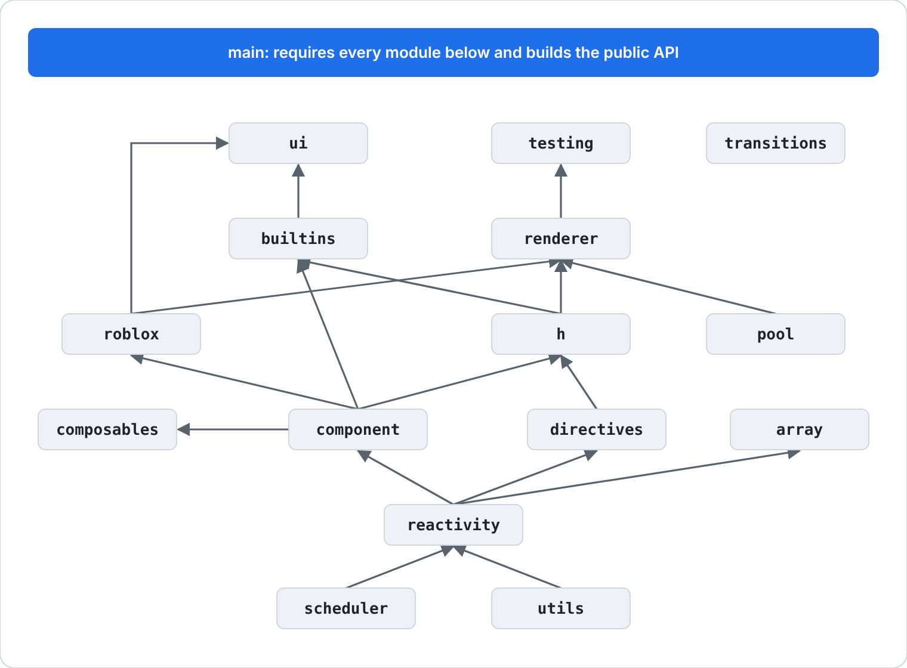
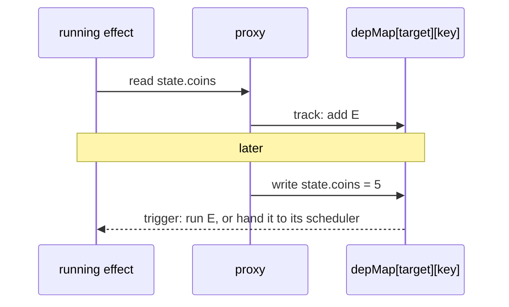
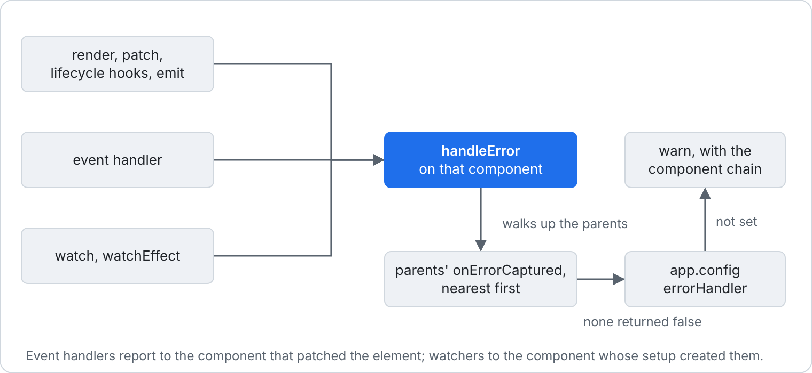
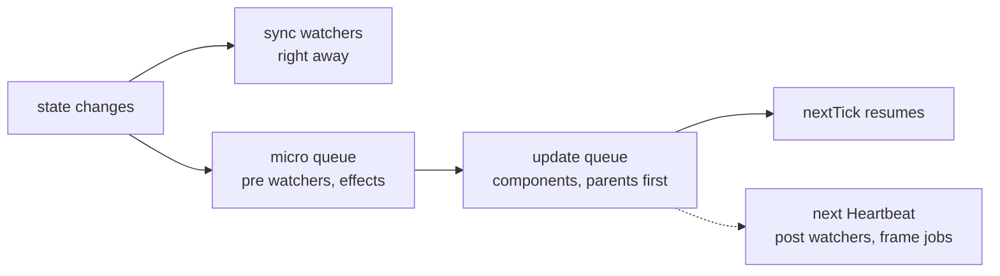
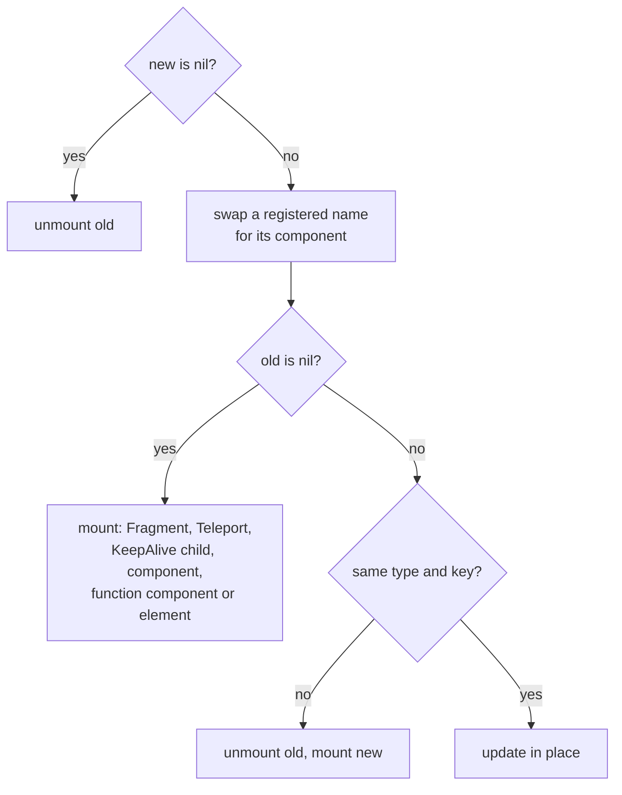
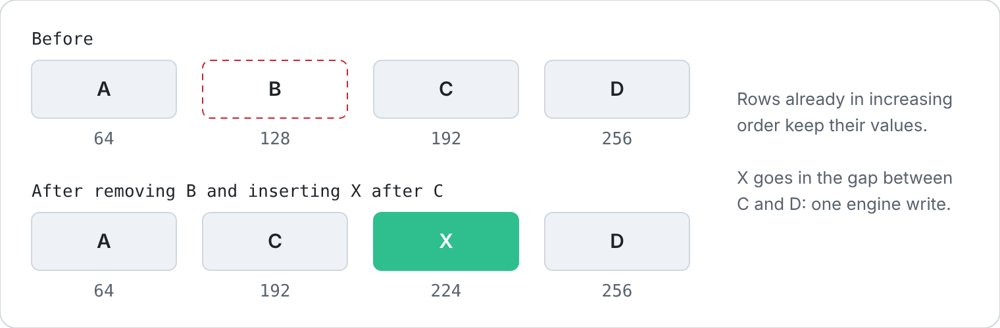
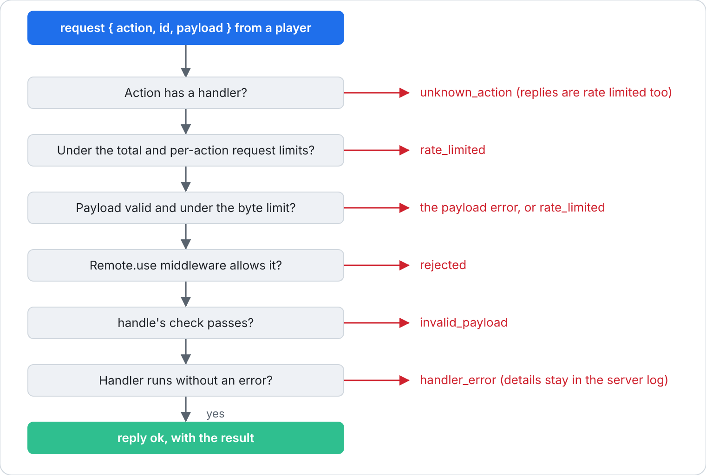

[Docs](README.md) › **Architecture**

# Architecture

This page is for people changing Rivue itself. To use it, read the [API reference](API.md).

## Packages

| Package | Source | Depends on |
|---|---|---|
| RivueUI | `packages/rivue-ui/src` | nothing |
| RivueRemote | `packages/rivue-remote/src/init.luau` | nothing |
| RivueRouter | `packages/rivue-router/src/init.luau` | the RivueUI the game already has |
| RivueDevTools | `packages/rivue-devtools/src` | reads attributes RivueUI writes |

Most of this page is about RivueUI. RivueRemote and RivueRouter each get a short section at the
end.

## Modules

RivueUI's entry point, `src/init.luau`, returns `runtime/main`. The rest is in `runtime/`:

```
main.luau           the public API; wraps watch/effect so they stop with their component
types.luau          shared exported types
reactivity.luau     proxies, refs, computed, effects, watch, effect scopes
scheduler.luau      micro queue, frame queues, component update queue
array.luau          Rivue.array: list edits that notify readers
h.luau              vnodes, slot splitting, hFor/hIf, Fragment
component.luau      component instances, props/attrs, emits, hooks, provide/inject, errors
renderer.luau       mount/patch/unmount, events, props, transitions, KeepAlive, Teleport, createApp
builtins.luau       Suspense, KeepAlive, Transition, TransitionGroup, VirtualList, ViewportModel
ui.luau             ErrorBoundary, Dialog, Row, Column, Spacer
transitions.luau    the fade, slide and pop presets
directives.luau     directive registry, the built-in directives, model helpers
composables.luau    useAttrs, useSlots, defineModel, useTheme, useStyles, useAsync
roblox.luau         attributeRef, useTag, RunService hooks, viewport/input/selection/tween/spring
pool.luau           Instance pool
testing.luau        Rivue.testing: render, click, typeInto
utils.luau          debounce, throttle and small helpers
debug.luau          logging, inspect, invariants
```

Requires only go one way. In the picture an arrow points from a module to the ones that require
it, so the leaves are at the bottom. `debug` and `types` are left out because almost everything
uses them, and an edge is left out when it already follows from others (`renderer` requires
`reactivity` directly, but also through `h`).



`builtins` never requires `renderer`. When KeepAlive needs to unmount something, it calls a
function the renderer stores on the component instance, `_keepAliveRenderer`.

## Reactivity

`reactive(t)` returns an empty table whose metatable forwards to the raw table. `__index` tracks
reads and `__newindex` triggers on writes. `__iter` and `__len` track the table's shape, so a loop
over it runs again when keys are added or removed. Raw tables, proxies and markers are kept in
weak-keyed maps: each table has one cached proxy, and both are collected together.

Dependencies are stored in a two-level map, `depMap[target][key]`:



Adding or removing a key also triggers `ITERATE_KEY`, and a change in array length triggers
`LENGTH_KEY`. A `ref` keeps its own dep set instead of using the map, like Vue's `RefImpl`, so
`.value` costs one lookup instead of two.

An effect drops its dependencies and collects them again on every run. Writing state it also
reads doesn't make it run again, except for component render effects (`allowRecurse`), since a
child can change its parent's state while it mounts. If the effect has a scheduler, `trigger`
calls `scheduler(run)`. If not, the effect goes on the micro queue once. The queued entry point,
`effect.job`, skips an effect that was stopped in the meantime.

Computeds are lazy. A trigger marks one dirty and tells its own dependents; the getter runs the
next time something reads `.value`, and it gets the value it returned last time. Getters run
inside a `pcall` up to 16 computeds deep and without one past that. Luau allows about 200 nested
C calls, and a `pcall` at every level broke chains at about 100 computeds. An error in a getter
reaches whoever read the value, as in Vue.

`watch` is an effect whose scheduler refreshes the watched value and queues the callback by
`flush`: `"pre"` on the micro queue, `"post"` on Heartbeat, `"sync"` straight away. A sync
callback that errors is caught, so it can't break the write that triggered it. Pausing a watcher
only records that something changed, and resuming replays it once.

`effectScope` collects the effects created while it runs. Each component runs `setup` in a
detached scope of its own, stopped when the component unmounts, or at once if `setup` errors.

## Errors

Errors from components go to `handleError` on the component they belong to. It walks up the
parents, calling each `onErrorCaptured` hook until one returns `false`, then calls
`app.config.errorHandler`, and warns if there's neither.



The renderer remembers which component patched each element with an event handler, and a
watcher remembers the component that was running `setup` when it was created. `component.luau`
gives `reactivity.luau` a way to report to that component, since reactivity can't require it.
A watcher created outside any component keeps the old behaviour and only warns.

## Scheduler

There are three kinds of queue.

The micro queue holds `queueJob(fn)` and `queueEffect(fn)`. It skips a function that's already
queued and flushes on `task.defer`. Jobs queued during a flush wait for the next one.

The frame queues are `"render"` (RenderStepped, or Heartbeat on the server) and `"heartbeat"`.
They skip duplicates too. Each has one connection, which only exists while something is queued.

Component updates go through `queueUpdate({ id, run })`. The queue drops duplicates and sorts by
component uid before it flushes. Parents are created before their children, so parents render
first, and a queued child whose parent passes it new props still renders once. A loop guard stops
updates that keep queuing themselves.

`nextTick` waits until all of that has run.



Roblox refuses a `task.defer` nested more than 80 deferred threads deep, and it only logs that,
so `pcall` can't see it. A loop of `nextTick()` calls reaches that depth quickly. The scheduler
counts its own depth and moves work to the next Heartbeat past 60, or a dropped flush would leave
the update queue stuck.

## Rendering

### Vnodes

`h()` returns a plain table:

```lua
{ type, props, children, slots?, key, _uid, _owner? }
```

While the vnode is mounted, the renderer adds its own fields:

| Field | Holds |
|-------|-------|
| `el` | The Instance |
| `_instance` | The component instance |
| `_conns` | Event connections |
| `_handlers` | The current handler for each event |
| `_bindings` | Properties bound to a ref or `Rivue.bind()` |
| `_dirs` | Directive state |
| `_touched` | Props written, so the pool can reset them |
| `_sugar` | Generated UICorner and similar children |
| `_tween` | The running enter tween |
| `_fnTree` | A function component's output |
| `_teleportTarget` | Where a Teleport rendered |
| `_keepAlive`, `_kept` | KeepAlive bookkeeping |
| `_transition` | The transition config |

When an element is patched, these move from the old vnode to the new one.

### patch(old, new, container)



Names are swapped for components in two places: `h()` handles a component's local `components`,
and `patch` handles names registered with `app:component()`. A mount checks the kinds in the order
above.

How an update in place works depends on the vnode. A Fragment patches its children as a list. A
Teleport patches inside its target, or mounts again if the target changed. A component gets new
props and slots, and its render effect does the rest (unless its `memo` deps match). A function
component diffs its output, and an element goes to `patchElement`.

An element's props are set and its children mounted while its Instance is still detached, and
`Parent` is set last, so the engine lays out the finished subtree once. Anything that needs the
tree in the DataModel waits for the outermost `patch` to return: `onMounted`, directive `mounted`,
component template refs, `onActivated` and enter tweens. They run children first.

### Elements

`setProp` checks each prop in this order:

1. `__directives`.
2. `on*` keys: an alias first (`onClick`), then an event with that name, then the property's
   changed signal, which passes the new value. The lookup is cached per ClassName and prop.
3. Modifier props on GuiObjects (`SUGAR_PROPS`) such as `cornerRadius`, `padding`, `stroke`,
   `aspectRatio`, `layout` and `flex`. Each owns one generated UI* child, which is replaced when a
   value needs a different class (`layout` going from list to grid).
4. Instance properties, by exact name and then in PascalCase, cached per ClassName.
5. Anything else gets a Studio warning.

Each event is connected once. The connection calls the handler stored in `vnode._handlers`, so a
render with a fresh closure only swaps a function in a table.

`class` is resolved before diffing. `applyClasses` puts the named styles (the component's
`styles`, then the app's) under the element's own props, so classes go through the same shallow
diff as everything else.

`patchElement` does nothing when `memo` deps match. Otherwise it moves template refs if `ref`
changed and diffs props shallowly. A new handler counts as unchanged because it's swapped in
place, and removed props are reset with `Pool.restoreDefaults`. Children are patched unless both
lists are the same table or both are empty. A TextBox keeps what the player typed unless the new
props change `Text`.

`patchKeyedChildren` matches keyed children by key, looking only at the old vnodes. It never
searches the parent Instance, because another list in the same parent may own a row with that key.
Unkeyed children match by position, never against a keyed old child. Whatever is left over is
unmounted.


#### LayoutOrder

When an element with a `layout` prop, or with a UI*Layout child, has patched its children,
`syncLayoutOrder` puts them in render order.



It finds the longest run of children whose `LayoutOrder` already increases and leaves them alone.
The others get values in the gaps between their neighbours. Values start 64 apart, so an insert
almost always fits; when a gap runs out, the list is renumbered once. Removing, appending,
prepending or moving one row writes one value, and the values are cached per Instance, so rows
that didn't move cost nothing.

The point of all this is fewer engine calls (Instance reads, writes and `IsA`), which cost far
more than Luau code. For the same reason the renderer passes the vnode's ClassName around instead
of reading `inst.ClassName`, and caches class checks. `tests/offline/Performance.test.luau` counts
engine calls for common updates and fails if the count goes up.

### Unmounting

`unmountVNode(vnode, poolOpt, doRemove)` treats components and elements differently.

A component stops its render effect, runs its unmount hooks and cleanups, then unmounts its
subtree. If a live KeepAlive has it cached, it's deactivated instead: its root Instances are
detached and `onDeactivated` runs.

An element first clears its connections and directives. Without the pool, its children are
unmounted with `doRemove = false`, so their hooks run and their Instances go with the root's
`Destroy()`. With the pool, each Instance is released on its own. An element with a leave
transition keeps its Instance until the tween ends, and nothing waits for it.

### Components

`mountComponent` creates the instance and runs `setup()` in its scope with the current instance
set. If setup returns a table and the component has a `render` option, the table becomes the setup
state and `render` gets a render context. That context is a proxy that looks a name up in the
setup state (through `proxyRefs`), then props, then the setup context.

Next it creates a lazy render effect. Each run renders with `currentRenderingInstance` set, so
string refs know their owner. An array result is wrapped in a Fragment, fallthrough attrs and the
Transition config are applied to the root, and the result is patched into `inst.container`. The
effect's scheduler queues an update job keyed by the instance uid. While the component is
deactivated, those jobs only mark it dirty, and it catches up when it's activated.

Props and attrs are `shallowReactive` tables. When a parent re-renders, `propsUnchanged` compares
the old and new props shallowly first, like Vue's `shouldUpdateComponent`. A fresh closure for a
declared listener counts as unchanged, because `emit` reads listeners from the current vnode. Only
when something changed does `updateComponentProps` write through the proxies, so only effects that
read a changed prop run again. Slots aren't reactive, so `updateComponentSlots` reports whether
there was slot content and the renderer queues the re-render itself.

## RivueRemote

A client sends `{ action, id, payload }` on one RemoteEvent and the server answers on another,
only to that player. `fire()` sends no id and gets no reply. The server runs each request through
these steps, and the first one that fails sends back its reason:



`Remote.stats()` counts calls, failures, rejections and handler time per action. Server-to-client events from
`send` and `sendAll` all travel on two shared RemoteEvents, one reliable and one unreliable, and
a frame's sends to one player go out as one message.

## RivueRouter

RivueRouter requires the RivueUI the game already has, from the same Packages folder or from
ReplicatedStorage. A second copy would track state separately, and the router's components
couldn't see the app's.

Routes have names instead of paths. `push` and `replace` resolve `redirect` first, and a push to
the route that's already open with the same params returns a `duplicated` failure. A navigation
then runs the guards in Vue Router's order:


Each navigation takes a number. If another one starts while a guard yields, the older navigation
returns `cancelled` when its guard resumes. A guard that redirects starts a new navigation; during
`back()` or `go()` that becomes a push, because history hasn't moved yet. After the guards pass,
the router updates its history list, sets `currentRoute`, runs `afterEach` and restores the
scroll position.

## Tests

Suites live in `tests/*.test.luau`, and each returns a function (or a table with `runAllTests`).
They run in three places:

| Where | How | Good for |
|---|---|---|
| Studio | `dev/client/TestRunner.client.luau` | a real client with a LocalPlayer |
| Lune | `lune run test` | speed; no Studio, runs on every push |
| A Roblox server | `lune run cloud-test`, through Open Cloud | the real engine, on every push that touches code |

The Lune run bundles each suite with `tests/offline/prelude.luau` and runs it in its own
environment (`.lune/lib/bundle.luau`, `.lune/lib/run.luau`). The prelude fakes enough of Roblox
for the suites: stub Instances (userdata with property signals), a virtual clock that `task.wait`
and frame signals move forward, and stand-ins for TweenService, GuiService, Players and
CollectionService. It also enforces the 80-level `task.defer` limit. If a test needs more of the
engine, extend the prelude.

A Roblox server has no local player and physics is off, so suites skip what needs either. The
setup is in [Releasing](RELEASING.md#tests-in-roblox).

When you fix a bug, add a test that fails without the fix first.
