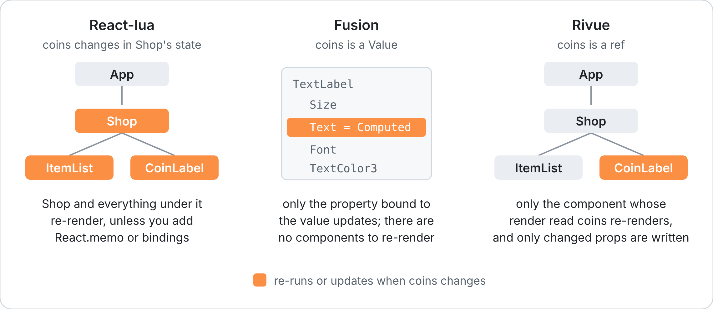

[Docs](README.md) › **Coming from React-lua or Fusion**

# Coming from React-lua or Fusion

All three build UI as a tree of Instances. They differ in what runs when a value changes. This
page compares React-lua (Roact's maintained successor) and Fusion 0.3, the latest version.



React-lua follows React: a state change re-runs the component's render and everything under it.
`React.memo` and bindings are how you cut that cost.

Fusion tracks state per value and writes Instance properties directly, so nothing re-renders.
Components are plain functions that take a `scope`; props, events and lifecycle are conventions
you build yourself.

Rivue does what Vue does. It tracks state per value like Fusion, and keeps React-style components
with props, events, slots and lifecycle hooks. A change re-runs only the components whose render
read that value.

## The same counter in each

React-lua:

```lua
local function Counter()
	local count, setCount = React.useState(0)
	return React.createElement("TextButton", {
		Text = `Clicked {count} times`,
		[React.Event.Activated] = function()
			setCount(count + 1)
		end,
	})
end
```

Fusion 0.3:

```lua
local function Counter(scope)
	local count = scope:Value(0)
	return scope:New "TextButton" {
		Text = scope:Computed(function(use)
			return `Clicked {use(count)} times`
		end),
		[OnEvent "Activated"] = function()
			count:set(peek(count) + 1)
		end,
	}
end
```

Rivue:

```lua
local Counter = Rivue.defineComponent({
	name = "Counter",
	setup = function()
		local count = Rivue.ref(0)
		return {
			count = count,
			increment = function()
				count.value += 1
			end,
		}
	end,
	render = function(ctx)
		return h("TextButton", { Text = `Clicked {ctx.count} times`, onClick = ctx.increment })
	end,
})
```

Rivue's version is the longest. In return, `setup` runs once, so there are no hook rules, and
`render` stays current without `Computed` wrappers.

## API map

| React-lua | Fusion | Rivue |
|---|---|---|
| `React.createElement("Frame", props, children)` | `scope:New "Frame" { ... }` | `h("Frame", props, children)` |
| function component | function taking `scope` | `Rivue.defineComponent({ name, props, setup, render })` |
| `useState` | `scope:Value` / `:set()` | `Rivue.ref` / `Rivue.reactive`, assign to change |
| `useMemo` | `scope:Computed` | `Rivue.computed` |
| `useEffect(fn, {})` | `scope` cleanup | `onMounted` / `onUnmounted` |
| `useEffect(fn, { deps })` | `scope:Observer` | `Rivue.watch(source, fn)` |
| `React.memo` | not needed | not needed: children with equal props are skipped. `memo = { deps }` for the rest |
| `[React.Event.Activated]` | `[OnEvent "Activated"]` | `onClick` / `onActivated` |
| `[React.Change.Text]` | `[OnChange "Text"]` | `onTextChanged` (any `on<Property>Changed`) |
| `useRef` + `ref` | `[Out]` / `Value` | `ref = "name"` + `Rivue.useTemplateRef("name")` |
| `useBinding` | `Value` | `Rivue.ref`. Only readers re-render, so no binding is needed for speed |
| `createContext` / `useContext` | `Contextual`: `:now()`, `:is(value):during(fn)` | `Rivue.provide` / `Rivue.inject` |
| `ReactRoblox.createPortal` | parent elsewhere | `Rivue.Teleport` |
| `React.Fragment` | a table of children | `Rivue.Fragment`, or return a list |
| `items.map` to elements | `scope:ForValues` / `scope:ForPairs` | `Rivue.hFor(items, fn)` with a `key` |
| an error boundary component | `Safe { try, fallback }` | `Rivue.ErrorBoundary`, `onErrorCaptured` |
| `props.children` | `[Children]` | slots: `ctx.renderSlot("default")` |
| `defaultProps`, `propTypes` | — | `props = { name = { type, default, required, validator } }` |
| `ReactRoblox.createRoot(parent):render(el)` | `scope:New` with `Parent` | `Rivue.createApp(App):mount(parent)` |
| `root:unmount()` | `scope:doCleanup()` | `app:unmount()` |
| `useReducer` | — | a store module ([Guide 14](guide/14-state-architecture.md)) |
| `Suspense`, `React.lazy` | — | `Rivue.Suspense`, `Rivue.defineAsyncComponent` |
| `ReactSpring` | `scope:Tween`, `scope:Spring` | `Rivue.useTween`, `Rivue.useSpring`, `Rivue.Transition` |
| children by name `{ Title = ... }` | `[Children] = { ... }` | a list. Set `Name` for the Explorer, `key` for lists |

## What works differently

### Children are a list

React-lua names children with dictionary keys. Rivue takes a list and keeps `LayoutOrder` in
render order for you. Give list items a `key`, and anything you'll look up later a `Name`.

### setup runs once

State and watchers are created once, in `setup`. `render` describes the UI and re-runs when state
it read changes. Rivue tracks dependencies itself, so there are no hook rules and no dependency
arrays.

### Writes are batched

Change several values in a row and each affected component re-renders once. If you need the
updated Instances right away, `Rivue.nextTick()` waits for the re-render.

### Styling has classes

Register style classes with `app:styles()` and write `class = "button"` instead of repeating
properties on every button. Classes can carry hover, pressed and per-device variants
([Guide 6](guide/06-styling-and-layout.md)).

### Lists change through Rivue.array

`table.insert` on reactive state goes unnoticed. Use `Rivue.array.push`, `removeWhere`, `sort` and
the rest.

## Tooling

Your Roblox tools carry over.

| | React-lua / Fusion projects | Rivue |
|---|---|---|
| Syncing files | Rojo | Rojo: point `$path` at the Rivue package |
| Packages | Wally | Wally or pesde ([Installation](INSTALLATION.md)), or the `.rbxm` from a release |
| Storybook | UI Labs, Hoarcekat, Flipbook | `Rivue.story()` for UI Labs and Hoarcekat ([API](api/utilities.md#story)) |
| Tests | TestEZ, Jest-Lua | either runner: mount, `Rivue.testing.trigger`, `Rivue.nextTick()` ([Guide 16](guide/16-testing-ui.md)) |
| Types and formatting | luau-lsp, StyLua | luau-lsp, StyLua; Rivue is `--!strict` with exported types |

Selene can't parse the Luau `const` declarations Rivue uses yet, so exclude the Rivue folder (or
your whole `Packages` folder) from Selene.
