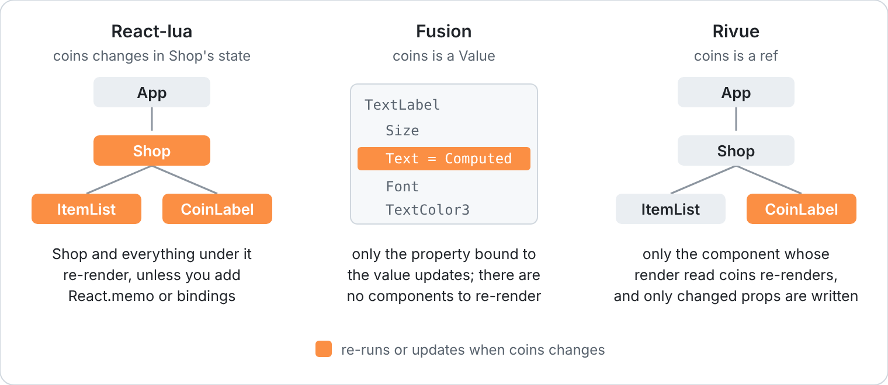

[Docs](README.md) › **Coming from React-lua or Fusion**

# Coming from React-lua or Fusion

React-lua, Fusion and Rivue all describe UI as a tree of Instances. Where they part ways is what
happens when a value changes. (Still on Roact? React-lua is its maintained successor, so this page
compares against React-lua.)



React-lua follows React. A component's render function runs again on every state change, along
with everything under it, and you reach for `React.memo` or bindings when that gets expensive.

Fusion goes the other way. It tracks state per value and updates Instance properties directly,
so nothing re-renders. It also has no component system: a component is just a function.

Rivue sits between the two, the way Vue does. State is tracked per value, like Fusion, but you
still get components with props, events, slots and lifecycle hooks, like React. When a value
changes, only the components whose render read it run again.

## The same counter in each

React-lua:

```lua
local function Counter()
	local count, setCount = React.useState(0)
	return React.createElement("TextButton", {
		Text = `Clicked {count} times`,
		[React.Event.Activated] = function()
			setCount(count + 1)
		end,
	})
end
```

Fusion 0.3:

```lua
local function Counter(scope)
	local count = scope:Value(0)
	return scope:New "TextButton" {
		Text = scope:Computed(function(use)
			return `Clicked {use(count)} times`
		end),
		[OnEvent "Activated"] = function()
			count:set(peek(count) + 1)
		end,
	}
end
```

Rivue:

```lua
local Counter = Rivue.defineComponent({
	name = "Counter",
	setup = function()
		local count = Rivue.ref(0)
		return {
			count = count,
			increment = function()
				count.value += 1
			end,
		}
	end,
	render = function(ctx)
		return h("TextButton", { Text = `Clicked {ctx.count} times`, onClick = ctx.increment })
	end,
})
```

Rivue's version is the longest of the three. In return, `setup` runs once, so there are no hook
rules, and `render` never needs a `Computed` wrapper to stay up to date.

## API map

| React-lua | Fusion | Rivue |
|---|---|---|
| `React.createElement("Frame", props, children)` | `scope:New "Frame" { ... }` | `h("Frame", props, children)` |
| function component | function taking `scope` | `Rivue.defineComponent({ name, props, setup, render })` |
| `useState` | `scope:Value` / `:set()` | `Rivue.ref` / `Rivue.reactive`, assign to change |
| `useMemo` | `scope:Computed` | `Rivue.computed` |
| `useEffect(fn, {})` | `scope` cleanup | `onMounted` / `onUnmounted` |
| `useEffect(fn, { deps })` | `scope:Observer` | `Rivue.watch(source, fn)` |
| `React.memo` | not needed | not needed: children with equal props are skipped. `memo = { deps }` for the rest |
| `[React.Event.Activated]` | `[OnEvent "Activated"]` | `onClick` / `onActivated` |
| `[React.Change.Text]` | `[OnChange "Text"]` | `onTextChanged` (any `on<Property>Changed`) |
| `useRef` + `ref` | `[Out]` / `Value` | `ref = "name"` + `Rivue.useTemplateRef("name")` |
| `useBinding` | `Value` | `Rivue.ref`. Only readers re-render, so no binding is needed for speed |
| `createContext` / `useContext` | pass values down | `Rivue.provide` / `Rivue.inject` |
| `ReactRoblox.createPortal` | parent elsewhere | `Rivue.Teleport` |
| `React.Fragment` | a table of children | `Rivue.Fragment`, or return a list |
| `props.children` | `[Children]` | slots: `ctx.renderSlot("default")` |
| `defaultProps`, `propTypes` | — | `props = { name = { type, default, required, validator } }` |
| `ReactRoblox.createRoot(parent):render(el)` | `scope:New` with `Parent` | `Rivue.createApp(App):mount(parent)` |
| `root:unmount()` | `scope:doCleanup()` | `app:unmount()` |
| `useReducer` | — | a store module ([Guide 14](guide/14-state-architecture.md)) |
| `Suspense`, `React.lazy` | — | `Rivue.Suspense`, `Rivue.defineAsyncComponent` |
| `ReactSpring` | `scope:Tween`, `scope:Spring` | `Rivue.useTween`, `Rivue.useSpring`, `Rivue.Transition` |
| children by name `{ Title = ... }` | `[Children] = { ... }` | a list. Set `Name` for the Explorer, `key` for lists |

## Things that work differently

### Children are a list

React-lua names children with dictionary keys. In Rivue, children are a list, and Rivue keeps
their `LayoutOrder` in render order for you. Give list items a `key`, and give anything you'll
look up later a `Name`.

### setup runs once

State and watchers are created once, in `setup`. `render` only describes the UI, and runs again
whenever state it read changes. That's why there are no hook rules and no dependency arrays: the
order you call things in doesn't matter, and Rivue works out the dependencies itself.

### Writes are batched

Change several values in a row and each affected component re-renders once. If you need the
updated Instances right away, `Rivue.nextTick()` waits for the re-render.

### Styling has classes

Rather than repeating the same properties on every button, register style classes with
`app:styles()` and write `class = "button"`. Classes can also carry hover, pressed and
per-device variants ([Guide 6](guide/06-styling-and-layout.md)).

### Lists change through Rivue.array

`table.insert` on reactive state goes unnoticed. Use `Rivue.array.push`, `removeWhere`, `sort` and
the rest instead.

## Tooling

Your usual Roblox tools carry over:

| | React-lua / Fusion projects | Rivue |
|---|---|---|
| Syncing files | Rojo | Rojo: point `$path` at the Rivue package |
| Packages | Wally | Wally or pesde ([Installation](../README.md#installation)), or the `.rbxm` from a release |
| Storybook | UI Labs, Hoarcekat, Flipbook | `Rivue.story()` for UI Labs and Hoarcekat ([API](api/utilities.md#story)) |
| Tests | TestEZ, Jest-Lua | either runner: mount, `Rivue.testing.trigger`, `Rivue.nextTick()` ([Guide 16](guide/16-testing-ui.md)) |
| Types and formatting | luau-lsp, StyLua | luau-lsp, StyLua; Rivue is `--!strict` with exported types |

One snag: Selene can't parse the Luau `const` declarations Rivue uses yet. Exclude the Rivue
folder (or your whole `Packages` folder) from Selene for now.
