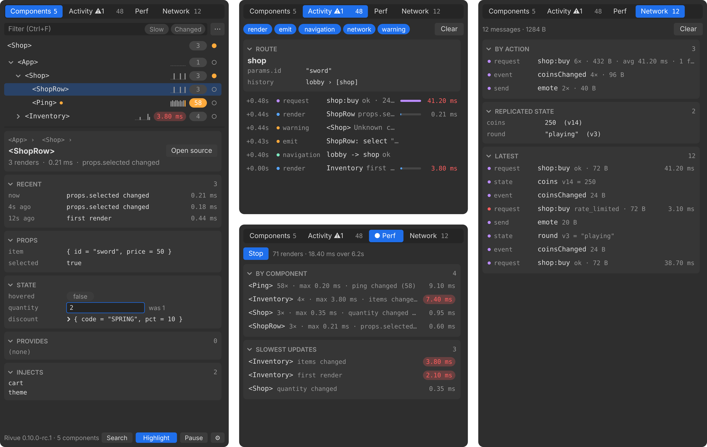
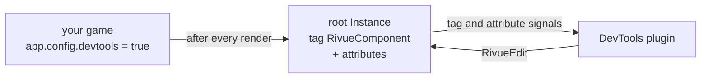

[Docs](README.md) › **DevTools**

# Rivue DevTools

A Studio plugin for inspecting Rivue UI during a playtest: what rendered, why, how long it took,
and live state editing.



## Install

1. Download `RivueDevTools.rbxm` from the latest release into your Plugins folder, or build it
   with `rojo build packages/rivue-devtools -o RivueDevTools.rbxm`.
2. Turn it on in your game before mounting:

   ```lua
   app.config.devtools = game:GetService("RunService"):IsStudio()
   ```

3. Press Play and open Rivue → DevTools.

> [!WARNING]
> Every render writes attributes, and each attribute write costs an engine call. Keep the
> `IsStudio()` check so DevTools stays off outside Studio. RivueRemote only measures payloads while
> the DevTools window is open.

## Shortcuts

| Key | Action |
| --- | --- |
| Ctrl+K | Search components, state, network and warnings |
| Ctrl+F | Filter the tree |
| Up / Down | Move through the tree |
| Enter | Open the selected component's source |
| Esc | Close search, stop picking, or clear the selection |

The status bar has Highlight (outlines re-renders on screen), Pause, and settings for the slow
threshold, activity length and row density.

## How it works

Plugins can't require game modules, so after every render Rivue writes each component's name,
props, state, render count, time and cause to attributes on its root Instance, tagged
`RivueComponent`. Each app also gets a `RivueDevTools` Configuration holding the timeline and the
current route. Edits come back through a `RivueEdit` attribute, including nested paths like
`inventory.flags.vip=true`.



> [!NOTE]
> Tables show up to eight fields, two levels deep. Other non-primitive values show as their type.

The plugin UI is itself built with Rivue, and `tests/offline/DevTools.test.luau` covers it.
