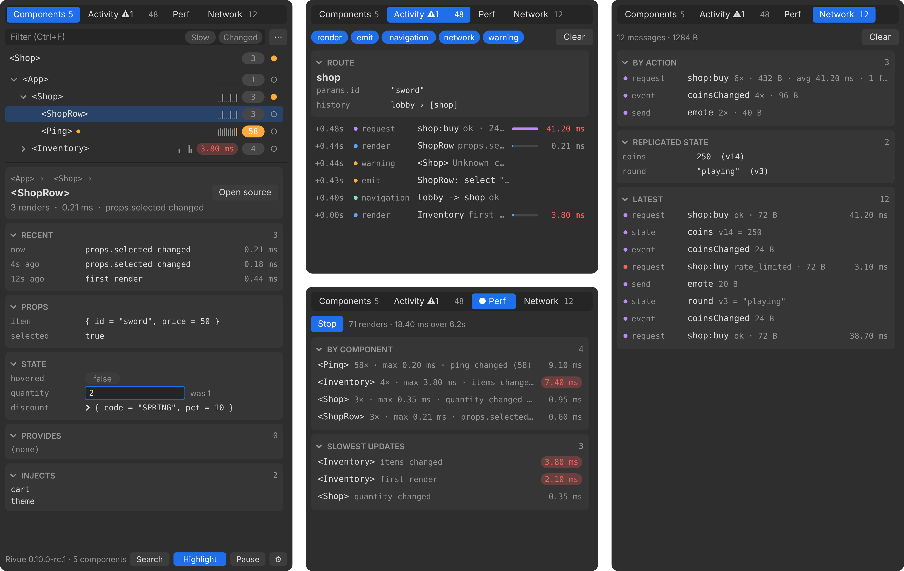
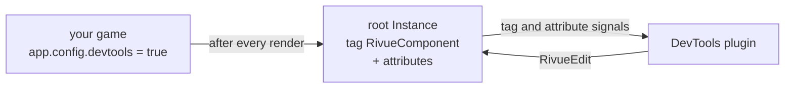

[Docs](README.md) › **DevTools**

# Rivue DevTools

A Studio plugin that shows the Rivue components on screen while you playtest: what rendered, how
long it took and why, with props and state you can edit live.



## Install

Grab `RivueDevTools.rbxm` from the latest release on the repo's Releases page and drop it in
your Plugins folder (**Plugins → Plugins Folder** in Studio). If you'd rather build
it yourself, run `rojo build packages/rivue-devtools -o RivueDevTools.rbxm`.

## Use

Your game has to opt in, before it mounts the app:

```lua
app.config.devtools = game:GetService("RunService"):IsStudio()
```

Then press Play and click **Rivue → DevTools** in the Plugins toolbar.

The window has four tabs, **Components**, **Activity**, **Perf** and **Network**, and a status
bar along the bottom with **Search**, **Highlight**, **Pause** and **⚙** (settings).

### Components

Components show up as a tree. Each row has a small graph of its renders over the last ten
seconds, its render count, and a pin. A dot after the name means it rendered since the last
refresh; one that keeps lighting up re-renders too often ([Guide
15](guide/15-performance-in-depth.md)). When the last render took longer than the slow threshold
(2 ms unless you change it), the time shows as a red pill. Click an arrow to fold a branch, and
hover a row to outline the component on the game screen.

Above the tree is the filter. Type to show only components whose name matches (their parents
stay, so you can see where each match sits), and use the **Slow** and **Changed** chips in it to
narrow the tree further. The **⋯** menu next to it has the rest:

- **Sort** switches between the tree, most renders and slowest first.
- **Reset counts** counts from zero, so you can do one thing in the game and see what it
  re-rendered.
- **Fold all** / **Open all**. Folded branches are remembered between sessions.
- **Pick from the game**: select a GUI object in the Explorer, or click it on the game screen
  while playing, and DevTools opens the component that rendered it.
- **Export snapshot** saves the tree and the activity as a ModuleScript,
  `ServerStorage.RivueSnapshot`. Changes made during Play are thrown away when you stop, so while
  the game runs, Export keeps the snapshot with the plugin; export again after stopping to write
  it.

The pin at the end of a row keeps that component in a short list above the tree. Pins are
remembered too.

Click a row and it's selected in the Explorer. The details show:

- breadcrumbs to its parent components, each one clickable;
- its render count, how long its last render took, and what caused it: `count changed`,
  `props.title changed`, `first render` or `parent update` (new slots or `forceUpdate`). A
  computed or a store shows as `a computed or outside state`;
- **Open source**, which opens the script that defined the component at the `defineComponent`
  line;
- **Recent**: its last five renders, with the cause and time of each;
- cards for its props, its state, and the keys it provides and injects. In state, numbers and
  strings are text fields (type a new value and press Enter), a boolean is a toggle, and a table
  opens into its fields, which you can edit the same way, two levels deep. A field that changed
  shows what it was before, as `was 10`. Values you can't edit can still be selected and copied
  with Ctrl+C.

In a narrow window the details sit under the tree; drag the line between them to give either more
room. Once the window is wider than 600 px, they move beside the tree.

### Activity

One list, newest first, of renders, emits, router navigations, RivueRemote traffic and Rivue's
warnings and errors (unknown classes, duplicate keys, undeclared emits, render errors, and
RivueRemote and RivueRouter warnings). Each entry has its time, and a bar and a duration when it
has one, so the slow ones stand out. The chips at the top hide or show each kind, and the tab
shows how many warnings arrived. Click a render, an emit or a warning to open its component, or
a network entry to open the Network tab. When RivueRouter is in use, the current route, its
params, query and meta, and the history sit above the list.

### Perf

Answers "what renders too much, and why". Press **Record**, use the UI, then **Stop**. It lists
each component that rendered with how many times, the total and the worst time, and the most
common cause (`coins changed`, `parent update`), slowest first, plus the slowest single updates.
Click a row to open the component.

### Network

RivueRemote traffic: requests, `fire` sends, events from the server and replicated state, with
payload sizes. **By action** totals each one, with the average request time and how many failed;
**Replicated state** shows each `Remote.state` value and its version; **Latest** is the raw list,
newest first.

### Search, shortcuts and settings

**Search** (or Ctrl+K) looks through components, state keys, network actions and warnings at
once; pick a result to jump to it. With the mouse over the window, **Ctrl+F** jumps to the
filter, **Up** and **Down** move through the tree, **Enter** opens the selected component's
source, and **Esc** closes the search, stops picking or clears the selection.

**Highlight** flashes an outline around every component that re-renders, on the game screen,
like Vue DevTools' option of the same name. **Pause** freezes the lists while the UI keeps
changing. **⚙** sets the slow-render threshold, how many activity entries to keep, and the row
density (comfortable or compact). Settings are saved with the plugin, and the window follows
Studio's light or dark theme.

## How it works

A plugin can't read a game script's modules, so the data has to travel some other way. With
`devtools` on, Rivue tags each component's root Instance `RivueComponent` and writes its name,
props, state, render count, render time and the cause of the render to attributes after every
render, plus the latest `emit`. Each app also gets a `RivueDevTools` Configuration that holds the
timeline and the current route, which is how RivueRouter and RivueRemote reach the plugin.
RivueRemote only measures payload sizes while DevTools is open. The
plugin watches the tags and the attributes. Edits go
the other way: the plugin sets a `RivueEdit` attribute, and Rivue applies it to the ref and
clears it.



Values are summarised on the way. Strings, numbers, booleans and Instance names show as they are,
tables show their fields two levels deep (up to eight per table), and anything else shows as its
type (`UDim2`). An edit to a nested field travels as a path, like `inventory.flags.vip=true`. When a component unmounts, Rivue removes
the tag and attributes again. The list only ever shows what's on screen, and pooled Instances
don't carry old data into their next life.

Writing those attributes costs an engine call per attribute per render, which is why it's off
unless you turn it on, and why the snippet above only turns it on in Studio.

The plugin's window is itself built with Rivue. It's tested offline in
`tests/offline/DevTools.test.luau`.
