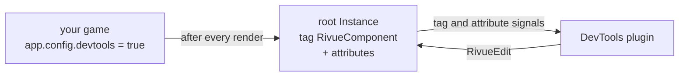

[Docs](README.md) › **DevTools**

# Rivue DevTools

A Studio plugin for looking at your Rivue UI while you playtest. It shows which components
rendered, how long that took and why, and lets you edit their state live.


## Install

Download `RivueDevTools.rbxm` from the latest release on the repo's Releases page and put it in
your Plugins folder (Plugins → Plugins Folder in Studio). To build it yourself, run
`rojo build packages/rivue-devtools -o RivueDevTools.rbxm`.

## Use

Your game has to turn it on before it mounts the app:

```lua
app.config.devtools = game:GetService("RunService"):IsStudio()
```

Press Play, then click Rivue → DevTools in the Plugins toolbar. The window has four tabs
(Components, Activity, Perf and Network) and a status bar with Search, Highlight, Pause and the
⚙ settings button.

### Components

The Components tab shows your components as a tree. Each row has the number of times it
rendered, a small graph of its renders over the last ten seconds, and a pin. A dot after the name
means it rendered since the last refresh. If that dot keeps lighting up, the component probably
re-renders too often ([Guide 15](guide/15-performance-in-depth.md)). A render slower than the
threshold (2 ms by default) shows its time in a red pill. Click an arrow to fold a branch, and
hover a row to outline that component on the game screen.

The filter above the tree matches component names and keeps their parents visible, so you can
still tell where a match sits. The Slow and Changed chips inside it narrow the tree to slow
components or ones that just rendered. The ⋯ menu next to it can:

- change the sort (tree, most renders, slowest first)
- reset the render counts, so you can do one thing in the game and see exactly what it
  re-rendered
- fold or open every branch
- pick a component from the game: select a GUI object in the Explorer, or click it on the
  game screen while playing, and DevTools opens the component that made it
- export a snapshot of the tree and the activity to `ServerStorage.RivueSnapshot`

Studio throws away changes made during Play, so an export during a playtest is kept by the plugin
until you stop. Export again after stopping and it's written to ServerStorage.

Pinning a component keeps it in a short list above the tree. Pins and folded branches are
remembered between sessions.

Clicking a row selects the component in the Explorer and opens its details. At the top are
links to its parent components, its render count, how long the last render took and what caused
it (`count changed`, `props.title changed`, `first render`, or `parent update` for new slots and
`forceUpdate`; a computed or a store shows as `a computed or outside state`). Open source jumps
to the `defineComponent` line in its script.

Below that, Recent lists its last five renders with their causes and times, followed by cards for
its props, its state, and the keys it provides and injects. State is editable. Numbers and
strings are text fields (type and press Enter), booleans are toggles, and tables open into their
fields, which you edit the same way, up to two levels deep. A field that has changed shows its
previous value, like `was 10`. You can select and copy any value with Ctrl+C, even
ones you can't edit.

In a narrow window the details sit under the tree, and you can drag the line between them. Wider
than 600 px, they move next to the tree.

### Activity

Activity is one list of what happened, newest first: renders, emits, router navigations,
RivueRemote traffic, and Rivue's warnings and errors (unknown classes, duplicate keys, undeclared
emits, render errors, RivueRemote and RivueRouter warnings). Timed entries get a bar, which
makes slow ones easy to spot. The chips at the top hide a kind, and the tab label counts
warnings. Clicking a render, emit or warning opens its component; clicking network traffic opens
the Network tab. If you use RivueRouter, the current route with its params, query, meta and
history sits above the list.

### Perf

Use Perf to find what renders too much. Press Record, use the UI, then press Stop. You get every
component that rendered, sorted by total time, with its render count, worst time and most common
cause (`coins changed`, `parent update`), plus a list of the slowest single updates. Click a row
to open the component.

### Network

Network shows RivueRemote traffic with payload sizes: requests, `fire` sends, events from the
server, and replicated state. It totals each action with its average request time and failures,
shows every `Remote.state` value with its version, and keeps the latest messages underneath.

### Search, shortcuts and settings

Search, or Ctrl+K, looks through component names, state keys, network actions and warnings at
the same time. Picking a result takes you there.

With the mouse over the window, Ctrl+F jumps to the filter, Up and Down move through the tree,
Enter opens the selected component's source, and Esc closes the search, stops picking or clears
the selection.

Highlight outlines every component on the game screen as it re-renders, like the Vue DevTools
option with the same name. Pause freezes the lists while the game keeps changing. Settings cover
the slow-render threshold, how many activity entries to keep, and row density (comfortable or
compact). The plugin saves them, and the window follows Studio's light or dark theme.

## How it works

A plugin can't require a game's modules, so Rivue passes the data through Instances instead.
With `devtools` on, Rivue tags each component's root Instance `RivueComponent` and, after every
render, writes its name, props, state, render count, render time, the cause of the render and the
latest `emit` to attributes. Each app also gets a `RivueDevTools` Configuration holding the
timeline and the current route, which is how RivueRouter and RivueRemote reach the plugin.
RivueRemote only measures payload sizes while DevTools is open.

The plugin listens to the tags and attributes. Edits travel back the same way: the plugin sets a
`RivueEdit` attribute, and Rivue applies it to the ref and clears it.



Values are shortened on the way. Strings, numbers, booleans and Instance names come through as
they are. Tables show up to eight fields each, two levels deep, and anything else shows as its
type (`UDim2`). An edit to a nested field is sent as a path, like `inventory.flags.vip=true`.
When a component unmounts, Rivue removes its tag and attributes, so the list only shows what's
on screen and pooled Instances don't carry old data into their next use.

Every attribute write is an engine call, so this costs something on every render. That's why
it's off unless you turn it on, and why the snippet above only turns it on in Studio.

The plugin's own window is built with Rivue and tested offline in
`tests/offline/DevTools.test.luau`.
