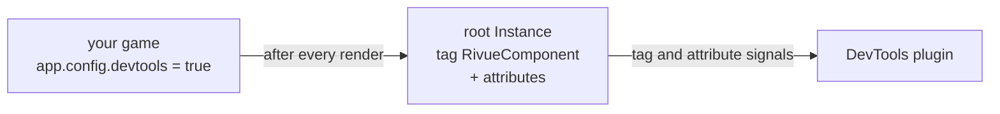

[Docs](README.md) › **DevTools**

# Rivue DevTools

A Studio plugin that shows the Rivue components on screen while you playtest. Click one and you
get its props, its state, how many times it has rendered, how long the last render took and what
caused it, and its root selected in the Explorer.


## Install

Grab `RivueDevTools.rbxm` from the latest [release](https://github.com/linhisreal/Rivue/releases)
and drop it in your Plugins folder (**Plugins → Plugins Folder** in Studio). If you'd rather build
it yourself, run `rojo build packages/rivue-devtools -o RivueDevTools.rbxm`.

## Use

Your game has to opt in, before it mounts the app:

```lua
app.config.devtools = game:GetService("RunService"):IsStudio()
```

Then press Play and click **Rivue → DevTools** in the Plugins toolbar.

Components show up as a tree with their render counts. Row colours:

- **orange**: rendered again since the last refresh. One that keeps flashing re-renders too
  often ([Guide 15](guide/15-performance-in-depth.md)).
- **red**: the last render took 2 ms or more.

Click a row for its props, its state, how long the last render took, and what caused it: `count
changed`, `props.title changed`, `first render` or `parent update` (new slots or
`forceUpdate`). A computed or a store shows as `a computed or outside state`.

The buttons:

- **Sort**: tree, most renders, or slowest first.
- **Pause**: freeze the list while the UI keeps changing.
- **Reset counts**: count from zero, do one thing in the game, and see what it re-rendered.

## How it works

A plugin can't read a game script's modules, so the data has to travel some other way. With
`devtools` on, Rivue tags each component's root Instance `RivueComponent` and writes its name,
props, state, render count, render time and the cause of the render to attributes after every
render. The plugin just watches the tag and the attributes.



Values are summarised on the way. Strings, numbers, booleans and Instance names show as they are,
and anything else shows as its type (`table`, `UDim2`). When a component unmounts, Rivue removes
the tag and attributes again. The list only ever shows what's on screen, and pooled Instances
don't carry old data into their next life.

Writing those attributes costs an engine call per attribute per render, which is why it's off
unless you turn it on, and why the snippet above only turns it on in Studio.

The plugin's window is itself built with Rivue. It's tested offline in
`tests/offline/DevTools.test.luau`.
