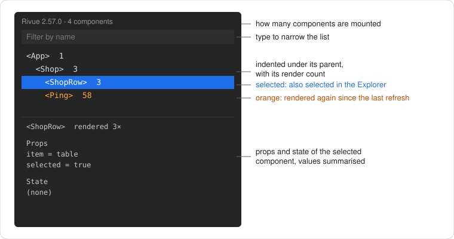
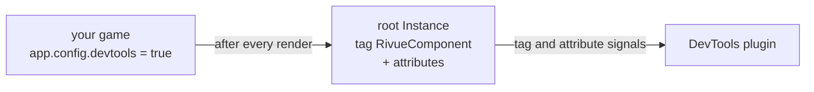

[Docs](README.md) › **DevTools**

# Rivue DevTools

A Studio plugin that shows the Rivue components on screen while you playtest. Click one and you
get its props, its state, how many times it has rendered, and its root selected in the Explorer.



## Install

Grab `RivueDevTools.rbxm` from the latest [release](https://github.com/linhisreal/Rivue/releases)
and drop it in your Plugins folder (**Plugins → Plugins Folder** in Studio). If you'd rather build
it yourself, run `rojo build packages/rivue-devtools -o RivueDevTools.rbxm`.

## Use

Your game has to opt in, before it mounts the app:

```lua
app.config.devtools = game:GetService("RunService"):IsStudio()
```

Then press Play and click **Rivue → DevTools** in the Plugins toolbar.

Every component shows up indented under its parent, with its render count next to it. A row
turns orange when that component rendered again since the last refresh, so a row that keeps
flashing is one re-rendering more than it should ([Guide 15](guide/15-performance-in-depth.md)
helps with that). Big UI? Type in the filter box to narrow the list down by name. The header
tells you how many components are mounted, and which Rivue version the plugin was built with.

## How it works

A plugin can't read a game script's modules, so the data has to travel some other way. With
`devtools` on, Rivue tags each component's root Instance `RivueComponent` and writes its name,
props and state to attributes after every render. The plugin just watches the tag and the
attributes.



Values are summarised on the way. Strings, numbers, booleans and Instance names show as they are,
and anything else shows as its type (`table`, `UDim2`). When a component unmounts, Rivue removes
the tag and attributes again. The list only ever shows what's on screen, and pooled Instances
don't carry old data into their next life.

Writing those attributes costs an engine call per attribute per render, which is why it's off
unless you turn it on, and why the snippet above only turns it on in Studio.

The plugin's window is itself built with Rivue. It's tested offline in
`tests/offline/DevTools.test.luau`.
