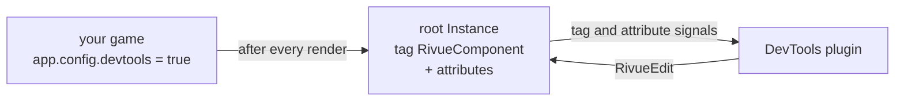

[Docs](README.md) › **DevTools**

# Rivue DevTools

A Studio plugin for inspecting Rivue UI during playtests: what rendered, why, how long it took,
and live state editing.


## Install

Download `RivueDevTools.rbxm` from the latest release and put it in your Plugins folder, or build
it with `rojo build packages/rivue-devtools -o RivueDevTools.rbxm`.

Turn it on in your game before mounting:

```lua
app.config.devtools = game:GetService("RunService"):IsStudio()
```

Then press Play and open Rivue → DevTools.

## Tabs

**Components.** The component tree with render counts and a 10-second render graph per row. A dot
marks a recent re-render; a red pill marks a render slower than the threshold (2 ms by default).
Filter by name, or narrow to Slow or Changed. The ⋯ menu has sort, reset counts, fold all, pick
from the game (Explorer selection or a click on the game screen), and export to
`ServerStorage.RivueSnapshot` (during Play it's kept until you stop, then export again). Pins and
folds are saved.

Selecting a component shows its parents, the cause of its last render (`count changed`,
`props.title changed`, `parent update`), its last five renders, props, state, provides and
injects. State is editable: text fields for numbers and strings, toggles for booleans, and
nested fields for tables (two levels). Changed fields show their previous value.

**Activity.** Renders, emits, navigations, network traffic and Rivue warnings in one list, newest
first, filterable by kind. Click an entry to open its component. The current route shows on top
when RivueRouter is used.

**Perf.** Record, use the UI, stop. Lists what rendered by total time, with count, worst time and
most common cause, plus the slowest single updates.

**Network.** RivueRemote requests, sends, events and replicated state, with sizes, per-action
totals and failures.

## Shortcuts

| Key | Action |
| --- | --- |
| Ctrl+K | Search components, state, network and warnings |
| Ctrl+F | Filter the tree |
| Up / Down | Move through the tree |
| Enter | Open the selected component's source |
| Esc | Close search, stop picking, or clear the selection |

The status bar has Highlight (outline re-renders on screen), Pause, and settings for the slow
threshold, activity length and row density.

## How it works

Plugins can't require game modules, so Rivue writes each component's name, props, state, render
count, time and cause to attributes on its root Instance (tagged `RivueComponent`) after every
render. Each app also gets a `RivueDevTools` Configuration with the timeline and current route.
Edits go back through a `RivueEdit` attribute, including nested paths like
`inventory.flags.vip=true`.



Tables show up to eight fields, two levels deep; other non-primitive values show as their type.
Attribute writes cost an engine call each, which is why it's off by default and the snippet
above limits it to Studio. RivueRemote only measures payloads while DevTools is open.

The plugin UI is built with Rivue and tested in `tests/offline/DevTools.test.luau`.
