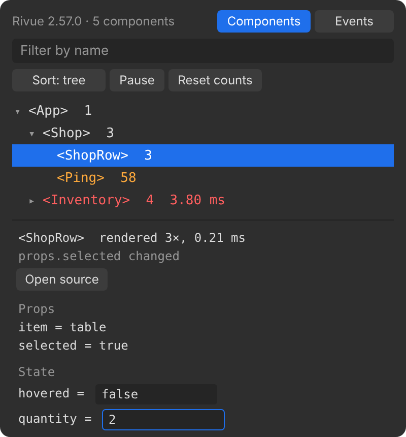
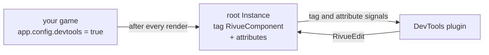

[Docs](README.md) › **DevTools**

# Rivue DevTools

A Studio plugin that shows the Rivue components on screen while you playtest: what rendered, how
long it took and why, with props and state you can edit live.



## Install

Grab `RivueDevTools.rbxm` from the latest release on the repo's Releases page and drop it in
your Plugins folder (**Plugins → Plugins Folder** in Studio). If you'd rather build
it yourself, run `rojo build packages/rivue-devtools -o RivueDevTools.rbxm`.

## Use

Your game has to opt in, before it mounts the app:

```lua
app.config.devtools = game:GetService("RunService"):IsStudio()
```

Then press Play and click **Rivue → DevTools** in the Plugins toolbar.

Components show up as a tree, each with its render count on the right. Click an arrow to fold a
branch away. Hover a row and the component is outlined on the game screen. What the rows show:

- **orange, with a dot**: rendered again since the last refresh. One that keeps flashing
  re-renders too often ([Guide 15](guide/15-performance-in-depth.md)).
- **red, with its time**: the last render took longer than the slow threshold (2 ms unless you
  change it in settings).

Click a row and it's selected in the Explorer. The panel below the tree shows:

- its render count, how long its last render took, and what caused it: `count changed`,
  `props.title changed`, `first render` or `parent update` (new slots or `forceUpdate`). A
  computed or a store shows as `a computed or outside state`.
- **Open source**, which opens the script that defined the component at the `defineComponent`
  line.
- cards for its props, its state, and the keys it provides and injects. Click a card's title to
  fold it. Numbers, strings and booleans in state are editable: type a new value, press Enter,
  and the game updates.

Drag the line between the tree and the details to give either more room.

Type in the filter box to show only components whose name matches. Their parents stay in the
list, so you can still see where each match sits. Next to it, **Sort** switches between the tree,
most renders and slowest first, and **Reset counts** counts from zero, so you can do one thing in
the game and see what it re-rendered.

The tabs show how many components, events and timeline entries there are. Along the bottom:

- **Highlight updates** flashes an outline around every component that re-renders, on the game
  screen, like Vue DevTools' option of the same name.
- **Pause** freezes the lists while the UI keeps changing.

The **Events** tab lists every `emit` as it happens, newest first, with its arguments. Click one
to select the component that sent it.

The **Timeline** tab puts renders, emits, router navigations and RivueRemote requests in one list,
newest first. Each entry has its time, and a bar and a duration when it has one, so the slow ones
stand out. The chips at the top hide or show each kind. Click a render or an emit to open its
component. It's the place to look when one click causes more work than you expected.

The **Router** tab shows RivueRouter's current route, its params, query and meta, and the
history, with the current entry marked.

The **⚙** tab sets the slow-render threshold and how many timeline entries to keep. Settings and
Highlight updates are saved with the plugin.

The window follows Studio's light or dark theme.

## How it works

A plugin can't read a game script's modules, so the data has to travel some other way. With
`devtools` on, Rivue tags each component's root Instance `RivueComponent` and writes its name,
props, state, render count, render time and the cause of the render to attributes after every
render, plus the latest `emit`. Each app also gets a `RivueDevTools` Configuration that holds the
timeline and the current route, which is how RivueRouter and RivueRemote reach the plugin. The
plugin watches the tags and the attributes. Edits go
the other way: the plugin sets a `RivueEdit` attribute, and Rivue applies it to the ref and
clears it.



Values are summarised on the way. Strings, numbers, booleans and Instance names show as they are,
and anything else shows as its type (`table`, `UDim2`). When a component unmounts, Rivue removes
the tag and attributes again. The list only ever shows what's on screen, and pooled Instances
don't carry old data into their next life.

Writing those attributes costs an engine call per attribute per render, which is why it's off
unless you turn it on, and why the snippet above only turns it on in Studio.

The plugin's window is itself built with Rivue. It's tested offline in
`tests/offline/DevTools.test.luau`.
