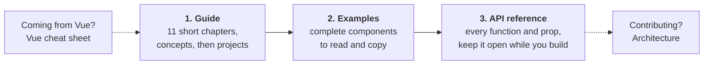

  

<h1 align="center">Rivue Guide</h1>

  Everything you need to build Roblox UI with Rivue, in the order you'll need it.

  <a href="GUIDE.md">Guide</a> ·
  <a href="../examples">Examples</a> ·
  <a href="API.md">API reference</a> ·
  <a href="VUE.md">Coming from Vue</a>

## Learning path

1. **[Guide](GUIDE.md)**: start here. Eleven chapters of about ten minutes each: the framework
   from your first component to debugging (1–9), then how to organise a real project and the
   style rules (10–11). Every chapter ends with an example and the API it used.
2. **[Examples](../examples)**: a todo list, inventory, modal, tabs, shop and HUD. Each is tested,
   and each one shows a few features well.
3. **[API reference](API.md)**: every function, prop and component, each with an example. Each
   page links back to the Guide chapter that explains it.

Also: **[Rivue for Vue developers](VUE.md)** maps Vue templates to Rivue, and
**[Architecture](ARCHITECTURE.md)** explains how the renderer and reactivity work inside.

## I want to…

| I want to… | Learn it | Look it up | See it working |
|---|---|---|---|
| put a first component on screen | [Guide 1](guide/01-introduction.md) | [defineComponent()](api/component.md#definecomponent) | [Counter](../examples/components/Counter.luau) |
| keep state and update the UI | [Guide 2](guide/02-state.md) | [ref()](api/reactivity-core.md#ref), [computed()](api/reactivity-core.md#computed) | [Counter](../examples/components/Counter.luau) |
| add and remove items in a list | [Guide 2](guide/02-state.md#changing-lists), [3](guide/03-describing-ui.md#lists-and-keys) | [Array helpers](api/array.md), [hFor()](api/render-function.md#hfor) | [TodoList](../examples/components/TodoList.luau) |
| split a screen into components | [Guide 4](guide/04-components.md) | [props](api/component.md#props), [emits](api/component.md#emits) | [TodoList](../examples/components/TodoList.luau) |
| make a panel, card or modal that takes content | [Guide 4](guide/04-components.md#slots-passing-ui-into-a-component) | [Slots](api/component.md#slots) | [Modal](../examples/components/Modal.luau) |
| read text the player types | [Guide 5](guide/05-forms-and-input.md) | [Element props: model](api/render-function.md#element-props) | [TodoList](../examples/components/TodoList.luau) |
| style things consistently | [Guide 6](guide/06-styling-and-layout.md#style-classes) | [app:styles()](api/application.md#appstyles) | [Demo app](../src/shared/Demo) |
| lay out rows, columns and grids | [Guide 6](guide/06-styling-and-layout.md#layout-without-positions) | [Element props: layout](api/render-function.md#element-props) | [Tabs](../examples/components/Tabs.luau) |
| support phones and controllers | [Guide 6](guide/06-styling-and-layout.md#different-devices) | [Roblox composables](api/roblox.md) | [Hud](../examples/components/Hud.luau) |
| run code when something changes | [Guide 7](guide/07-effects-and-animation.md) | [watch()](api/reactivity-core.md#watch) | [Hud](../examples/components/Hud.luau) |
| animate things in and out | [Guide 7](guide/07-effects-and-animation.md#animation) | [Transition](api/builtins.md#transition) | [Modal](../examples/components/Modal.luau) |
| share state across the game | [Guide 8](guide/08-state-and-server.md) | [provide()](api/component.md#provide), [readonly()](api/reactivity-core.md#readonly) | |
| load data from the server | [Guide 8](guide/08-state-and-server.md#talking-to-the-server) | [Remote](api/remote.md) | [Shop](../examples/components/Shop.luau) |
| show a long list fast | [Guide 9](guide/09-performance-and-debugging.md) | [VirtualList](api/builtins.md#virtuallist) | [Inventory](../examples/components/Inventory.luau) |
| organise files once there are many screens | [Guide 10](guide/10-organising-a-project.md) | [components](api/component.md#components) | [Demo app](../src/shared/Demo) |
| check my code follows the conventions | [Guide 11](guide/11-style-rules.md) | | |
| find out why something broke | [Guide 9](guide/09-performance-and-debugging.md#debugging) | [Utilities and debugging](api/utilities.md) | |
