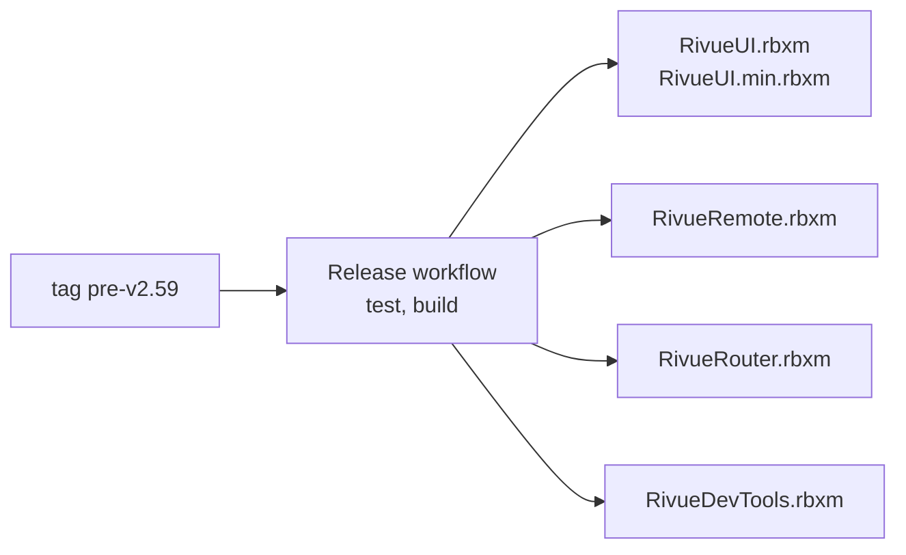
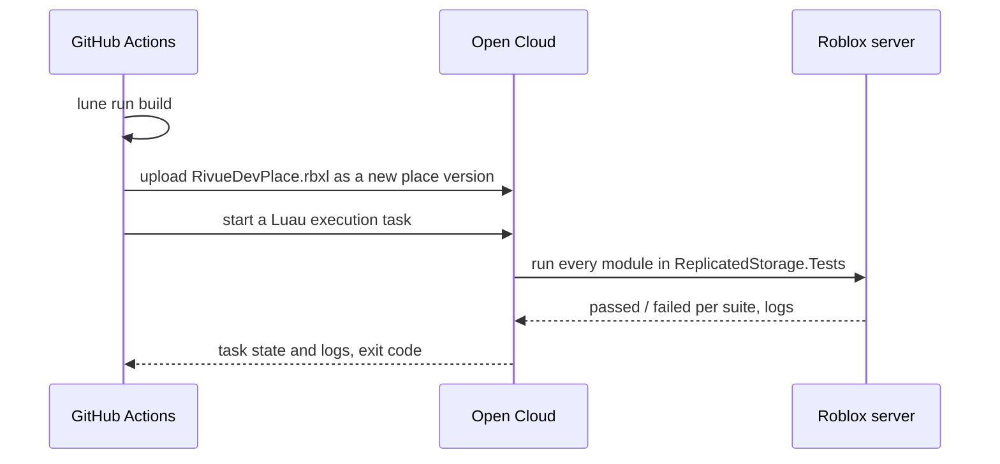

[Docs](README.md) › **Releasing**

# Releasing

Notes for maintainers: cutting a release, publishing the packages, the docs site, and the test
run in a real Roblox server.

## A GitHub release

A GitHub release covers the whole repo, so it has its own number, separate from the packages':
`v2.59` for a release, `pre-v2.59` for a pre-release. Write the release notes first, in
`.github/release-notes/<tag>.md`, listing each package's version in it, and push them. Then open
**Actions → Release → Run workflow** and type the tag. Anything starting with `pre-` is published
as a pre-release.

The workflow runs the tests, builds the files, creates the tag on the current `main` and attaches
the files to the release:



## Packages

Every folder in `packages/` is published on its own, with its own version. A package moves on
when it's ready, without waiting for the others. Where each one stands:

| Folder | Stage | Wally | pesde | Release file |
|---|---|---|---|---|
| `packages/rivue-ui` | release candidate | `linhisreal/rivue-ui` | `linhisreal/rivue_ui` | `RivueUI.rbxm`, `RivueUI.min.rbxm` |
| `packages/rivue-remote` | beta | `linhisreal/rivue-remote` | `linhisreal/rivue_remote` | `RivueRemote.rbxm` |
| `packages/rivue-router` | beta | `linhisreal/rivue-router` | `linhisreal/rivue_router` | `RivueRouter.rbxm` |
| `packages/rivue-devtools` | follows Rivue | — | — | `RivueDevTools.rbxm` (a Studio plugin) |

The current versions are in each package's `wally.toml`.

pesde names can't have dashes, hence the underscore in `rivue_remote`. Each package folder has its
own `default.project.json`, `wally.toml`, `pesde.toml`, `README.md` and `LICENSE.md` (a copy of
the root one). The root `pesde.toml` ties them into a pesde workspace. Wally has nothing like that,
so with Wally each package is published from its own folder.

To publish:

1. Bump the package you're publishing, for example `lune run version rivue-router 0.1.0-beta.2`.
   That updates its manifests, its `version` field and its install line in the README. Commit.
2. `rokit install` gets you Wally and pesde along with the other tools. Log in once with
   `wally login` and `pesde auth login`.
3. Publish the packages you bumped:

   ```sh
   wally publish --project-path packages/rivue-ui
   wally publish --project-path packages/rivue-remote
   wally publish --project-path packages/rivue-router
   cd packages/rivue-ui && pesde publish && cd ../..
   cd packages/rivue-remote && pesde publish && cd ../..
   cd packages/rivue-router && pesde publish && cd ../..
   ```

You'll find out early if something's wrong: the **Packages** workflow packs every package for both
registries on every change, it just doesn't publish them.

## Docs site

`docs/` doubles as a [VitePress](https://vitepress.dev) site. The **Docs site** workflow publishes
it to GitHub Pages on every push that changes `docs/`, once Pages is switched on under
**Settings → Pages → Source: GitHub Actions**. To preview it locally:

```sh
npm install --no-save vitepress@1.6.4 vitepress-plugin-mermaid@2.0.17 mermaid@11
npx vitepress dev docs
```

## Tests in Roblox

After `lune run test` has run the suites offline, the **Tests in Roblox** workflow runs them all
again inside a real Roblox server, through Open Cloud's Luau Execution API:



Setting it up takes three steps, once:

1. Publish an empty, private experience (something like "Rivue CI") and note its universe and
   place ids from the Creator Dashboard.
2. Create an Open Cloud API key with **Luau Execution Session** (write) and **Universe Places**
   (write), limited to that experience, with `0.0.0.0/0` as the allowed IP range and an expiry
   date.
3. In the repo's **Settings → Secrets and variables → Actions**, add the key as the secret
   `ROBLOX_API_KEY`, and the ids as the variables `ROBLOX_UNIVERSE_ID` and `ROBLOX_PLACE_ID`.
   Keep the key in that secret and nowhere else.

Until those exist the workflow is skipped. You can also run it from your machine:

```sh
ROBLOX_API_KEY=... ROBLOX_UNIVERSE_ID=... ROBLOX_PLACE_ID=... lune run cloud-test
```

Bear in mind the tests run on a server. There's no `LocalPlayer` and physics is off, so a suite
that needs either checks `_G.__CLOUD` (or `Players.LocalPlayer`) and skips that part.
