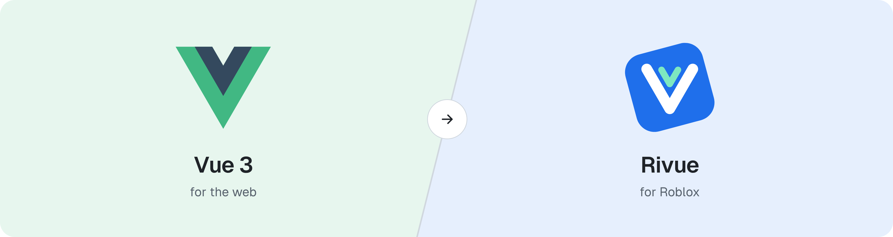
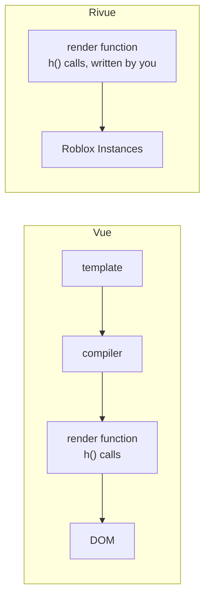

[Docs](README.md) › **Rivue for Vue developers**



# Rivue for Vue developers

If you know Vue 3, you know most of Rivue. It's Vue's runtime (reactivity, components, the virtual
DOM) rewritten in Luau, with Vue's names wherever the idea carries over. What's missing is the
template compiler: you write the render function a template would compile to, made of `h()`
calls, and Rivue turns it into Roblox Instances instead of DOM nodes.



## Templates to render functions

| Vue template | Rivue |
|--------------|-------|
| `<div class="card">` | `h("Frame", { class = "card" })` (classes from `app:styles()` or the `styles` option) |
| `:class="{ active: isActive }"` / `:class="[a, b]"` | `class = { active = isActive }` / `class = { a, b }` |
| `<style scoped>` | the component's `styles = { ... }` option |
| `display: flex; gap: 8px` | `layout = { direction = "horizontal", gap = 8 }`, `flex = "fill"` on children |
| `:size="size"` | `Size = size` |
| `@click="onClick"` | `onClick = onClick` |
| `@update:modelValue` | `["onUpdate:modelValue"] = fn` |
| `v-if="open"` | `Rivue.hIf(open.value, h(...))` or `if open.value then h(...) else nil` |
| `v-else` | `if a then h(A) else h(B)` |
| `v-show="open"` | `vShow = open.value` |
| `v-for="item in items" :key="item.id"` | `Rivue.hFor(items.value, function(item) return h(..., { key = item.id }) end)` |
| `v-model="name"` | `model = name` (TextBox, or a component using `defineModel`), or `model = "name"` in `render(ctx)` |
| `v-model:title="t" v-model:body="b"` | `models = { title = t, body = b }`, with `defineModel({ name = "title" })` and `defineModel({ name = "body" })` in the child |
| `v-model.trim` / `.number` / `.lazy` | `modelModifiers = { trim = true }` (and `number`, `lazy`) |
| `:hover` / `:active` / `:disabled` in CSS | `hover`, `pressed`, `disabled` variants in a style class |
| `@media` queries | `phone`, `tablet`, `desktop`, `console` variants in a style class |
| `v-focus` / custom `v-x` | `vFocus = true` / `vX = value` |
| `v-memo="[a, b]"` | `memo = { a, b }` |
| `v-once` | `vOnce = true` |
| `ref="input"` | `ref = "input"` + `Rivue.useTemplateRef("input")` |
| `<slot name="header" :title="t" />` | `ctx.renderSlot("header", { title = t })` |
| `<template #header="{ title }">` | `header = function(scope) ... end` in the children table |
| `<Teleport to="body">` | `h(Rivue.Teleport, { to = screenGui }, ...)` |
| `<Transition name="fade">` | `h(Rivue.Transition, { tweenInfo = ..., from = { BackgroundTransparency = 1 } }, ...)` |
| `<KeepAlive>` / `<Suspense>` | `Rivue.KeepAlive` / `Rivue.Suspense` |
| `{{ count }}` | `Text = tostring(ctx.count)` in `render(ctx)`, or `` Text = `{count.value}` `` in setup's render function |
| `components: { ItemRow }` | `components = { ItemRow = ItemRow }`, then `h("ItemRow", ...)` |
| `items.push(x)` / `items.splice(i, 1)` | `Rivue.array.push(items, x)` / `Rivue.array.splice(items, i, 1)` |

## script setup to defineComponent

```vue [Vue] tab
<script setup>
const props = defineProps({ start: { type: Number, default: 0 } })
const emit = defineEmits(["change"])
const count = ref(props.start)
const doubled = computed(() => count.value * 2)
onMounted(() => console.log("mounted"))
</script>
```

```lua [Rivue] tab
local Counter = Rivue.defineComponent({
	name = "Counter",
	props = { start = { type = "number", default = 0 } },
	emits = { "change" },
	setup = function(props, ctx)
		local count = Rivue.ref(props.start)
		Rivue.onMounted(function()
			print("mounted")
		end)
		return {
			count = count,
			doubled = Rivue.computed(function()
				return count.value * 2
			end),
			increment = function()
				count.value += 1
				ctx.emit("change", count.value)
			end,
		}
	end,
	render = function(ctx)
		return h("TextButton", { Text = `{ctx.count} ({ctx.doubled})`, onClick = ctx.increment })
	end,
})
```

`setup` returns what `render(ctx)` can use, the way `<script setup>` exposes its bindings to the
template, and `ctx` unwraps refs the way a template does. This is the form the docs use. Two
shorter forms also work: `setup` can return the render function itself, and
`Rivue.defineComponent(function(props, ctx) ... end, { name = "Counter" })` takes only a setup
function.

## Same names, same behaviour

| Area | APIs |
|------|------|
| Reactivity | `ref`, `shallowRef`, `reactive`, `shallowReactive`, `readonly`, `shallowReadonly`, `computed` (getter and get/set), `customRef`, `triggerRef`, `toRef`, `toRefs`, `toValue`, `unref`, `toRaw`, `markRaw`, `isRef`, `isReactive`, `isReadonly`, `isProxy`, `isShallow` |
| Watching | `watch` (`immediate`, `deep` incl. a depth number, `flush`, `once`, multiple sources, pause/resume handle), `watchEffect`, `watchPostEffect`, `watchSyncEffect`, `onWatcherCleanup`, `getCurrentWatcher`, `onEffectCleanup` |
| Scopes | `effectScope` (with `pause`/`resume`), `getCurrentScope`, `onScopeDispose` |
| Lifecycle | `onBeforeMount`, `onMounted`, `onBeforeUpdate`, `onUpdated`, `onBeforeUnmount`, `onUnmounted`, `onActivated`, `onDeactivated`, `onErrorCaptured`, `onRenderTracked`, `onRenderTriggered` |
| Components | `defineComponent`, `defineAsyncComponent`, `defineModel`, `useAttrs`, `useSlots`, `useTemplateRef`, `useId`, `getCurrentInstance`, `provide`, `inject`, `hasInjectionContext`, `resolveComponent` |
| Render | `h`, `Fragment`, `mergeProps`, `cloneVNode`, `isVNode`, `nextTick` |
| App | `createApp`, `app.mount/unmount/provide/component/directive/use/onUnmount/runWithContext`, `app.config.errorHandler/warnHandler/globalProperties/performance` |
| Built-ins | `Transition` (with `mode` `"out-in"` and `"in-out"`), `TransitionGroup`, `KeepAlive`, `Teleport` (with `to`, `disabled` and `defer`), `Suspense` (with `pending`, `fallback` and `resolve` events) |

## Differences to know

### Proxies and Luau

`.value` and reactive proxies behave as in Vue. Two Luau gaps change how you loop and edit lists:

> [!WARNING]
> Luau has no `__pairs` or `__ipairs`, so `pairs()`, `ipairs()` and `next()` see an empty table on
> a reactive proxy. Loop with `for k, v in state do` or a numeric loop.

> [!WARNING]
> `table.insert` and `table.remove` go around the proxy, so nothing re-renders. Where you'd reach
> for JavaScript's array methods, use [`Rivue.array`](api/array.md) (`push`, `splice`,
> `removeWhere`, `sort` and the rest).

### No compiler

Props destructuring, `<style>` blocks and single-file components need the compiler, so they
aren't here. Each component is a ModuleScript ([Organising a project](guide/10-organising-a-project.md)
shows a layout), and the `defineProps` and `defineEmits` macros become the `props` and `emits`
options. Every render builds its vnodes from scratch; Rivue diffs props shallowly, and `memo` and
keys cover what static hoisting does in Vue.

### Instances instead of the DOM

Element types are Roblox ClassNames, and props are Instance properties and events. Styling is
properties too, grouped into `class` styles, plus modifier props like `cornerRadius`, `padding`
and `layout`.

> [!IMPORTANT]
> There's no cascade. A class styles the element it's on and nothing else, so children don't
> inherit text colour or font from a parent's class.

Events follow Roblox. `onClick` connects `Activated`, and `onX` connects the event `X`, or the
changed signal of property `X` when there's no such event.

### Transitions are tweens

`from` takes the place of Vue's `*-enter-from` and `*-leave-to` classes, and TweenService does
the animating.

### Client only

> [!NOTE]
> There's no SSR and no hydration. Rivue runs on the client.

### Vue Router

[RivueRouter](api/router.md) follows Vue Router 4 and ships as its own package, like Vue's.
`createRouter`, `RouterView`, `RouterLink`, `useRoute`, nested and named views, the guards,
navigation failures and `scrollBehavior` keep their names and behaviour. Roblox has no URLs, so
routes have names but no paths, there's no hash, `query` is a table, and guards yield where Vue's
return Promises. Those are most of the [differences from Vue Router](api/router.md#differences-from-vue-router).

### Things Vue doesn't have

Roblox needs some extras with no Vue counterpart: `VirtualList`, `useTween` and `useSpring`,
`useViewportSize`, `useInputType`, `useSafeArea`, `useSelection`, `useGamepadFocus`, `useAsync`,
`attributeRef`, `useTag`, and the Instance pool. A few more cover what Vue leaves to libraries:
`Dialog`, `ErrorBoundary`, `Row`/`Column`/`Spacer`, `Rivue.transitions`, `Rivue.bind` for
property bindings, and `testing.render` in the style of Vue Testing Library.
