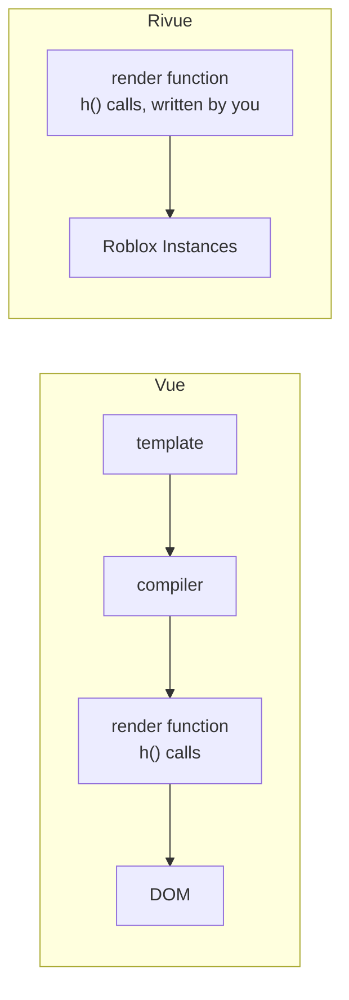

[Docs](README.md) › **Rivue for Vue developers**

# Rivue for Vue developers

If you know Vue 3, you already know most of Rivue. It's Vue's runtime (reactivity, components,
the virtual DOM) rewritten in Luau, with the same names wherever the idea carries over. The big
missing piece is the template compiler. You write what a Vue template compiles to, a render
function made of `h()` calls, and Rivue turns that into Roblox Instances instead of DOM nodes:



The tables below are the cheat sheet. The differences worth knowing are at the end.

## Templates to render functions

| Vue template | Rivue |
|--------------|-------|
| `<div class="card">` | `h("Frame", { class = "card" })` (classes from `app:styles()` or the `styles` option) |
| `:class="{ active: isActive }"` / `:class="[a, b]"` | `class = { active = isActive }` / `class = { a, b }` |
| `<style scoped>` | the component's `styles = { ... }` option |
| `display: flex; gap: 8px` | `layout = { direction = "horizontal", gap = 8 }`, `flex = "fill"` on children |
| `:size="size"` | `Size = size` |
| `@click="onClick"` | `onClick = onClick` |
| `@update:modelValue` | `["onUpdate:modelValue"] = fn` |
| `v-if="open"` | `Rivue.hIf(open.value, h(...))` or `if open.value then h(...) else nil` |
| `v-else` | `if a then h(A) else h(B)` |
| `v-show="open"` | `vShow = open.value` |
| `v-for="item in items" :key="item.id"` | `Rivue.hFor(items.value, function(item) return h(..., { key = item.id }) end)` |
| `v-model="name"` | `model = name` (TextBox, or a component using `defineModel`), or `model = "name"` in `render(ctx)` |
| `v-model.trim` / `.number` / `.lazy` | `modelModifiers = { trim = true }` (and `number`, `lazy`) |
| `:hover` / `:active` / `:disabled` in CSS | `hover`, `pressed`, `disabled` variants in a style class |
| `@media` queries | `phone`, `tablet`, `desktop`, `console` variants in a style class |
| `v-focus` / custom `v-x` | `vFocus = true` / `vX = value` |
| `v-memo="[a, b]"` | `memo = { a, b }` |
| `v-once` | `vOnce = true` |
| `ref="input"` | `ref = "input"` + `Rivue.useTemplateRef("input")` |
| `<slot name="header" :title="t" />` | `ctx.renderSlot("header", { title = t })` |
| `<template #header="{ title }">` | `header = function(scope) ... end` in the children table |
| `<Teleport to="body">` | `h(Rivue.Teleport, { to = screenGui }, ...)` |
| `<Transition name="fade">` | `h(Rivue.Transition, { tweenInfo = ..., from = { BackgroundTransparency = 1 } }, ...)` |
| `<KeepAlive>` / `<Suspense>` | `Rivue.KeepAlive` / `Rivue.Suspense` |
| `{{ count }}` | `Text = tostring(ctx.count)` in `render(ctx)`, or `` Text = `{count.value}` `` in setup's render function |
| `components: { ItemRow }` | `components = { ItemRow = ItemRow }`, then `h("ItemRow", ...)` |
| `items.push(x)` / `items.splice(i, 1)` | `Rivue.array.push(items, x)` / `Rivue.array.splice(items, i, 1)` |

## script setup to defineComponent

```vue
<script setup>
const props = defineProps({ start: { type: Number, default: 0 } })
const emit = defineEmits(["change"])
const count = ref(props.start)
const doubled = computed(() => count.value * 2)
onMounted(() => console.log("mounted"))
</script>
```

```lua
local Counter = Rivue.defineComponent({
	name = "Counter",
	props = { start = { type = "number", default = 0 } },
	emits = { "change" },
	setup = function(props, ctx)
		local count = Rivue.ref(props.start)
		local doubled = Rivue.computed(function()
			return count.value * 2
		end)
		Rivue.onMounted(function()
			print("mounted")
		end)

		return function()
			return h("TextButton", {
				Text = `{count.value} ({doubled.value})`,
				onClick = function()
					count.value += 1
					ctx.emit("change", count.value)
				end,
			})
		end
	end,
})
```

There's a short form too, when all you have is a setup function:
`Rivue.defineComponent(function(props, ctx) ... end, { name = "Counter" })`.

Most of the docs use a third form. `setup()` returns its state, much like the Options API's
`setup` + `render` pair, or what `<script setup>` exposes to a template, and refs are unwrapped
in `render(ctx)` the way they are in a template:

```lua
local Counter = Rivue.defineComponent({
	name = "Counter",
	props = { start = { type = "number", default = 0 } },
	emits = { "change" },
	setup = function(props, ctx)
		local count = Rivue.ref(props.start)
		return {
			count = count,
			doubled = Rivue.computed(function()
				return count.value * 2
			end),
			increment = function()
				count.value += 1
				ctx.emit("change", count.value)
			end,
		}
	end,
	render = function(ctx)
		return h("TextButton", { Text = `{ctx.count} ({ctx.doubled})`, onClick = ctx.increment })
	end,
})
```

## Same names, same behaviour

| Area | APIs |
|------|------|
| Reactivity | `ref`, `shallowRef`, `reactive`, `shallowReactive`, `readonly`, `shallowReadonly`, `computed` (getter and get/set), `customRef`, `triggerRef`, `toRef`, `toRefs`, `toValue`, `unref`, `toRaw`, `markRaw`, `isRef`, `isReactive`, `isReadonly`, `isProxy`, `isShallow` |
| Watching | `watch` (`immediate`, `deep` incl. a depth number, `flush`, `once`, multiple sources, pause/resume handle), `watchEffect`, `watchPostEffect`, `watchSyncEffect`, `onWatcherCleanup` |
| Scopes | `effectScope`, `getCurrentScope`, `onScopeDispose` |
| Lifecycle | `onBeforeMount`, `onMounted`, `onBeforeUpdate`, `onUpdated`, `onBeforeUnmount`, `onUnmounted`, `onActivated`, `onDeactivated`, `onErrorCaptured`, `onRenderTracked`, `onRenderTriggered` |
| Components | `defineComponent`, `defineAsyncComponent`, `defineModel`, `useAttrs`, `useSlots`, `useTemplateRef`, `useId`, `getCurrentInstance`, `provide`, `inject`, `hasInjectionContext`, `resolveComponent` |
| Render | `h`, `Fragment`, `mergeProps`, `cloneVNode`, `isVNode`, `nextTick` |
| App | `createApp`, `app.mount/unmount/provide/component/directive/use/onUnmount/runWithContext`, `app.config.errorHandler/warnHandler/globalProperties` |
| Built-ins | `Transition`, `TransitionGroup`, `KeepAlive`, `Teleport` (with `to`, `disabled` and `defer`), `Suspense` |

## Differences to know

### Proxies and Luau

`.value` and reactive proxies work the same as in Vue. What's missing is `__pairs` and `__ipairs`:
Luau doesn't have them, so `pairs()` and `ipairs()` see an empty table. Loop with
`for k, v in state do` or a numeric loop instead. `table.insert` and `table.remove` go around the
proxy too, so where you'd use JavaScript's array methods, use [`Rivue.array`](api/array.md)
(`push`, `splice`, `removeWhere`, `sort` and the rest).

### No compiler

Without templates there's nothing to compile, so a few things that depend on the compiler aren't
here: props destructuring, `<style>` blocks and single-file components. Each component is a
ModuleScript instead ([Organising a project](guide/10-organising-a-project.md) shows a layout).
The `defineProps` and `defineEmits` macros become the `props` and `emits` options.

It also means every render builds its vnodes from scratch. Rivue diffs props shallowly, and
`memo` and keys cover what the compiler's static hoisting would do in Vue.

### Instances instead of the DOM

Element types are Roblox ClassNames, and props are Instance properties and events. Styling is
properties as well, grouped into `class` styles, plus modifier props like `cornerRadius`,
`padding` and `layout`. There's no cascade. A class styles the element it's on, and nothing else.

Event names follow Roblox. `onClick` connects `Activated`, and `onX` connects the event `X`, or
the changed signal of property `X` if there's no such event.

### Transitions are tweens

`from` takes the place of Vue's `*-enter-from` and `*-leave-to` classes, and TweenService does
the animating.

### Client only

There's no SSR and no hydration. Rivue runs on the client.

### Things Vue doesn't have

Roblox needs a few extras with no Vue counterpart: `VirtualList`, `useTween` and `useSpring`,
`useViewportSize`, `useInputType`, `useSafeArea`, `useSelection`, `attributeRef`, `useTag`, and
the Instance pool.
