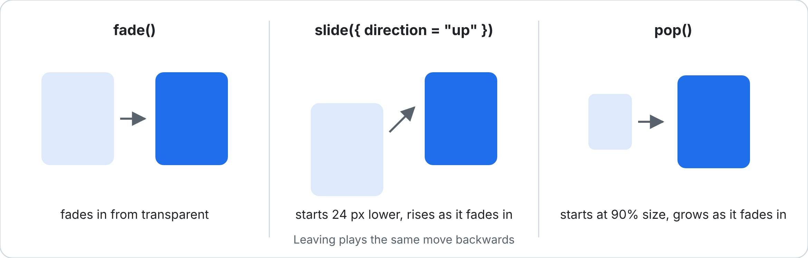
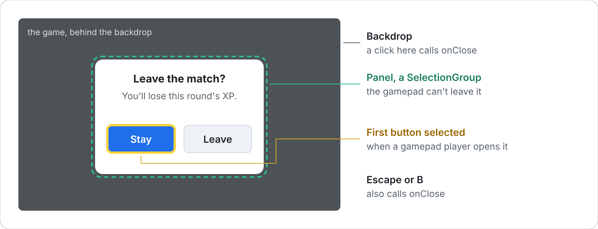
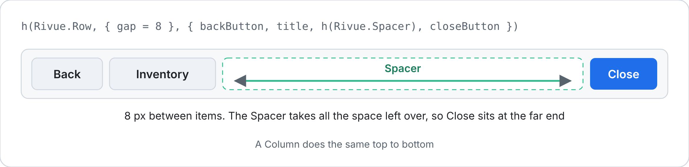

[Docs](../README.md) › [API](../API.md) › **Built-in components**

# Built-in components

**Learn it:** [Guide 7: Effects and animation](../guide/07-effects-and-animation.md) · [Guide 13: Component patterns](../guide/13-advanced-components.md)

Components that ship with Rivue. Use them like any component: `h(Rivue.Transition, props, children)`.
Examples assume:

```lua
local Rivue = require(game.ReplicatedStorage.RivueUI)
local h = Rivue.h
```

---

## Transition

Animates one element in when it appears and out before it's removed, using TweenService. Wrap the
element you toggle, and describe its hidden state with `from`.

```lua signature
h(Rivue.Transition, props: TransitionProps, { child })
```

| Prop | Type | Default | Description |
|---|---|---|---|
| `tweenInfo` | `TweenInfo?` | | used for both entering and leaving |
| `enterInfo` | `TweenInfo?` | `tweenInfo` | used when entering |
| `leaveInfo` | `TweenInfo?` | `tweenInfo` | used when leaving |
| `from` | `{ [string]: any }?` | | the hidden state: applied before entering, tweened to when leaving |
| `enterFrom` | `{ [string]: any }?` | `from` | the start state when entering |
| `enterGoals` | `{ [string]: any }?` | the element's own props | where entering ends |
| `leaveGoals` | `{ [string]: any }?` | `from` | where leaving ends |
| `appear` | `boolean` | `false` | also animate the first render |
| `mode` | `"out-in" \| "in-out"` | both at once | `"out-in"`: the old child leaves first; `"in-out"`: the new one enters first |
| `onBeforeEnter`, `onAfterEnter` | `(el: Instance) -> ()` | | around entering |
| `onBeforeLeave`, `onAfterLeave` | `(el: Instance) -> ()` | | around leaving |

### Example

```lua
local SettingsPanel = Rivue.defineComponent({
	name = "SettingsPanel",
	setup = function()
		local open = Rivue.ref(false)
		return {
			open = open,
			toggle = function()
				open.value = not open.value
			end,
		}
	end,
	render = function(ctx)
		return h("Frame", { Size = UDim2.fromScale(1, 1), BackgroundTransparency = 1 }, {
			h("TextButton", { Text = "Settings", onClick = ctx.toggle }),
			h(Rivue.Transition, {
				tweenInfo = TweenInfo.new(0.2, Enum.EasingStyle.Quad),
				-- the hidden state: tweened from when it appears, back to before it's destroyed
				from = { BackgroundTransparency = 1, Position = UDim2.fromScale(0.5, 0.55) },
			}, {
				Rivue.hIf(
					ctx.open,
					h("Frame", {
						AnchorPoint = Vector2.new(0.5, 0.5),
						Position = UDim2.fromScale(0.5, 0.5),
						Size = UDim2.fromOffset(300, 200),
					})
				),
			}),
		})
	end,
})
```

Switching tabs, the old one fading out before the new one fades in:

```lua
local tab = Rivue.ref("Shop")

h(Rivue.Transition, { mode = "out-in", tweenInfo = TweenInfo.new(0.15), from = { GroupTransparency = 1 } }, {
	-- a new key means a new child, so changing tabs plays leave, then enter
	h("CanvasGroup", { key = tab.value, Size = UDim2.fromScale(1, 1) }),
})
```

The same animation on one element with the `transition` prop, where `enter` and `leave` turn each
phase on:

```lua
h("Frame", {
	transition = {
		tweenInfo = TweenInfo.new(0.3),
		from = { BackgroundTransparency = 1 },
		enter = true,
		leave = true,
	},
})
```

### Details

- Keep the `Transition` mounted and toggle its child with `hIf`, an `if` expression or a changing
  `key`.
- Entering starts at `from` and tweens to the element's own props. Leaving tweens to `from`, keeps
  the element on screen until the tween ends, then destroys it. Leaving never blocks rendering.
- A component child animates its root element.

---

## TransitionGroup

[Transition](#transition) for lists: each keyed item animates in when added and out when removed.
For notifications, chat messages and inventories.

```lua signature
h(Rivue.TransitionGroup, props: TransitionGroupProps, children)
```

| Prop | Type | Default | Description |
|---|---|---|---|
| `tag` | `string?` | no wrapper | wrap the items in this element |
| `tagProps` | `Props?` | | props for that element |
| `moveInfo` | `TweenInfo?` | | slide items that change place, like Vue's move transition |
| others | | | the same as [Transition](#transition), except `mode` |

> [!WARNING]
> Every child needs a unique `key`.

### Example

```lua
local notifications = Rivue.ref({
	{ id = 1, text = "Welcome!" },
})

h(Rivue.TransitionGroup, {
	tag = "Frame",
	tagProps = { Size = UDim2.new(0, 300, 1, 0), BackgroundTransparency = 1 },
	tweenInfo = TweenInfo.new(0.2),
	from = { BackgroundTransparency = 1, Size = UDim2.new(1, 0, 0, 0) },
}, {
	h("UIListLayout"),
	Rivue.hFor(notifications.value, function(n)
		return h("TextLabel", { key = n.id, Text = n.text, Size = UDim2.new(1, 0, 0, 40) })
	end),
})
```

A leaderboard that slides rows into their new places when it re-sorts:

```lua
local sortedPlayers = Rivue.ref({} :: { Player })

h(Rivue.TransitionGroup, { tag = "Frame", tagProps = { layout = { gap = 4 } }, moveInfo = TweenInfo.new(0.25) }, {
	Rivue.hFor(sortedPlayers.value, function(p)
		return h("TextLabel", { key = p.UserId, Text = p.Name, Size = UDim2.new(1, 0, 0, 32) })
	end),
})
```

### Details

- Items placed with `Position` slide from the old `Position` to the new one, whatever changed.
- Items in a `UIListLayout` or `UIGridLayout` slide when the same items change order. The layout
  steps aside while they slide and comes back when they land. A change that also adds or removes
  items, or a wrapping list, skips the slide; adding and removing still animate.

---

## KeepAlive

Keeps a switched-out component alive instead of destroying it, so tabs and menus come back as the
player left them: scroll position, typed text and state.

```lua signature
h(Rivue.KeepAlive, props: KeepAliveProps, { child })
```

| Prop | Type | Default | Description |
|---|---|---|---|
| `include` | `{ string }?` | everything | only cache components with these names |
| `exclude` | `{ string }?` | | never cache these |
| `max` | `number` | `10` | most entries kept; the least recently used goes first |

### Example

```lua
local Inventory = Rivue.defineComponent({ name = "Inventory", render = function() return h("ScrollingFrame") end })
local Settings = Rivue.defineComponent({ name = "Settings", render = function() return h("Frame") end })

local Menu = Rivue.defineComponent({
	name = "Menu",
	setup = function()
		return { tab = Rivue.ref("inventory") }
	end,
	render = function(ctx)
		return h(Rivue.KeepAlive, { max = 5, exclude = { "Settings" } }, {
			if ctx.tab == "inventory" then h(Inventory) else h(Settings),
		})
	end,
})
```

### Details

- Switching away detaches the component's Instances (`Parent = nil`) and keeps its state. Switching
  back attaches the same Instances, and re-renders triggered meanwhile run then.
- Entries are cached by `key`, or by component without one.
- Cached components get [`onActivated`](lifecycle.md#onactivated) and
  [`onDeactivated`](lifecycle.md#ondeactivated); their watchers keep running while hidden.

---

## Teleport

Renders its children somewhere else, usually a ScreenGui with a higher DisplayOrder. For modals,
tooltips and dropdowns that must draw above everything, or escape a parent's `ClipsDescendants`.

```lua signature
h(Rivue.Teleport, props: TeleportProps, children)
```

| Prop | Type | Default | Description |
|---|---|---|---|
| `to` | `Instance \| () -> Instance?` | | where to render; it must be parented |
| `disabled` | `boolean` | `false` | render in place instead |
| `defer` | `boolean` | `false` | wait until the rest of the tree is mounted to resolve `to`, so it can point at something rendered later |

### Example

```lua
local overlay = Instance.new("ScreenGui")
overlay.DisplayOrder = 100
overlay.Parent = Players.LocalPlayer:WaitForChild("PlayerGui")

local Shop = Rivue.defineComponent({
	name = "Shop",
	setup = function()
		local confirming = Rivue.ref(false)
		return {
			confirming = confirming,
			ask = function()
				confirming.value = true
			end,
		}
	end,
	render = function(ctx)
		return h("Frame", { ClipsDescendants = true, Size = UDim2.fromOffset(300, 300) }, {
			h("TextButton", { Text = "Buy", onClick = ctx.ask }),
			-- rendered into the overlay, so the shop's clipping doesn't cut it off
			h(Rivue.Teleport, { to = overlay }, {
				Rivue.hIf(ctx.confirming, h("Frame", { Name = "ConfirmDialog", Size = UDim2.fromOffset(240, 120) })),
			}),
		})
	end,
})
```

### Details

- Children update in place, move when `to` changes, and are removed when the Teleport unmounts.

---

## Suspense

Shows a fallback, like a spinner, while async components inside it load, then swaps in the content.

```lua signature
h(Rivue.Suspense, props: SuspenseProps, children)
```

| Prop | Type | Default | Description |
|---|---|---|---|
| `fallback` | `VNode?` | a "Loading..." label | shown while loading |
| `timeout` | `number` | `5000` | milliseconds before showing an error |
| `onPending` | `() -> ()` | | something started loading |
| `onFallback` | `() -> ()` | | the fallback is showing |
| `onResolve` | `() -> ()` | | everything loaded |

> [!NOTE]
> Unlike Vue's, `timeout` is how long to wait before showing an error, not a delay before the
> fallback. The fallback shows straight away, so `onPending` and `onFallback` come together.

### Example

```lua
local Profile = Rivue.defineAsyncComponent(function()
	task.wait(1) -- e.g. waiting for data
	return Rivue.defineComponent({
		name = "ProfileLoaded",
		render = function()
			return h("TextLabel", { Text = "Player profile" })
		end,
	})
end)

h(Rivue.Suspense, { fallback = h("TextLabel", { Text = "Loading profile..." }) }, {
	h(Profile),
})
```

With events:

```lua
h(Rivue.Suspense, {
	onPending = function()
		print("loading started")
	end,
	onResolve = function()
		print("everything loaded")
	end,
}, { h(Profile) })
```

### Details

- Children mount inside a hidden Frame while loading, with the fallback on top. On failure or
  timeout an error message shows.
- [`defineAsyncComponent()`](component.md#defineasynccomponent) and
  [`useAsync()`](component.md#useasync) register with it on their own.

---

## VirtualList

A scrolling list or grid that only creates the rows on screen, so 5,000 items cost about as much as
20.

```lua signature
h(Rivue.VirtualList, props: VirtualListProps<T>)
```

| Prop | Type | Default | Description |
|---|---|---|---|
| `items` | `{ T }` | | a plain or reactive array |
| `itemSize` | `number \| (item: T, index: number) -> number` | | row height in pixels, or width when horizontal |
| `render` | `(item: T, index: number) -> VNode` | | the row for an item |
| `key` | `(item: T, index: number) -> unknown` | the index | each row's key |
| `columns` | `number` | `1` | items per row, for a grid |
| `gap` | `number` | `0` | pixels between rows and between columns |
| `overscan` | `number` | `2` | extra rows rendered above and below the visible ones |
| `horizontal` | `boolean` | `false` | scroll sideways |
| others | | | go to the ScrollingFrame: `Size`, `Position`, ... |

> [!WARNING]
> `itemSize` as a function needs `columns = 1`; with a grid it errors.

### Example

```lua
local items = {}
for i = 1, 5000 do
	items[i] = { id = i, name = `Item {i}` }
end

h(Rivue.VirtualList, {
	Size = UDim2.fromOffset(300, 400),
	items = items,
	itemSize = 40,
	key = function(item)
		return item.id
	end,
	render = function(item)
		return h("TextLabel", { Size = UDim2.new(1, 0, 0, 40), Text = item.name })
	end,
})
```

An inventory grid, four slots wide:

```lua
h(Rivue.VirtualList, {
	Size = UDim2.fromOffset(400, 500),
	items = items,
	itemSize = 90, -- row height
	columns = 4,
	gap = 8,
	render = function(item)
		return h("TextButton", { Text = item.name }) -- Size is set for you
	end,
})
```

A chat feed where messages have different heights:

```lua
local messages = {
	{ text = "gg", lines = 1 },
	{ text = "anyone want to trade? I have a sword and two potions", lines = 2 },
}

h(Rivue.VirtualList, {
	Size = UDim2.fromOffset(300, 400),
	items = messages,
	itemSize = function(message)
		return message.lines * 20 + 8
	end,
	render = function(message)
		return h("TextLabel", {
			Size = UDim2.new(1, 0, 0, message.lines * 20 + 8),
			TextWrapped = true,
			Text = message.text,
		})
	end,
})
```

### Details

- Rivue sets each row's `Position` and `key`. In a list, make rows fill the cross axis; in a grid it
  sets `Size` too, unless the row sets its own.
- Sizes from a function are recomputed when the items change, not while scrolling.
- Scrolling re-renders only the rows coming into view.

---

## ViewportModel

Shows a 3D model in the UI, framed by a camera that fits it. For shop and inventory previews.

```lua signature
h(Rivue.ViewportModel, props: ViewportModelProps)
```

| Prop | Type | Default | Description |
|---|---|---|---|
| `model` | `Model \| BasePart` | | what to show; it's cloned |
| `angle` | `number` | `30` | degrees around the model |
| `pitch` | `number` | `20` | degrees above it |
| `fieldOfView` | `number` | `40` | the camera's field of view |
| `distance` | `number` | `1` | `1` just fits, `2` is twice as far |
| others | | | go to the ViewportFrame: `Size`, `Position`, ... |

> [!WARNING]
> The model must be `Archivable`, and a Model or BasePart. Otherwise it warns and shows nothing.

### Example

```lua
local ItemPreview = Rivue.defineComponent({
	name = "ItemPreview",
	props = { model = { type = "Instance", required = true } },
	render = function(ctx)
		return h(Rivue.ViewportModel, {
			model = ctx.model, -- e.g. ReplicatedStorage.Items.Sword
			Size = UDim2.fromOffset(120, 120),
			angle = 45,
		})
	end,
})
```

### Details

- The camera sits on a sphere around the model's bounding box, far enough back for the whole model
  to fit. Changing any prop, or passing another model, frames it again.

---

## transitions

Ready-made props for [Transition](#transition), so a fade or slide doesn't need its TweenInfo and
start values written out.



```lua signature
transitions.fade(options: { duration: number?, easing: Enum.EasingStyle?, [string]: any }?): TransitionProps
transitions.slide(options: { direction: ("up" | "down" | "left" | "right")?, distance: number?, fade: boolean?, ... }?): TransitionProps
transitions.pop(options: { scale: number?, fade: boolean?, ... }?): TransitionProps
```

| Parameter | Type | Default | Description |
|---|---|---|---|
| `options.duration` | `number?` | | seconds |
| `options.easing` | `Enum.EasingStyle?` | | the easing style |
| `options.direction` | `"up" \| "down" \| "left" \| "right"` | | `slide`: the way it moves when entering |
| `options.distance` | `number` | `24` | `slide`: pixels it travels |
| `options.scale` | `number` | `0.9` | `pop`: the size it grows from |
| `options.fade` | `boolean` | `true` | `slide` and `pop`: fade as well |
| other options | | | passed on to the Transition, such as `mode = "out-in"` |

**Returns** props for a Transition.

### Example

```lua
local Toast = Rivue.defineComponent({
	name = "Toast",
	props = { message = { type = "string" } },
	render = function(ctx)
		return h(Rivue.Transition, Rivue.transitions.slide({ direction = "up" }), {
			Rivue.hIf(
				ctx.message ~= nil,
				h("TextLabel", {
					Text = ctx.message,
					Size = UDim2.fromOffset(260, 40),
					Position = UDim2.new(0.5, -130, 1, -60),
				})
			),
		})
	end,
})
```

### Details

- `fade()` covers every transparency an element can have, so it works on a Frame, a TextLabel or an
  ImageButton. Children don't fade with their parent; to fade a whole panel, make it a
  `CanvasGroup`.
- `pop()` looks best with `AnchorPoint = Vector2.new(0.5, 0.5)`, so it grows from the centre.
- Your own presets work the same way. A value in `from` can be a function that gets the element's
  current value and returns the start value; that's how `slide` starts 24 pixels away from wherever
  the element sits.

---

## ErrorBoundary

Shows a fallback instead of its children when something inside them throws, so one broken widget
doesn't take the rest of the screen with it.

```lua signature
h(Rivue.ErrorBoundary, props: ErrorBoundaryProps, children)
```

| Prop | Type | Default | Description |
|---|---|---|---|
| `fallback` | `VNode \| (message: string, reset: () -> ()) -> VNode?` | | what to show; `reset()` clears the error and mounts the children again |
| `onError` | `(message: string, info: string) -> ()` | | runs first, for logging; an error in it is warned |

> [!NOTE]
> The error stops at the boundary, so it doesn't reach `app.config.errorHandler`. Log it in
> `onError`.

### Example

```lua
local ShopItems = Rivue.defineComponent({
	name = "ShopItems",
	render = function()
		return h("Frame")
	end,
})

local ShopPanel = Rivue.defineComponent({
	name = "ShopPanel",
	render = function()
		return h(Rivue.ErrorBoundary, {
			onError = function(message)
				warn("Shop failed:", message)
			end,
			fallback = function(_message, reset)
				return h("TextButton", { Text = "The shop didn't load. Tap to try again", onActivated = reset })
			end,
		}, {
			h(ShopItems),
		})
	end,
})
```

### Details

- It catches what [`onErrorCaptured()`](lifecycle.md#onerrorcaptured) catches: errors in
  descendants' render, lifecycle hooks, emit and event handlers, and watchers.

---

## Dialog

A modal: a dark backdrop over the screen with your content in the middle.



```lua signature
h(Rivue.Dialog, props: DialogProps, children)
```

| Prop | Type | Default | Description |
|---|---|---|---|
| `open` | `boolean` | | renders while true |
| `onClose` | `() -> ()` | | the player asked to close: backdrop click, Escape or B |
| `closeOnBackdrop` | `boolean` | `true` | a backdrop click calls `onClose` |
| `closeOnEscape` | `boolean` | `true` | Escape and B call `onClose` |
| `backdropColor` | `Color3` | black | the backdrop's colour |
| `backdropTransparency` | `number` | `0.4` | the backdrop's transparency |
| `zIndex` | `number` | `100` | the dialog's ZIndex |
| `transition` | `TransitionProps?` | | animates the panel, such as `Rivue.transitions.pop()` |

> [!NOTE]
> It never closes itself. `onClose` tells you the player wants out; you set `open` to false.

### Example

```lua
local LeaveButton = Rivue.defineComponent({
	name = "LeaveButton",
	setup = function()
		local asking = Rivue.ref(false)
		return {
			asking = asking,
			ask = function()
				asking.value = true
			end,
			close = function()
				asking.value = false
			end,
		}
	end,
	render = function(ctx)
		return h("Frame", { Size = UDim2.fromScale(1, 1), BackgroundTransparency = 1 }, {
			h("TextButton", { Text = "Leave match", onActivated = ctx.ask }),
			h(Rivue.Dialog, { open = ctx.asking, onClose = ctx.close, transition = Rivue.transitions.pop() }, {
				h(Rivue.Column, { gap = 12 }, {
					h("TextLabel", { Text = "Leave the match?", Size = UDim2.fromOffset(220, 30) }),
					h("TextButton", { Text = "Stay", Size = UDim2.fromOffset(100, 36), onActivated = ctx.close }),
				}),
			}),
		})
	end,
})
```

### Details

- While open, gamepad selection can't leave the panel (it's a `SelectionGroup`) and starts on its
  first button. When it closes, the selection goes back where it was.
- It covers its parent, so render it in a full-screen ScreenGui, or move it there with
  [Teleport](#teleport).

---

## Row, Column and Spacer

Layout without a `layout` table. A Row lays its children left to right, a Column top to bottom, and
a Spacer takes whatever room is left.



```lua signature
h(Rivue.Row, props: RowProps, children)
h(Rivue.Column, props: RowProps, children)
h(Rivue.Spacer)
```

| Prop | Type | Default | Description |
|---|---|---|---|
| `gap` | `number \| UDim` | | space between children |
| `align` | `"start" \| "center" \| "end"` | | the cross axis |
| `justify` | `"start" \| "center" \| "end" \| "space-between" \| "space-around" \| "space-evenly" \| "fill"` | | the main axis |
| `wrap` | `boolean` | `false` | wrap onto more lines |
| others | | | go to the Frame: `Size`, `Position`, `Name`, `class`, ... |

### Example

```lua
local TitleBar = Rivue.defineComponent({
	name = "TitleBar",
	render = function()
		return h(Rivue.Row, { gap = 8, align = "center", Size = UDim2.new(1, 0, 0, 40) }, {
			h("TextButton", { Text = "Back", Size = UDim2.fromOffset(80, 32) }),
			h("TextLabel", { Text = "Inventory", Size = UDim2.fromOffset(120, 32) }),
			h(Rivue.Spacer),
			h("TextButton", { Text = "Close", Size = UDim2.fromOffset(80, 32) }),
		})
	end,
})
```

### Details

- A Row fills the width and grows to fit its children's height; a Column the other way round.
- A Spacer is an empty Frame with `flex = "fill"`, so it only works inside a Row, a Column or any
  `layout`.

---

[← Lifecycle hooks](lifecycle.md) · [API reference](../API.md) · [Directives →](directives.md)
