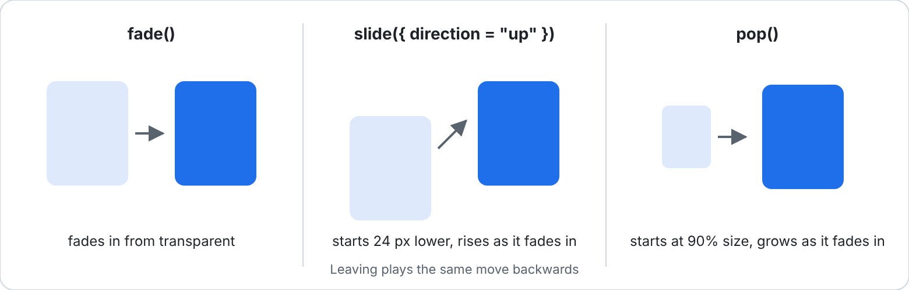
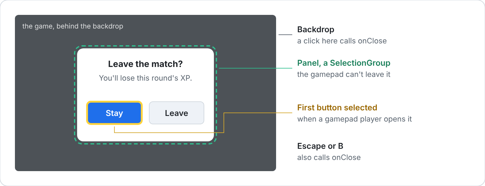
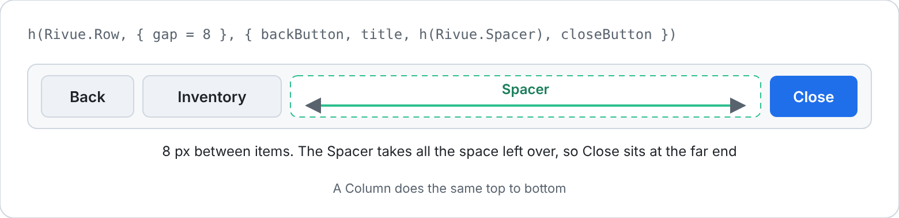

[Docs](../README.md) › [API](../API.md) › **Built-in components**

# Built-in components

**Learn it:** [Guide 7: Effects and animation](../guide/07-effects-and-animation.md) · [Guide 9: Performance and debugging](../guide/09-performance-and-debugging.md)

Components that ship with Rivue. Use them like any component: `h(Rivue.Transition, props, children)`.
All examples assume:

```lua
local Rivue = require(game.ReplicatedStorage.RivueUI)
local h = Rivue.h
```

- [Transition](#transition)
- [TransitionGroup](#transitiongroup)
- [KeepAlive](#keepalive)
- [Teleport](#teleport)
- [Suspense](#suspense)
- [VirtualList](#virtuallist)
- [ViewportModel](#viewportmodel)
- [transitions](#transitions)
- [ErrorBoundary](#errorboundary)
- [Dialog](#dialog)
- [Row, Column and Spacer](#row-column-and-spacer)

---

## Transition

Animates one element in when it appears and out before it's removed, using TweenService. Wrap the
element you toggle, and describe its hidden state with `from`.

- **Example**

  A panel that fades and slides in when opened, and back out when closed:

  ```lua
  local SettingsPanel = Rivue.defineComponent({
  	name = "SettingsPanel",
  	setup = function()
  		local open = Rivue.ref(false)
  		return {
  			open = open,
  			toggle = function()
  				open.value = not open.value
  			end,
  		}
  	end,
  	render = function(ctx)
  		return h("Frame", { Size = UDim2.fromScale(1, 1), BackgroundTransparency = 1 }, {
  			h("TextButton", { Text = "Settings", onClick = ctx.toggle }),
  			h(Rivue.Transition, {
  				tweenInfo = TweenInfo.new(0.2, Enum.EasingStyle.Quad),
  				-- The hidden state: tweened from when it appears, back to before it's destroyed
  				from = { BackgroundTransparency = 1, Position = UDim2.fromScale(0.5, 0.55) },
  			}, {
  				Rivue.hIf(
  					ctx.open,
  					h("Frame", {
  						AnchorPoint = Vector2.new(0.5, 0.5),
  						Position = UDim2.fromScale(0.5, 0.5),
  						Size = UDim2.fromOffset(300, 200),
  					})
  				),
  			}),
  		})
  	end,
  })
  ```

  Switching tabs, the old one fading out before the new one fades in (`mode = "out-in"`):

  ```lua
  local tab = Rivue.ref("Shop")

  h(Rivue.Transition, { mode = "out-in", tweenInfo = TweenInfo.new(0.15), from = { GroupTransparency = 1 } }, {
  	-- A new key means a new child, so changing tabs plays leave, then enter
  	h("CanvasGroup", { key = tab.value, Size = UDim2.fromScale(1, 1) }),
  })
  ```

  The same animation on a single element, with the `transition` prop:

  ```lua
  h("Frame", {
  	transition = {
  		tweenInfo = TweenInfo.new(0.3),
  		from = { BackgroundTransparency = 1 },
  		enter = true,
  		leave = true,
  	},
  })
  ```

- **Details**

  - **What triggers it.** Keep the `Transition` mounted and toggle its child (with `hIf`, an
    `if` expression, or a changing `key`).
  - **Entering.** The child starts at `from` and tweens back to its own prop values.
  - **Leaving.** The child tweens to `from`, stays on screen until the tween finishes, and is
    then destroyed. Leaving never blocks rendering.
  - **Component children.** A component child animates its root element.

  The same config can also be set per element with the `transition` prop. There, `enter = true`
  and `leave = true` turn each phase on.

- **Props**

  ```lua
  type TransitionProps = {
  	tweenInfo: TweenInfo?, -- used for both phases
  	enterInfo: TweenInfo?, -- overrides tweenInfo when entering
  	leaveInfo: TweenInfo?, -- overrides tweenInfo when leaving
  	from: { [string]: any }?, -- hidden state: applied before enter, tweened to on leave
  	enterFrom: { [string]: any }?, -- overrides `from` when entering
  	enterGoals: { [string]: any }?, -- explicit enter target (default: the element's own props)
  	leaveGoals: { [string]: any }?, -- explicit leave target (default: `from`)
  	appear: boolean?, -- also animate the first render (default false)
  	mode: "out-in"?, -- wait for the old child to leave before showing the new one
  	onBeforeEnter: ((el: Instance) -> ())?,
  	onAfterEnter: ((el: Instance) -> ())?,
  	onBeforeLeave: ((el: Instance) -> ())?,
  	onAfterLeave: ((el: Instance) -> ())?,
  }
  ```

---

## TransitionGroup

Transition for lists: each keyed item animates in when it's added and out when it's removed. Use it
for notifications, chat messages and inventories.

- **Example**

  ```lua
  local notifications = Rivue.ref({
  	{ id = 1, text = "Welcome!" },
  })

  h(Rivue.TransitionGroup, {
  	tag = "Frame",
  	tagProps = { Size = UDim2.new(0, 300, 1, 0), BackgroundTransparency = 1 },
  	tweenInfo = TweenInfo.new(0.2),
  	from = { BackgroundTransparency = 1, Size = UDim2.new(1, 0, 0, 0) },
  }, {
  	h("UIListLayout"),
  	Rivue.hFor(notifications.value, function(n)
  		return h("TextLabel", { key = n.id, Text = n.text, Size = UDim2.new(1, 0, 0, 40) })
  	end),
  })
  ```

- **Details**

  Every child must have a unique `key`. Added items enter, removed items leave, and items that
  stay are moved without animating.

- **Props**

  Same as [Transition](#transition) except `mode`, plus:

  ```lua
  type TransitionGroupProps = TransitionProps & {
  	tag: string?, -- wrap the items in this element (default: no wrapper)
  	tagProps: Props?, -- props for that element
  }
  ```

---

## KeepAlive

Keeps a component alive when it's switched out, instead of destroying it. Tabs and menus come back
exactly as the player left them: scroll position, typed text and state included.

- **Example**

  Tabs that keep their scroll position and state, except Settings, which always starts fresh:

  ```lua
  local Inventory = Rivue.defineComponent({ name = "Inventory", render = function() return h("ScrollingFrame") end })
  local Settings = Rivue.defineComponent({ name = "Settings", render = function() return h("Frame") end })

  local Menu = Rivue.defineComponent({
  	name = "Menu",
  	setup = function()
  		return { tab = Rivue.ref("inventory") }
  	end,
  	render = function(ctx)
  		return h(Rivue.KeepAlive, { max = 5, exclude = { "Settings" } }, {
  			if ctx.tab == "inventory" then h(Inventory) else h(Settings),
  		})
  	end,
  })
  ```

- **Details**

  - **Switching away.** The cached component's Instances are detached (Parent = nil) instead of
    destroyed, and its state is kept.
  - **Switching back.** The same Instances are re-attached. Re-renders triggered while cached run
    when it comes back.
  - **Cache key.** Entries are cached by `key`, or by component when there's no key.

  Cached components get [`onActivated`](lifecycle.md#onactivated) and
  [`onDeactivated`](lifecycle.md#ondeactivated).

- **Props**

  ```lua
  type KeepAliveProps = {
  	include: { string }?, -- only cache these component names
  	exclude: { string }?, -- never cache these
  	max: number?, -- most entries to keep, least recently used dropped first (default 10)
  }
  ```

---

## Teleport

Renders part of a component somewhere else in the game, usually a ScreenGui with a higher
DisplayOrder. Use it for modals, tooltips and dropdowns that must appear above everything.

- **Example**

  A confirm dialog that opens from inside a clipped shop frame but draws above everything:

  ```lua
  local overlay = Instance.new("ScreenGui")
  overlay.DisplayOrder = 100
  overlay.Parent = Players.LocalPlayer:WaitForChild("PlayerGui")

  local Shop = Rivue.defineComponent({
  	name = "Shop",
  	setup = function()
  		local confirming = Rivue.ref(false)
  		return {
  			confirming = confirming,
  			ask = function()
  				confirming.value = true
  			end,
  		}
  	end,
  	render = function(ctx)
  		return h("Frame", { ClipsDescendants = true, Size = UDim2.fromOffset(300, 300) }, {
  			h("TextButton", { Text = "Buy", onClick = ctx.ask }),
  			-- Rendered into the overlay, so the shop's clipping doesn't cut it off
  			h(Rivue.Teleport, { to = overlay }, {
  				Rivue.hIf(ctx.confirming, h("Frame", { Name = "ConfirmDialog", Size = UDim2.fromOffset(240, 120) })),
  			}),
  		})
  	end,
  })
  ```

- **Details**

  It also gets UI out from under a parent with `ClipsDescendants`.
  - Children update in place.
  - If `to` changes, the children move to the new target.
  - Children are removed when the Teleport unmounts.
  - With `defer = true`, `to` can point at something rendered later in the same tree.

- **Props**

  ```lua
  type TeleportProps = {
  	to: Instance | () -> Instance?, -- where to render (must be parented)
  	disabled: boolean?, -- render in place instead
  	defer: boolean?, -- wait until the rest of the tree is mounted to resolve `to`
  }
  ```

---

## Suspense

Shows something else (a spinner, "Loading...") while the async components inside it are still
loading, then swaps in the real content.

- **Example**

  ```lua
  local Profile = Rivue.defineAsyncComponent(function()
  	task.wait(1) -- e.g. waiting for data
  	return Rivue.defineComponent({
  		name = "ProfileLoaded",
  		render = function()
  			return h("TextLabel", { Text = "Player profile" })
  		end,
  	})
  end)

  h(Rivue.Suspense, { fallback = h("TextLabel", { Text = "Loading profile..." }) }, {
  	h(Profile),
  })
  ```

- **Details**

  - **While loading.** The children are mounted inside a hidden Frame, so async components can
    load, and the fallback shows on top.
  - **When everything has loaded,** the content becomes visible.
  - **On failure or timeout,** an error message is shown.

  Components made with [`defineAsyncComponent()`](component.md#defineasynccomponent) register
  themselves automatically.

- **Props**

  ```lua
  type SuspenseProps = {
  	fallback: VNode?, -- shown while loading (default: a "Loading..." label)
  	timeout: number?, -- ms before showing an error (default 5000)
  }
  ```

---

## VirtualList

A scrolling list or grid that only creates the rows you can see, so a list of 5,000 items costs
about as much as one of 20.

- **Example**

  ```lua
  local items = {}
  for i = 1, 5000 do
  	items[i] = { id = i, name = `Item {i}` }
  end

  h(Rivue.VirtualList, {
  	Size = UDim2.fromOffset(300, 400),
  	items = items,
  	itemSize = 40,
  	key = function(item)
  		return item.id
  	end,
  	render = function(item)
  		return h("TextLabel", { Size = UDim2.new(1, 0, 0, 40), Text = item.name })
  	end,
  })
  ```

  An inventory grid, four slots wide:

  ```lua
  h(Rivue.VirtualList, {
  	Size = UDim2.fromOffset(400, 500),
  	items = items,
  	itemSize = 90, -- row height
  	columns = 4,
  	gap = 8,
  	render = function(item)
  		return h("TextButton", { Text = item.name }) -- Size is set for you
  	end,
  })
  ```

  A chat feed where messages have different heights:

  ```lua
  local messages = {
  	{ text = "gg", lines = 1 },
  	{ text = "anyone want to trade? I have a sword and two potions", lines = 2 },
  }

  h(Rivue.VirtualList, {
  	Size = UDim2.fromOffset(300, 400),
  	items = messages,
  	itemSize = function(message)
  		return message.lines * 20 + 8
  	end,
  	render = function(message)
  		return h("TextLabel", {
  			Size = UDim2.new(1, 0, 0, message.lines * 20 + 8),
  			TextWrapped = true,
  			Text = message.text,
  		})
  	end,
  })
  ```

- **Details**

  - **Positions.** Rivue sets each row's `Position` and `key`. In a list, make rows fill the cross
    axis (`Size = UDim2.new(1, 0, 0, itemSize)`). In a grid it also sets `Size`, unless the row
    sets its own.
  - **Different sizes.** Pass `itemSize` as a function of the item. The sizes are worked out again
    when the items change, not while scrolling. It needs `columns = 1`.
  - **Cost.** Scrolling re-renders only the rows coming into view.

- **Props**

  ```lua
  type VirtualListProps<T> = {
  	items: { T }, -- plain or reactive array (required)
  	itemSize: number | (item: T, index: number) -> number, -- row height in pixels, or width when horizontal (required)
  	columns: number?, -- items per row, for a grid (default 1)
  	gap: number?, -- pixels between rows and between columns (default 0)
  	render: (item: T, index: number) -> VNode, -- (required)
  	key: ((item: T, index: number) -> unknown)?, -- default: the index
  	overscan: number?, -- extra rows rendered above and below (default 2)
  	horizontal: boolean?,
  	-- Any other prop (Size, Position, ...) goes to the ScrollingFrame
  }
  ```

---

## ViewportModel

Shows a 3D model in the UI, framed by a camera that fits it. For shop and inventory previews.

- **Example**

  ```lua
  local ItemPreview = Rivue.defineComponent({
  	name = "ItemPreview",
  	props = { model = { type = "Instance", required = true } },
  	render = function(ctx)
  		return h(Rivue.ViewportModel, {
  			model = ctx.model, -- e.g. ReplicatedStorage.Items.Sword
  			Size = UDim2.fromOffset(120, 120),
  			angle = 45,
  		})
  	end,
  })
  ```

- **Details**

  Clones the model (it must be `Archivable`) into a ViewportFrame with its own Camera. The camera
  sits on a sphere around the model's bounding box, `angle` degrees around and `pitch` degrees up,
  far enough back for the whole model to fit. Changing any prop, or passing another model,
  re-frames it. Other props, such as `Size`, go to the ViewportFrame.

- **Props**

  ```lua
  type ViewportModelProps = {
  	model: Model | BasePart, -- (required)
  	angle: number?, -- degrees around the model (default 30)
  	pitch: number?, -- degrees above it (default 20)
  	fieldOfView: number?, -- camera field of view (default 40)
  	distance: number?, -- 1 just fits, 2 is twice as far (default 1)
  }
  ```

---

## transitions

Ready-made props for [Transition](#transition), so a fade or a slide doesn't need its TweenInfo
and start values written out each time.



- **Example**

  A toast that slides up into view and back down when it goes:

  ```lua
  local Toast = Rivue.defineComponent({
  	name = "Toast",
  	props = { message = { type = "string" } },
  	render = function(ctx)
  		return h(Rivue.Transition, Rivue.transitions.slide({ direction = "up" }), {
  			Rivue.hIf(
  				ctx.message ~= nil,
  				h("TextLabel", {
  					Text = ctx.message,
  					Size = UDim2.fromOffset(260, 40),
  					Position = UDim2.new(0.5, -130, 1, -60),
  				})
  			),
  		})
  	end,
  })
  ```

- **Details**

  - `fade()` fades the element in and out. It covers every transparency an element can have, so
    the same preset works on a Frame, a TextLabel or an ImageButton. Children don't fade with
    their parent; to fade a whole panel at once, make it a `CanvasGroup`, whose
    `GroupTransparency` fades too.
  - `slide({ direction, distance })` moves the element in from `distance` pixels away (24 by
    default), fading as it goes. `direction` is the way it moves when it enters: `"up"`,
    `"down"`, `"left"` or `"right"`.
  - `pop({ scale })` grows the element from `scale` of its size (0.9 by default). It looks best
    with `AnchorPoint = Vector2.new(0.5, 0.5)`, so it grows from the centre.
  - All three take `duration` and `easing`, and `fade = false` turns the fading off for `slide`
    and `pop`. Any other option, such as `mode = "out-in"`, is passed on to the Transition.

  You can write your own the same way. A value in `from` can be a function: it gets the
  element's current value and returns the start value, which is how `slide` starts "24 pixels
  below wherever the element sits".

- **Type**

  ```lua
  transitions.fade(options: { duration: number?, easing: Enum.EasingStyle?, [string]: any }?): TransitionProps
  transitions.slide(options: { direction: ("up" | "down" | "left" | "right")?, distance: number?, fade: boolean?, ... }?): TransitionProps
  transitions.pop(options: { scale: number?, fade: boolean?, ... }?): TransitionProps
  ```

---

## ErrorBoundary

Shows a fallback instead of its children when something inside them throws, so one broken widget
doesn't take the rest of the screen with it.

- **Example**

  A shop panel that offers a retry if it fails:

  ```lua
  local ShopItems = Rivue.defineComponent({
  	name = "ShopItems",
  	render = function()
  		return h("Frame")
  	end,
  })

  local ShopPanel = Rivue.defineComponent({
  	name = "ShopPanel",
  	render = function()
  		return h(Rivue.ErrorBoundary, {
  			onError = function(message)
  				warn("Shop failed:", message)
  			end,
  			fallback = function(_message, reset)
  				return h("TextButton", { Text = "The shop didn't load. Tap to try again", onActivated = reset })
  			end,
  		}, {
  			h(ShopItems),
  		})
  	end,
  })
  ```

- **Details**

  - It catches what [`onErrorCaptured()`](lifecycle.md#onerrorcaptured) catches: errors in
    descendants' render, lifecycle hooks and emit handlers.
  - `fallback` is a vnode, or a function of `(message, reset)` that returns one. `reset()` clears
    the error and mounts the children again.
  - `onError(message, info)` runs first, for logging.
  - The error stops at the boundary, so it doesn't reach `app.config.errorHandler`.

- **Props**

  ```lua
  type ErrorBoundaryProps = {
  	fallback: VNode | ((message: string, reset: () -> ()) -> VNode?)?,
  	onError: ((message: string, info: string) -> ())?,
  }
  ```

---

## Dialog

A modal: a dark backdrop over the screen, with your content in the middle.



- **Example**

  A confirm prompt that closes on Stay, a backdrop click, Escape or B:

  ```lua
  local LeaveButton = Rivue.defineComponent({
  	name = "LeaveButton",
  	setup = function()
  		local asking = Rivue.ref(false)
  		return {
  			asking = asking,
  			ask = function()
  				asking.value = true
  			end,
  			close = function()
  				asking.value = false
  			end,
  		}
  	end,
  	render = function(ctx)
  		return h("Frame", { Size = UDim2.fromScale(1, 1), BackgroundTransparency = 1 }, {
  			h("TextButton", { Text = "Leave match", onActivated = ctx.ask }),
  			h(Rivue.Dialog, { open = ctx.asking, onClose = ctx.close, transition = Rivue.transitions.pop() }, {
  				h(Rivue.Column, { gap = 12 }, {
  					h("TextLabel", { Text = "Leave the match?", Size = UDim2.fromOffset(220, 30) }),
  					h("TextButton", { Text = "Stay", Size = UDim2.fromOffset(100, 36), onActivated = ctx.close }),
  				}),
  			}),
  		})
  	end,
  })
  ```

- **Details**

  - The dialog renders while `open` is true. It never closes itself: a backdrop click, Escape
    and the gamepad's B button call `onClose`, and you set `open` to false.
  - While it's open, the gamepad can't move out of the panel (it's a `SelectionGroup`), and a
    gamepad player starts on its first button. When it closes, the selection goes back where it
    was.
  - It covers its parent, so render it inside a full-screen ScreenGui, or move it there with
    [Teleport](#teleport).
  - `transition` takes Transition props such as `Rivue.transitions.pop()` and animates the panel.

- **Props**

  ```lua
  type DialogProps = {
  	open: boolean,
  	onClose: (() -> ())?,
  	closeOnBackdrop: boolean?, -- default true
  	closeOnEscape: boolean?, -- Escape and B, default true
  	backdropColor: Color3?, -- default black
  	backdropTransparency: number?, -- default 0.4
  	zIndex: number?, -- default 100
  	transition: TransitionProps?,
  }
  ```

---

## Row, Column and Spacer

Layout without writing out a `layout` table. A Row lays its children left to right, a Column top
to bottom, and a Spacer takes up whatever room is left.



- **Example**

  A title bar with the close button pushed to the right:

  ```lua
  local TitleBar = Rivue.defineComponent({
  	name = "TitleBar",
  	render = function()
  		return h(Rivue.Row, { gap = 8, align = "center", Size = UDim2.new(1, 0, 0, 40) }, {
  			h("TextButton", { Text = "Back", Size = UDim2.fromOffset(80, 32) }),
  			h("TextLabel", { Text = "Inventory", Size = UDim2.fromOffset(120, 32) }),
  			h(Rivue.Spacer),
  			h("TextButton", { Text = "Close", Size = UDim2.fromOffset(80, 32) }),
  		})
  	end,
  })
  ```

- **Details**

  - `gap`, `align`, `justify` and `wrap` mean the same as in the [`layout`
    prop](render-function.md#element-props).
  - Every other prop (`Size`, `Position`, `Name`, a `class`) goes to the Frame. A Row fills the
    width and grows to fit its children's height; a Column the other way round.
  - A Spacer is an empty Frame with `flex = "fill"`, so it only works inside a Row or Column (or
    any `layout`).

- **Props**

  ```lua
  type RowProps = {
  	gap: (number | UDim)?,
  	align: ("start" | "center" | "end")?,
  	justify: ("start" | "center" | "end" | "space-between" | "space-around" | "space-evenly" | "fill")?,
  	wrap: boolean?,
  }
  -- Column takes the same props. Spacer takes none.
  ```

---

[← Lifecycle hooks](lifecycle.md) · [API reference](../API.md) · [Directives →](directives.md)
