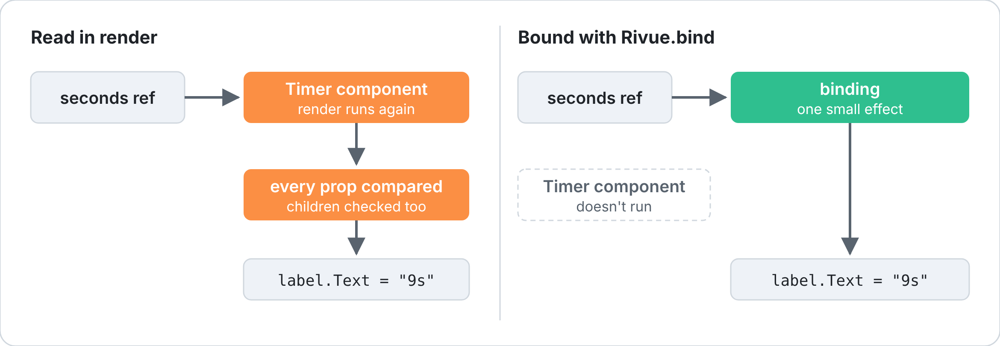

[Docs](../README.md) › [API](../API.md) › **Render function**

# Render function

**Learn it:** [Guide 3: Describing UI](../guide/03-describing-ui.md) · [Guide 6: Styling and layout](../guide/06-styling-and-layout.md)

Rivue has no templates: components return a tree of vnodes built with `h()`. Examples assume:

```lua
local Rivue = require(game.ReplicatedStorage.RivueUI)
local h = Rivue.h
```

---

## h()

Describes one Instance or component, with its props and children. Every render is built from these
calls.

```lua signature
function h(type: VNodeType, props: Props?, children: Children?): VNode
```

| Parameter | Type | Default | Description |
|---|---|---|---|
| `type` | `string \| ComponentDef \| function \| Fragment` | | a ClassName like `"Frame"`, a name registered with `app:component()`, a component, a [function component](#function-components) or [`Fragment`](#fragment) |
| `props` | `Props?` | | properties, events and Rivue's own props; see [Element props](#element-props) |
| `children` | `Children?` | | a list, a single vnode, or a string or number; a table with string keys passes [named slots](component.md#slots) to a component |

**Returns** a `VNode`.

> [!NOTE]
> An unknown ClassName warns and renders a Frame instead.

### Example

```lua
h("Frame", { Size = UDim2.fromScale(1, 1), BackgroundTransparency = 1 }, {
	h("UIListLayout", { Padding = UDim.new(0, 8) }),
	h("TextLabel", { Text = "Title" }),
	h("TextButton", {
		Text = "Close",
		onClick = function()
			print("closed")
		end,
	}),
})

-- text as the child
h("TextLabel", nil, "Hello")

-- a component with props
local Badge = Rivue.defineComponent({
	name = "Badge",
	props = { text = { type = "string" } },
	render = function(props)
		return h("TextLabel", { Text = props.text })
	end,
})
h(Badge, { text = "NEW" })
```

### Details

- A string or number child sets `Text` on a TextLabel, TextButton or TextBox.
- A nested list, such as the result of `hFor`, becomes a [Fragment](#fragment), so its keyed diff
  stays separate from its siblings.
- `nil` and `false` children are skipped.

### Hoisting static parts

A part of the UI that never changes can be built once, outside `render`, and reused. When a
render returns the same vnode table as last time, Rivue skips it without comparing anything. Vue's
template compiler hoists static parts the same way.

```lua
local header = h("TextLabel", { Name = "Header", Text = "Shop" })

local Shop = Rivue.defineComponent({
	name = "Shop",
	setup = function()
		local coins = Rivue.ref(0)
		return function()
			return h("Frame", nil, {
				header,
				h("TextLabel", { Name = "Coins", Text = tostring(coins.value) }),
			})
		end
	end,
})
```

- A hoisted vnode can appear more than once, in one tree or in several apps. Each place gets its
  own Instance.
- It can hold a bound ref, such as `Text = titleRef`, and every copy keeps updating.
- Only hoist what doesn't read state while it's built: a hoisted `Text = tostring(coins.value)`
  would keep the value it had when the module loaded.

---

## Element props

Everything an element's props table can hold.

| Prop | Type | Default | Description |
|---|---|---|---|
| `Size`, `Text`, ... | | | Instance properties; camelCase (`size`) works too |
| `onX` | `(...) -> ()` | | connects event `X`: `onMouseEnter`, `onFocusLost`, `onInputBegan`, ... |
| `onClick` | `() -> ()` | | `Activated` on buttons, falling back to `MouseButton1Click` |
| `onTextChanged` | `(text: string) -> ()` | | called with the new `Text` |
| `onXChanged` | `(value) -> ()` | | for a property `X` that isn't an event, called with the new value: `onSizeChanged`, `onVisible` |
| `key` | `string \| number` | | identity among siblings; a new key replaces the element |
| `ref` | `Ref \| function \| string` | | gives code the Instance; see [template refs](component.md#usetemplateref) |
| `vName` | `any` | | a [directive](directives.md): `vShow`, `vFocus`, `vClickOutside`, `vSelect`, `vDrag`, ... |
| `model` | `Ref<string> \| string` | | two-way `Text` binding on a TextBox; a string names a ref returned by `setup()` |
| `modelModifiers` | `{ trim, number, lazy }` | | with `model`: `trim` strips spaces, `number` stores a number when the text is one, `lazy` writes on focus lost instead of every key |
| `models` | `{ [string]: Ref }` | | on a component: several named models, paired with [`defineModel({ name })`](component.md#definemodel) in the child |
| `class` | `string \| { string } \| { [string]: boolean }` | | named styles from [`styles`](component.md#styles) and [`app:styles()`](application.md#appstyles) |
| `style` | `table \| { table }` | | prop tables merged under the element's own props; `false` and `nil` entries are skipped |
| `memo` | `{ any }` | | skip patching this element and its children while every value is `==` to last time |
| `vOnce` | `boolean` | `false` | render once and never patch again; the same as `memo = {}` |
| `disabled` | `boolean` | `false` | apply the classes' `disabled` variants, set `Interactable = false`, and turn hover and pressed styles off |
| `transition` | `TransitionProps` | | enter and leave tweens for this element; see [Transition](builtins.md#transition) |
| `cornerRadius` | `number \| UDim` | | creates a `UICorner` |
| `padding` | `number \| UDim \| { top, right, bottom, left } \| { x, y }` | | creates a `UIPadding` |
| `stroke` | `Color3 \| number \| table` | | creates a `UIStroke`: a colour, a thickness, or UIStroke properties |
| `aspectRatio` | `number` | | creates a `UIAspectRatioConstraint` |
| `layout` | `string \| table` | | creates a `UIListLayout` or `UIGridLayout`; see below |
| `flex` | `"fill" \| "grow" \| "shrink" \| "none" \| number \| table` | | creates a `UIFlexItem`; a number is the grow ratio |
| `gradient` | `Color3 \| ColorSequence \| table` | | creates a `UIGradient`; a table is `{ from, to, rotation, transparency, offset }` |
| `scale` | `number` | | creates a `UIScale` |
| `sizeLimit` | `{ min: Vector2?, max: Vector2? }` | | creates a `UISizeConstraint` |
| `textSizeLimit` | `{ min: number?, max: number? }` | | creates a `UITextSizeConstraint`, for `TextScaled` text |

Any Instance property or Rivue prop can also take a ref or a [`bind()`](#bind), to update without
re-rendering.

| Field | Type | Default | Description |
|---|---|---|---|
| `layout` | `"vertical" \| "horizontal"` | | a `UIListLayout` in that direction |
| `layout` | `"grid"` | | a `UIGridLayout` |
| `layout.direction` | `"vertical" \| "horizontal"` | `"vertical"` | the list direction |
| `layout.gap` | `number \| UDim` | | space between children |
| `layout.align` | `"start" \| "center" \| "end"` | | the cross axis |
| `layout.justify` | `"start" \| "center" \| "end" \| "space-between" \| "space-around" \| "space-evenly" \| "fill"` | | the main axis |
| `layout.wrap` | `boolean` | `false` | wrap onto more lines |
| `layout.grid` | `UDim2` | | a `UIGridLayout` with this cell size |

> [!NOTE]
> An error in an event handler is caught and reported with the component it came from, so it
> doesn't stop other handlers.

### Example

```lua
local name = Rivue.ref("")
local Styles = {
	card = { BackgroundColor3 = Color3.fromRGB(30, 30, 30), cornerRadius = 8, padding = 12 },
}

h("Frame", { style = Styles.card, Size = UDim2.fromOffset(300, 120), layout = { gap = 6 } }, {
	h("TextBox", { model = name, vFocus = true, PlaceholderText = "Name" }),
	h("TextLabel", {
		Text = `Hello {name.value}`,
		onSizeChanged = function(size: UDim2)
			print("resized", size)
		end,
	}),
})

-- a toolbar: title on the left, buttons on the right
local isFull = false
h("Frame", { Size = UDim2.new(1, 0, 0, 40), layout = { direction = "horizontal", justify = "space-between", align = "center" } }, {
	h("TextLabel", { Text = "Inventory", flex = "fill" }),
	h("TextButton", { class = { "button", isFull and "button-disabled" }, Text = "Sort" }),
})
```

### Details

- Props are diffed shallowly and only changed ones are written. Removing a prop restores the
  property's default, or destroys the child it created.
- Each event is connected once. A new handler function on a re-render is swapped in place.
- A TextBox keeps what the player typed, the cursor and focus across re-renders, unless the render
  passes a different `Text`. With `onTextChanged` or `model`, state always owns `Text`.
- With a `layout` prop, or a UI*Layout among the children, Rivue keeps each child's `LayoutOrder`
  in render order. A child that sets `LayoutOrder` itself keeps it.
- `class` as a list applies in order, later entries winning. As a map, enabled names apply in
  alphabetical order, so use a list when order matters. From lowest to highest: app styles,
  component styles, `style`, then the element's own props. A component's root also gets the
  `class` its parent passed.

---

## bind()

Ties one property to state, so Rivue updates that property alone instead of re-rendering the
component. Meant for values that change many times a second, like a countdown or a health bar.



```lua signature
function bind<T>(getter: () -> T): T
```

| Parameter | Type | Default | Description |
|---|---|---|---|
| `getter` | `() -> T` | | works out the property's value; what it reads is tracked by the binding, not by render |

**Returns** a binding to use as a prop value. Passing something that isn't a function errors.

### Example

```lua
local RoundTimer = Rivue.defineComponent({
	name = "RoundTimer",
	setup = function()
		local seconds = Rivue.ref(90)
		task.spawn(function()
			while seconds.value > 0 do
				task.wait(1)
				seconds.value -= 1
			end
		end)
		return { seconds = seconds }
	end,
	render = function(ctx)
		return h("TextLabel", {
			Size = UDim2.fromOffset(120, 40),
			Text = Rivue.bind(function()
				return `{ctx.seconds}s left`
			end),
		})
	end,
})
```

### Details

- A ref works as a binding without `bind()`: `TextTransparency = fadeRef`. Inside `render(ctx)`
  refs come out of `ctx` already unwrapped, so wrap the read in `bind()` there.
- Replacing a binding with a plain value stops it, and unmounting stops every binding.
- Bindings work on Instance properties and on Rivue's own props such as `cornerRadius` or `scale`,
  but not on event handlers.

---

## Fragment

Groups several elements without an Instance around them, for components that return more than
one root.

```lua signature
Rivue.Fragment: FragmentType
```

### Example

```lua
-- both labels are parented straight to whatever this renders into
h(Rivue.Fragment, nil, {
	h("TextLabel", { Text = "One" }),
	h("TextLabel", { Text = "Two" }),
})
```

### Details

- Nested lists in children become Fragments on their own, and a render function can return a list
  instead of one vnode.

---

## hIf()

Includes an element only when a condition is true: a shorter `if cond then h(...) else nil` inside
a children list.

```lua signature
function hIf(condition: boolean, vnode: VNode?): VNode?
```

| Parameter | Type | Default | Description |
|---|---|---|---|
| `condition` | `boolean` | | whether to include it |
| `vnode` | `VNode?` | | the element |

> [!NOTE]
> The vnode is built either way. When building it is expensive, use an `if` expression.

### Example

```lua
local loading = Rivue.ref(true)

h("Frame", nil, {
	h("TextLabel", { Text = "Inventory" }),
	Rivue.hIf(loading.value, h("TextLabel", { Text = "Loading..." })),
})
```

---

## hFor()

One element per list item. Works with plain and reactive lists, and the result goes straight into a
children list.

```lua signature
function hFor<T>(list: { T }, mapper: (item: T, index: number) -> VNode?): { VNode }
```

| Parameter | Type | Default | Description |
|---|---|---|---|
| `list` | `{ T }` | | the items |
| `mapper` | `(item, index) -> VNode?` | | returns the element for an item, or `nil` to skip it |

> [!WARNING]
> Give each element a `key` that belongs to the item, like an id. Without keys, reordering the list
> re-patches every item, and Rivue warns in Studio.

### Example

```lua
local items = Rivue.ref({
	{ id = 1, name = "Sword" },
	{ id = 2, name = "Shield" },
})

h("ScrollingFrame", nil, {
	h("UIListLayout"),
	Rivue.hFor(items.value, function(item)
		return h("TextLabel", { key = item.id, Text = item.name })
	end),
})
```

---

## mergeProps()

Combines props tables into one, chaining event handlers so both run. Safe for wrapper components
that add their own handlers.

```lua signature
function mergeProps(...: Props?): Props
```

| Parameter | Type | Default | Description |
|---|---|---|---|
| `...` | `Props?` | | tables merged left to right; `nil` is skipped |

**Returns** a new props table: `on*` handlers chained, `__directives` and `style` combined, and
everything else taken from the later table.

### Example

```lua
local base = {
	Size = UDim2.fromOffset(100, 40),
	onClick = function()
		print("base")
	end,
}
local extra = {
	Size = UDim2.fromOffset(200, 40),
	onClick = function()
		print("extra")
	end,
}

local merged = Rivue.mergeProps(base, extra)
-- merged.Size is 200x40, and clicking prints "base" then "extra"
h("TextButton", merged)
```

---

## cloneVNode()

Copies an element description, optionally with extra props. For wrapper components that adjust the
children they were given.

```lua signature
function cloneVNode(vnode: VNode, extraProps: Props?): VNode
```

| Parameter | Type | Default | Description |
|---|---|---|---|
| `vnode` | `VNode` | | the element to copy; children, slots and key are kept |
| `extraProps` | `Props?` | | merged over its props |

### Example

```lua
local Highlight = Rivue.defineComponent({
	name = "Highlight",
	render = function(ctx)
		local child = ctx.slots[1]
		if not Rivue.isVNode(child) then
			return nil
		end
		return Rivue.cloneVNode(child :: Rivue.VNode, { stroke = Color3.fromRGB(255, 220, 0) })
	end,
})

h(Highlight, nil, { h("ImageButton", { Size = UDim2.fromOffset(64, 64) }) })
```

---

## isVNode()

Whether a value is an element description made by `h()`.

```lua signature
function isVNode(value: unknown): boolean
```

| Parameter | Type | Default | Description |
|---|---|---|---|
| `value` | `unknown` | | anything |

### Example

```lua
print(Rivue.isVNode(h("Frame"))) -- true
print(Rivue.isVNode({ type = "Frame" })) -- false
```

---

## resolveComponent()

Looks up a component registered with [`app:component()`](application.md#appcomponent) or the
current component's `components` option. You rarely need it: `h("Name")` resolves names itself.

```lua signature
function resolveComponent(name: string): ComponentDef?
```

| Parameter | Type | Default | Description |
|---|---|---|---|
| `name` | `string` | | the registered name |

**Returns** the component, or `nil`. In Studio a missing name warns.

> [!WARNING]
> Call it in `setup()` or a render function. Anywhere else it errors.

### Example

```lua
local Toolbar = Rivue.defineComponent({
	name = "Toolbar",
	setup = function()
		return { Icon = Rivue.resolveComponent("Icon") }
	end,
	render = function(ctx)
		return h("Frame", { layout = "horizontal" }, {
			if ctx.Icon then h(ctx.Icon, { name = "settings" }) else h("TextLabel", { Text = "Settings" }),
		})
	end,
})
```

---

## Function components

A function from props to UI, with no state and no hooks. Use one for small display pieces like a
badge or an icon.

```lua signature
type FunctionalComponent = (props: Props) -> VNode?
```

> [!NOTE]
> It runs again every time its parent re-renders. Once it needs state or lifecycle hooks, use
> [`defineComponent()`](component.md#definecomponent).

### Example

```lua
local function Pill(props)
	return h("TextLabel", {
		Text = props.text,
		Size = UDim2.fromOffset(80, 24),
		cornerRadius = 12,
	})
end

h(Pill, { text = "Online" })
```

---

[← Reactivity: Advanced](reactivity-advanced.md) · [API reference](../API.md) · [Components →](component.md)
