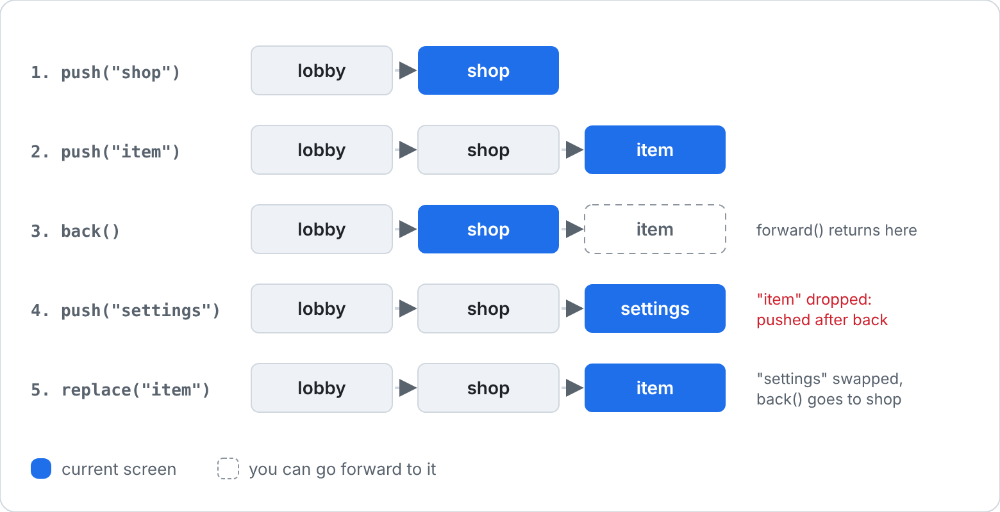

[Docs](../README.md) › [API](../API.md) › **RivueRouter**

# RivueRouter

**Learn it:** [Guide 17: Screens and navigation](../guide/17-screens-and-navigation.md)

Screens with history, like a small Vue Router. It's a separate package, the way Vue Router is
separate from Vue: install `RivueRouter` next to `RivueUI`, in the same Packages folder or both in
ReplicatedStorage. It uses the Rivue your game already requires. All examples assume
`local Router = require(game.ReplicatedStorage.RivueRouter)`.

- [Router.createRouter()](#routercreaterouter)
- [Router.RouterView](#routerrouterview)
- [Router.useRouter()](#routeruserouter)

---

## Router.createRouter()

Screens with history, like a small Vue Router: you name each screen, move between them with
`push`, and go `back` and `forward`. There are no URLs, since Roblox UI has none.

- **Example**

  A menu that opens an item screen and comes back:

  ```lua
  local Home = Rivue.defineComponent({
  	name = "Home",
  	setup = function()
  		local router = Router.useRouter()
  		return {
  			open = function()
  				router.push("item", { id = 7 })
  			end,
  		}
  	end,
  	render = function(ctx)
  		return h("TextButton", { Text = "Open item 7", onClick = ctx.open })
  	end,
  })

  local Item = Rivue.defineComponent({
  	name = "Item",
  	props = { id = { type = "number", required = true } },
  	setup = function()
  		local router = Router.useRouter()
  		return { back = router.back }
  	end,
  	render = function(ctx)
  		return h("TextButton", { Text = `Item {ctx.id}, tap to go back`, onClick = ctx.back })
  	end,
  })

  local router = Router.createRouter({
  	routes = { home = Home, item = Item },
  	initial = "home",
  })

  local App = Rivue.defineComponent({
  	name = "App",
  	render = function()
  		return h("ScreenGui", { ResetOnSpawn = false }, { h(Router.RouterView) })
  	end,
  })

  local app = Rivue.createApp(App)
  app:use(router)
  app:mount(Instance.new("Folder"))
  ```

- **Details**

  

  - `push(name, params)` adds a screen to the history. `params` reach the screen's component as
    props. Pushing after going back drops the screens you could have gone forward to.
  - `replace(name, params)` swaps the current screen, so `back` skips it. Good for a login screen
    you never want to return to.
  - `back()` and `forward()` return `false` when there's nowhere to go. `canGoBack` and
    `canGoForward` are refs, for greying out buttons.
  - `current` is a ref holding `{ name, params }`.
  - `beforeEach(guard)` runs before every move. Return `false` from it to cancel, for example
    while a form has unsaved changes. It returns a function that removes the guard.
  - An unknown route name errors and lists the routes there are.

- **Type**

  ```lua
  function createRouter(options: {
  	routes: { [string]: ComponentDef },
  	initial: string,
  	initialParams: { [string]: any }?,
  }): Router

  type Router = {
  	current: Ref<{ name: string, params: { [string]: any } }>,
  	canGoBack: Ref<boolean>,
  	canGoForward: Ref<boolean>,
  	push: (name: string, params: { [string]: any }?) -> boolean,
  	replace: (name: string, params: { [string]: any }?) -> boolean,
  	back: () -> boolean,
  	forward: () -> boolean,
  	beforeEach: (guard: (to: Route, from: Route) -> boolean?) -> () -> (),
  }
  ```

---

## Router.RouterView

Renders the current screen, with the route's params as props. Put it where screens should appear.

- **Example**

  Keep the shop's scroll position and search when the player opens an item and comes back:

  ```lua
  local Layout = Rivue.defineComponent({
  	name = "Layout",
  	render = function()
  		return h("Frame", { Size = UDim2.fromScale(1, 1) }, {
  			h(Router.RouterView, { keepAlive = true }),
  		})
  	end,
  })
  ```

- **Details**

  With `keepAlive = true`, screens you leave stay alive in a [KeepAlive](builtins.md#keepalive),
  so their state is still there when you come back. Two routes that share a component still get
  separate instances.

- **Props**

  ```lua
  type RouterViewProps = {
  	keepAlive: boolean?,
  }
  ```

---

## Router.useRouter()

The router installed with `app:use(router)`. Call it in `setup()`.

- **Example**

  A back button that hides when there's nothing to go back to:

  ```lua
  local BackButton = Rivue.defineComponent({
  	name = "BackButton",
  	setup = function()
  		local router = Router.useRouter()
  		return { canGoBack = router.canGoBack, back = router.back }
  	end,
  	render = function(ctx)
  		return h("TextButton", { Text = "Back", Visible = ctx.canGoBack, onClick = ctx.back })
  	end,
  })
  ```

- **Details**

  Errors if no router was installed, so a missing `app:use(router)` shows up straight away.

- **Type**

  ```lua
  function useRouter(): Router
  ```

---

[← RivueRemote](remote.md) · [API reference](../API.md) · [Instance pool →](pool.md)
