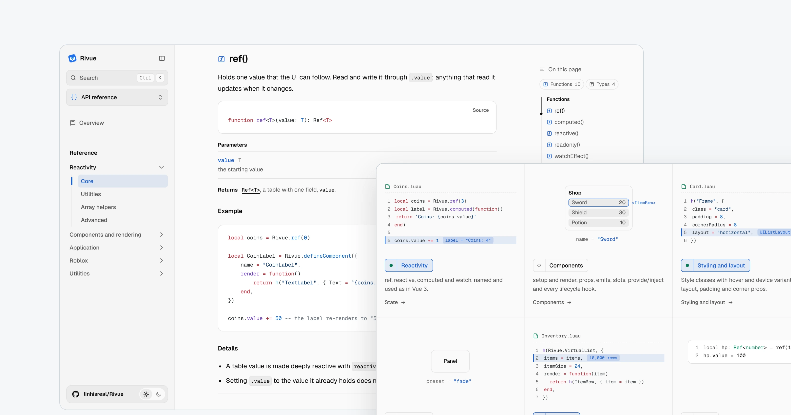

# The docs, rebuilt

The docs used to be stock VitePress: one sidebar holding the guide and the whole API, API entries
written as paragraphs, and diagrams that were white cards in dark mode. Finding one function meant
scrolling past everything else. This post covers what changed and where things are now.

## Finding your way

The Guide, the API reference, the Examples and this blog each have their own sidebar, and the
switcher at the top of the sidebar moves between them. Guide chapters are grouped into folders
(Basics, Styling and motion, Building a game), so the list stays short until you open one.

On desktop you can hide the sidebar and peek at it from the left edge. On phones the top bar stays
on screen while you scroll, and search is one tap away.

"On this page" draws a line through the headings and highlights every section that's on screen, so
you can see how much of a long chapter is left.

## One format for API entries

Every entry in the [API reference](../API.md) has the same parts: the signature with a link to its
source in `packages/`, one row per parameter (option fields sit under their parameter), what it
returns, an example and the details. Labels like `server · yields` sit under the name, and type
names link to where the type is documented.

The outline on API pages shows what each entry is, a function, a component or a type, and you can
filter to just one kind.

The Markdown behind it is still plain: a `lua signature` block, a table and a **Returns** line, so
the pages read fine on GitHub too. `check-docs` runs every example on every page, 229 of them, so
the code you copy works.

## A landing page that shows the code

The [home page](../README.md) now has a Studio-style Shop demo: click the buttons and the Explorer
shows which components re-render and which properties Rivue writes. Under it, each feature cell
flips over to the Luau behind it, with the line that matters highlighted. There's also the same
counter in Vue, Rivue, React-lua and Fusion side by side.

## Smaller things

- Every diagram has a dark version, so they don't glare in dark mode.
- Guide chapters end with a "Try it / Reference" block that links the example and the API entries
  the chapter used.
- Each page has Copy Markdown and an Open menu for GitHub, and the whole site is in
  [llms.txt](https://linhisreal.github.io/Rivue/llms.txt) for AI tools.
- A missing page gets a 404 that suggests the closest pages.
- This blog has an [RSS feed](https://linhisreal.github.io/Rivue/feed.xml).

Next up is Rivue 1.0.0. Its release notes will be posted here.
