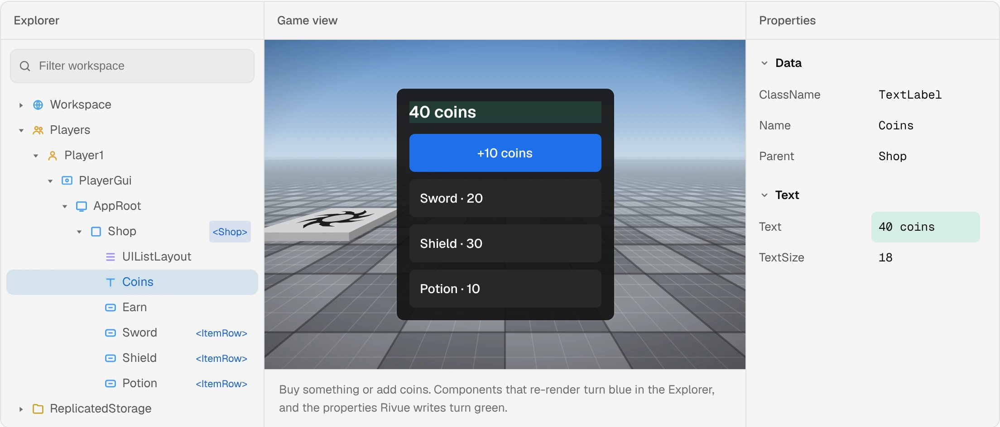

# The docs, rebuilt


The old docs were stock VitePress. One sidebar held the guide and the whole API, API entries were
written as paragraphs, and the diagrams showed up as white cards in dark mode. Looking up one
function meant scrolling past everything else, which got old fast. So I rebuilt most of it.

## Finding your way

The [Guide](../GUIDE.md), the [API reference](../API.md) and the Examples each have their own
sidebar now. Use the switcher at the top of the sidebar to move between them. Guide chapters sit in
folders (Basics, Styling and motion, Building a game), so the list stays short until you open one.
The Guide page also shows every chapter as a card and ticks off the ones you've read.

On desktop you can hide the sidebar and peek at it from the left edge. On phones the top bar
follows you down the page, and search is one tap away.

"On this page" draws a line through the headings and lights up every section on screen, which
tells you how much of a long chapter is left.


## One format for API entries

Every entry in the API reference follows the same layout: the signature with a link to its
source in `packages/`, a row per parameter (option fields go under their parameter), the return
value, an example and the details. Labels like `server · yields` sit under the name, and type
names link to where the type is documented.

The Markdown behind it stays plain, so the pages read fine on GitHub too. This is the top of the
entry for [`ref()`](../api/reactivity-core.md#ref):

````md
## ref()

```lua signature
function ref<T>(value: T): Ref<T>
```

| Parameter | Type | Default | Description |
|---|---|---|---|
| `value` | `T` | | the starting value |
````

The site turns that into a signature card and parameter rows. On API pages the outline marks
each entry as a function, a component or a type, and you can filter it down to one kind.

`check-docs` runs every Luau example in the docs, 229 of them right now, and CI runs it on every
pull request and every push to `main`. A broken example fails CI.

## A landing page that shows the code

The [home page](../README.md) opens with a small Shop laid out like Studio: an Explorer, a game
view and a Properties panel. Click **+10 coins** or buy an item, and the Explorer marks the
components that re-rendered in blue while Properties marks the values Rivue wrote in green. The
code behind it is the [Shop example](../../examples/components/Shop.luau).



Below it, each feature cell flips over to a short Luau file, and one counter is written in Vue,
Rivue, React-lua and Fusion side by side. If you're coming from Vue, the
[Vue cheat sheet](../VUE.md) maps each Vue API to its Rivue name.

## Smaller things

- Every diagram has a dark version, so nothing glares at you in dark mode.
- Guide chapters end with a "Try it / Reference" block linking the example and the API entries the
  chapter used.
- Each page has Copy Markdown and an Open menu for GitHub, and the whole site is in
  [llms.txt](https://linhisreal.github.io/Rivue/llms.txt) for AI tools.
- A missing page gets a 404 that suggests the closest pages.

Rivue 1.0.0 is next, and its release notes will go up here.
