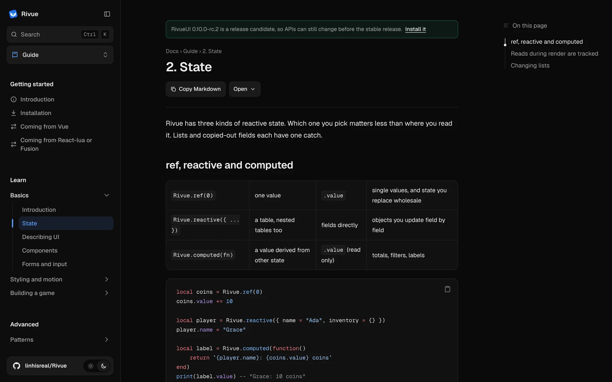
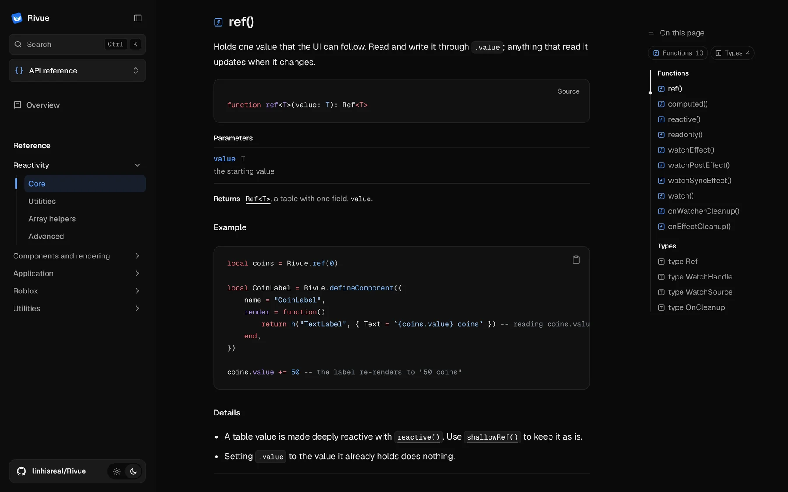
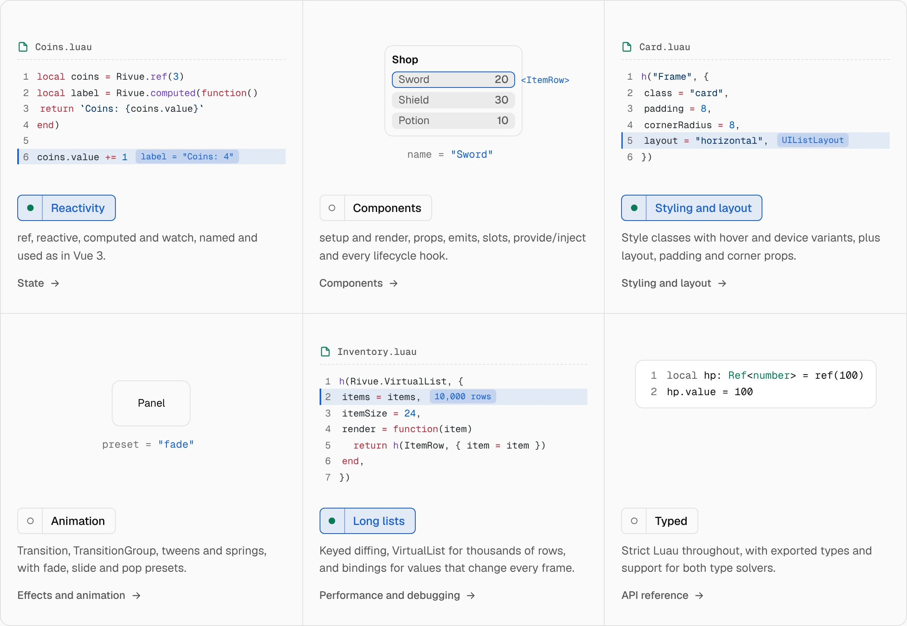

# The docs, rebuilt

The old docs were stock VitePress. One sidebar held the guide and the whole API, API entries were
written as paragraphs, and the diagrams showed up as white cards in dark mode. If you wanted one
function, you scrolled past everything else to find it.

## Finding your way

The Guide, the API reference and the Examples each have their own sidebar now. Use the switcher at
the top of the sidebar to move between them. Guide chapters sit in folders (Basics, Styling and
motion, Building a game), so the list stays short until you open one.

On desktop you can hide the sidebar and peek at it from the left edge. On phones the top bar
follows you down the page, and search is one tap away.

"On this page" draws a line through the headings and lights up every section on screen, which
tells you how much of a long chapter is left.

## One format for API entries

Every entry in the [API reference](../API.md) follows the same layout: the signature with a link
to its source in `packages/`, a row per parameter (option fields go under their parameter), the
return value, an example and the details. Labels like `server · yields` sit under the name, and
type names link to where the type is documented.

On API pages the outline marks each entry as a function, a component or a type, and you can
filter it down to one kind.

The Markdown behind all this is still plain: a `lua signature` block, a table and a **Returns**
line, so the pages read fine on GitHub too. `check-docs` runs all 229 examples across the site, so
the code you copy should work.

## A landing page that shows the code

The [home page](../README.md) has a Studio-style Shop demo. Click its buttons and the Explorer
shows which components re-render and which properties Rivue writes. Below that, each feature cell
flips over to the Luau behind it, with the important line highlighted. There's also one counter
written in Vue, Rivue, React-lua and Fusion, side by side.

## Smaller things

- Every diagram has a dark version, so nothing glares at you in dark mode.
- Guide chapters end with a "Try it / Reference" block linking the example and the API entries the
  chapter used.
- Each page has Copy Markdown and an Open menu for GitHub, and the whole site is in
  [llms.txt](https://linhisreal.github.io/Rivue/llms.txt) for AI tools.
- A missing page gets a 404 that suggests the closest pages.
- This blog has an [RSS feed](https://linhisreal.github.io/Rivue/feed.xml).

Rivue 1.0.0 is next, and its release notes will go up here.
