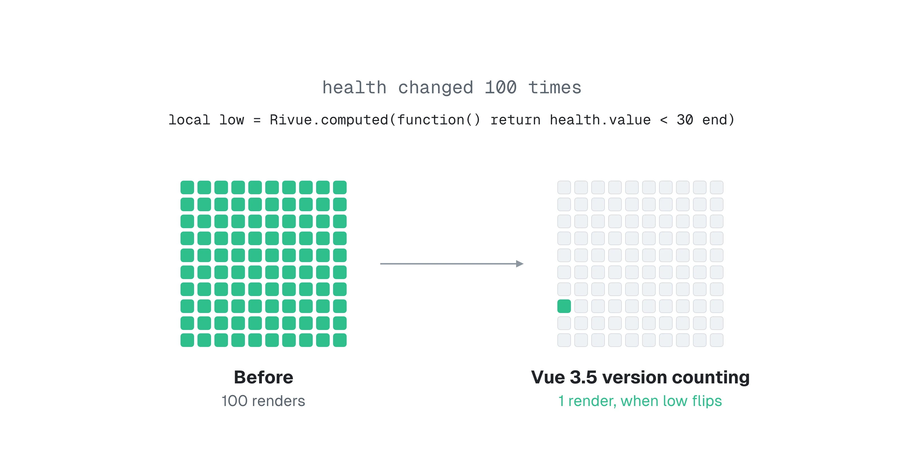
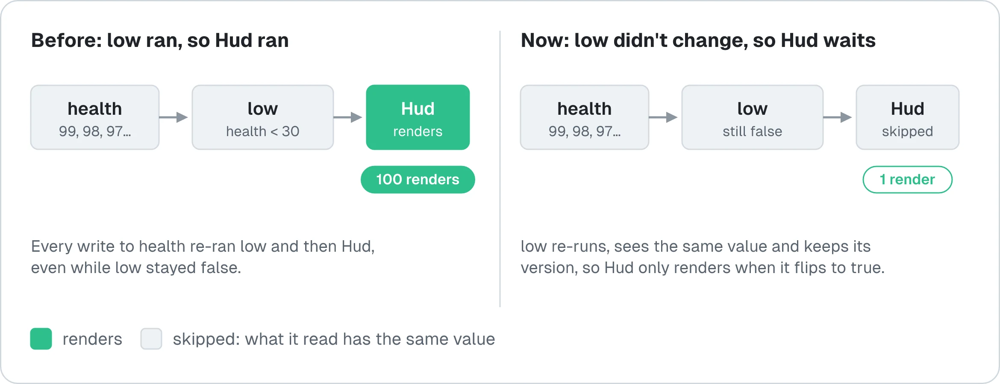
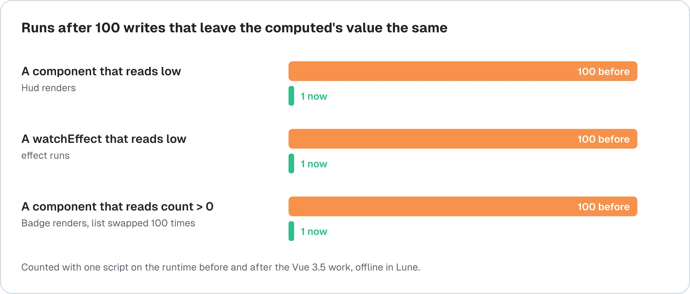
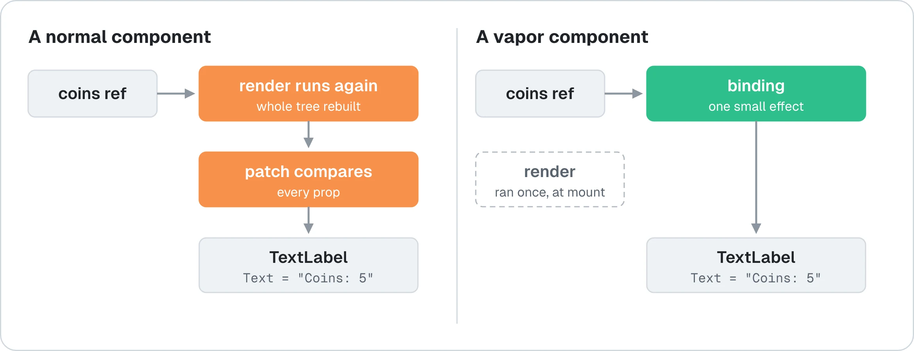

# Rivue catches up with Vue 3.5



Vue 3.5 reworked a lot of its reactivity under the hood, and Rivue now does the same things. Your
code stays the same and runs less often: a component that reads a computed stops re-rendering when
that computed comes out the same.

## Unchanged computeds skip their readers

Say the HUD shows a warning when health drops below 30:

```lua
local health = Rivue.ref(100)

local Hud = Rivue.defineComponent({
	name = "Hud",
	setup = function()
		local low = Rivue.computed(function()
			return health.value < 30
		end)
		return { low = low }
	end,
	render = function(ctx)
		return h("TextLabel", { Text = if ctx.low then "Health low" else "" })
	end,
})
```

Before, every write to `health` marked `low` as stale, and everything that read `low` ran again.
Take a hit from 100 down to 99 and the Hud rendered again, even though `low` was `false` before
the hit and after it.


Now every ref and computed carries a version number, the way Vue 3.5 does it. A write bumps the
version. When `low` runs again and gets the same answer, it keeps its old version, so the Hud
checks, sees nothing it read has changed, and skips the render. It renders once, when health
crosses 30 and `low` flips to `true`.



Watchers and `watchEffect` get the same treatment. I counted it with one script on the runtime
from before this work and on `main`, running offline in Lune:



The one run that's left is the write that flips the result, like health going from 30 to 29.

It isn't free, though. Every read now records a version, so a long chain where every computed
really does change on every write does a bit more bookkeeping than before. In the render
benchmark, a chain of 100 computeds takes about 55 ms now against 33 ms before. The other
scenarios (mounting, reordering, bindings) came out about the same. It pays off when a computed
turns lots of writes into a few real changes, which is how most UI state behaves.

## Pausing a scope

`effectScope()` can now `pause()` and `resume()`, as in Vue 3.5. While a scope is paused, its
watchers and effects don't run. Anything that changed in the meantime runs once on `resume()`:

```lua
local health = Rivue.ref(100)
local hud = Rivue.effectScope()

hud:run(function()
	Rivue.watchEffect(function()
		print("health:", health.value)
	end)
	return nil
end)

hud:pause()
health.value = 80 -- nothing runs
health.value = 60
hud:resume() -- runs once, with 60
```

That fits UI that's hidden but not gone, like a shop you close and open again. Computeds keep
updating while paused, so reading one still gives you the current value. Each component's
`setup()` runs in its own scope, so the same works for anything a component creates.

Two smaller helpers came with it. `getCurrentWatcher()` returns the watcher that's running, so a
watcher can stop itself once it's done:

```lua
local score = Rivue.ref(0)

Rivue.watch(score, function(value)
	if value >= 100 then
		print("goal reached")
		Rivue.getCurrentWatcher():stop()
	end
end, { flush = "sync" })
```

And `onEffectCleanup()` registers cleanup from inside `effect()`, `watchEffect()` or a computed,
the same as `onWatcherCleanup()` does in a `watch` callback.

## Smaller things from 3.5

- `app.config.idPrefix` swaps the `r` at the start of `useId()` ids, so you can tell which app
  made an id when you're reading Instance names.
- `customRef` now keeps the value its getter last returned, as Vue's does. DevTools uses it to show
  and edit custom refs.
- A vnode built once outside `render` can be used in several places, or in several apps. When a
  vnode already owns an Instance, the renderer mounts a copy, the same trick as Vue's
  `cloneIfMounted`. The [hoisting section](../api/render-function.md#hoisting-static-parts) has
  the rules.
- The scheduler queue, the prop name lookups and the dirty checks were tidied up, and
  `lune run bench` now runs a render benchmark, so changes like this one have numbers behind them.

## A first look at Vapor mode

Vue 3.6 adds Vapor mode, where a component renders once and then updates the DOM directly.
Rivue has an experimental version of it. A Vapor component's `render` runs once, at mount. After
that, state reaches the Instances through bindings, and nothing re-renders:

```lua
local coins = Rivue.ref(0)

local Wallet = Rivue.defineComponent({
	name = "Wallet",
	vapor = true,
	setup = function()
		return function()
			return h("TextLabel", {
				Text = Rivue.bind(function()
					return `Coins: {coins.value}`
				end),
			})
		end
	end,
})

local app = Rivue.createApp(Wallet)
app.config.experimental = { vapor = true }
app:mount(Instance.new("Folder"))
coins.value = 10 -- updates the label; the component doesn't render again
```



Parts of the tree that come and go use `Rivue.createIf` and `Rivue.createFor`, which update only
their own children. DevTools follows Vapor components too: their props and state update as they
change, and the render count stays at 1, because that's how many renders there were.

It's experimental, the same as in Vue, where Vapor is still in beta. Names and behaviour may still
change, so keep it off in games you ship. The [Vapor mode page](../api/vapor.md) has the details
and the gotchas, like the fact that a value read directly in a Vapor render never updates.

## Upgrading

Code that uses the public API needs no changes. Your components just run less often. The one type
that changed is the `scheduler` option of [`effect()`](../api/reactivity-advanced.md#effect): it
now gets `run: () -> boolean`, and `run` returns `false` when nothing the effect read changed. If
you wrote your own scheduler, that's the place to look.

The [Vue cheat sheet](../VUE.md) lists every Vue 3.5 API and its Rivue name. Rivue 1.0.0 is next.
