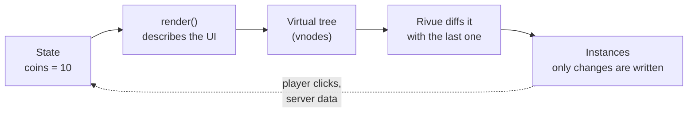
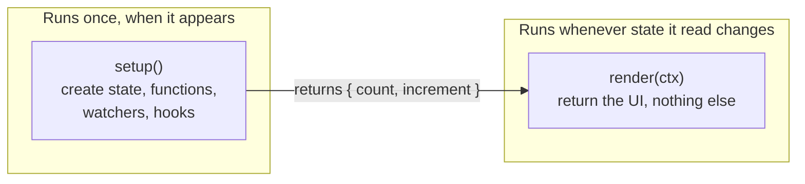

[Docs](../README.md) › [Guide](../GUIDE.md) › **1. Introduction**

# 1. Introduction

**You'll learn:** what Rivue does for you, how to put a first component on screen, and the shape
every component in these docs follows.

## The idea

Without a framework, UI code creates Instances and then keeps them in sync by hand. Every time
the coins change, something has to find the label and set its `Text`, and that gets harder with
every screen.

With Rivue you describe what the UI should look like **for the current state**. When the state
changes, Rivue works out what's different and updates only those Instance properties.



So you never write `label.Text = ...` yourself.

## Your first component

Put Rivue in `ReplicatedStorage` (see [Installation](../../README.md#installation)), then add a
LocalScript:

```lua
-- StarterPlayerScripts/Hud.client.luau
local Players = game:GetService("Players")
local ReplicatedStorage = game:GetService("ReplicatedStorage")
local Rivue = require(ReplicatedStorage.Rivue)
local h = Rivue.h

local Counter = Rivue.defineComponent({
	name = "Counter",

	setup = function()
		local count = Rivue.ref(0)
		return {
			count = count,
			increment = function()
				count.value += 1
			end,
		}
	end,

	render = function(ctx)
		return h("TextButton", {
			Size = UDim2.fromOffset(200, 50),
			Text = `Clicked {ctx.count} times`,
			onClick = ctx.increment,
		})
	end,
})

Rivue.createApp(Counter):mountToPlayerGui(Players.LocalPlayer)
```

Press Play and click the button: the text updates.

## The two halves of a component



- **`setup()`** runs **once**. Create state here, and anything that should live as long as the
  component.
- **`render(ctx)`** runs **every time** state it read changes. It only describes UI: no
  connections, no server calls, no state changes.
- **`ctx`** gives render what setup returned, with refs already unwrapped (`ctx.count`, not
  `ctx.count.value`), then the component's props, then helpers like `ctx.emit`.

`createApp(Counter):mountToPlayerGui(player)` creates a ScreenGui in the player's PlayerGui and
renders into it. `app:mount(instance)` renders into any other Instance.

> **Short form.** For tiny components, `setup` can return the render function itself instead of a
> table. You'll see it in a few API examples. Everything else in these docs uses `setup` + `render`.

---

**Try it:** [Counter example](../../examples/components/Counter.luau)
**Reference:** [defineComponent()](../api/component.md#definecomponent) ·
[render()](../api/component.md#render) · [createApp()](../api/application.md#createapp)

[Guide contents](../GUIDE.md) · [2. State →](02-state.md)
