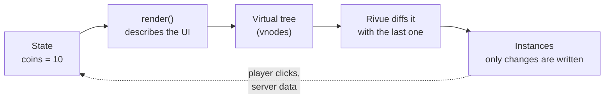
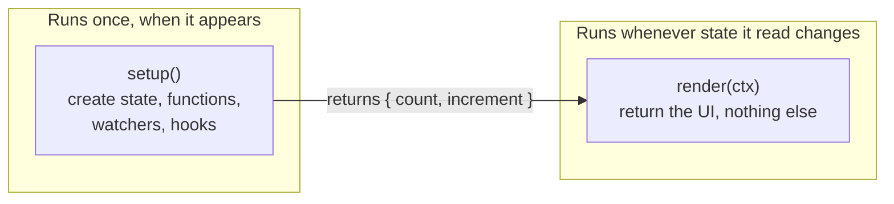

[Docs](../README.md) › [Guide](../GUIDE.md) › **1. Introduction**

# 1. Introduction

This page gets a button on screen that counts its clicks, and shows the shape every component in
these docs follows.

## The idea

Without a framework you create Instances and keep them in sync by hand: the coins change, so
something has to find the label and set its `Text`, and the same again for every value on every
screen.

With Rivue you describe what the UI looks like for the current state. When the state changes, Rivue
compares the new description with the last one and writes only the properties that differ, so
there's no `label.Text = ...` in your code.



## Your first component

Put Rivue in `ReplicatedStorage` (see [Installation](../INSTALLATION.md)), then add a
LocalScript:

```lua {9,19} /ctx/
-- StarterPlayerScripts/Hud.client.luau
local Players = game:GetService("Players")
local ReplicatedStorage = game:GetService("ReplicatedStorage")
local Rivue = require(ReplicatedStorage.RivueUI)
local h = Rivue.h

local Counter = Rivue.defineComponent({
	name = "Counter",

	setup = function()
		local count = Rivue.ref(0)
		return {
			count = count,
			increment = function()
				count.value += 1
			end,
		}
	end,

	render = function(ctx)
		return h("TextButton", {
			Size = UDim2.fromOffset(200, 50),
			Text = `Clicked {ctx.count} times`,
			onClick = ctx.increment,
		})
	end,
})

Rivue.createApp(Counter):mountToPlayerGui(Players.LocalPlayer)
```

Press Play and click. The text counts up.

## The two halves of a component



`setup()` runs once, when the component appears. State goes there, along with anything that should
live as long as the component does. `render(ctx)` runs again every time state it read changes, so
it only describes UI: no connections, no server calls, no changing state.

What render gets as `ctx` is whatever setup returned, with refs already unwrapped (`ctx.count`,
not `ctx.count.value`). After that come the component's props, then helpers like `ctx.emit`.

`createApp(Counter):mountToPlayerGui(player)` creates a ScreenGui in the player's PlayerGui and
renders into it. `app:mount(instance)` renders into any other Instance.

> [!NOTE]
> Tiny components can skip the table and return the render function straight from `setup`. A few
> API examples do that. The rest of these docs stick to `setup` + `render`.

---

**Try it:** [Counter example](../../examples/components/Counter.luau)\
**Reference:** [defineComponent()](../api/component.md#definecomponent) ·
[render()](../api/component.md#render) · [createApp()](../api/application.md#createapp)

[Guide contents](../GUIDE.md) · [2. State →](02-state.md)
