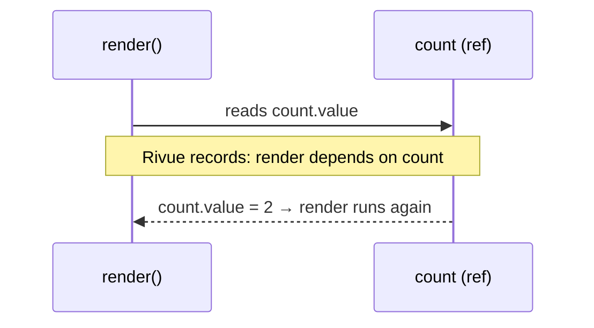

[Docs](../README.md) › [Guide](../GUIDE.md) › **2. State**

# 2. State

Rivue has three kinds of reactive state. Which one you pick matters less than where you read it,
and lists need a little care of their own.

## ref, reactive and computed

| | Holds | Read / write | Use it for |
|---|---|---|---|
| `Rivue.ref(0)` | one value | `.value` | single values, and state you replace wholesale |
| `Rivue.reactive({ ... })` | a table, nested tables too | fields directly | objects you update field by field |
| `Rivue.computed(fn)` | a value derived from other state | `.value` (read only) | totals, filters, labels |

```lua
local coins = Rivue.ref(0)
coins.value += 10

local player = Rivue.reactive({ name = "Ada", inventory = {} })
player.name = "Grace"

local label = Rivue.computed(function()
	return `{player.name}: {coins.value} coins`
end)
print(label.value) -- "Grace: 10 coins"
```

Computeds are cached. Reading `label.value` ten times runs the function once, and it only runs
again after something it read has changed.

## Reads during render are tracked

While a render function runs (or a computed, or a watcher), Rivue writes down everything it reads.
Change one of those values later and that function runs again. Change something it never read and
nothing happens.



Most "why didn't my UI update?" questions come down to this:

```lua
setup = function()
	local count = Rivue.ref(0)
	local snapshot = count.value -- read once, in setup: never updates
	return { count = count, snapshot = snapshot }
end,

render = function(ctx)
	return h("TextLabel", { Text = tostring(ctx.count) }) -- read in render: updates
end,
```

## Changing lists

`table.insert`, `table.remove` and `table.sort` write straight to the table behind the proxy, so
nothing notices. `Rivue.array` has the same operations, and it does tell the UI:

```lua
local array = Rivue.array
local items = Rivue.ref({})

array.push(items.value, { id = 1, name = "Sword" })
array.removeWhere(items.value, function(item)
	return item.id == 1
end)
array.sort(items.value, function(a, b)
	return a.name < b.name
end)
```

Looping has a catch too. Luau's `pairs` and `ipairs` skip proxies, so loop with
`for k, v in state do` or `for i = 1, #list do` instead.

---

**Try it:** [TodoList example](../../examples/components/TodoList.luau) (array helpers, computed counts)
**Reference:** [Reactivity: core](../api/reactivity-core.md) ·
[Array helpers](../api/array.md) · [Reactivity: utilities](../api/reactivity-utilities.md)

[← 1. Introduction](01-introduction.md) · [Guide contents](../GUIDE.md) · [3. Describing UI →](03-describing-ui.md)
