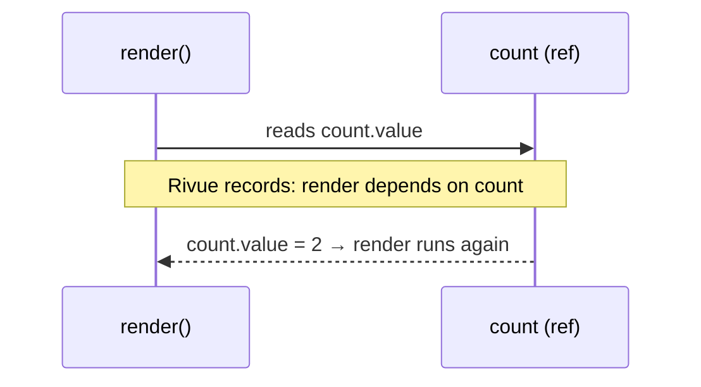

[Docs](../README.md) › [Guide](../GUIDE.md) › **2. State**

# 2. State

**You'll learn:** the three kinds of reactive state, the one rule that decides what updates, and
how to change lists.

## ref, reactive and computed

| | Holds | Read / write | Use it for |
|---|---|---|---|
| `Rivue.ref(0)` | one value | `.value` | single values, and state you replace wholesale |
| `Rivue.reactive({ ... })` | a table, nested tables too | fields directly | objects you update field by field |
| `Rivue.computed(fn)` | a value derived from other state | `.value` (read only) | totals, filters, labels |

```lua
local coins = Rivue.ref(0)
coins.value += 10

local player = Rivue.reactive({ name = "Ada", inventory = {} })
player.name = "Grace"

local label = Rivue.computed(function()
	return `{player.name}: {coins.value} coins`
end)
print(label.value) -- "Grace: 10 coins"
```

A computed is cached: it only re-runs when something it read changes.

## The rule: reads during render are tracked

Rivue remembers **what each render function (or computed, or watcher) read while it ran**. When
one of those values changes, that function runs again. Nothing else does.



That explains most surprises:

```lua
setup = function()
	local count = Rivue.ref(0)
	local snapshot = count.value -- read once, in setup: never updates
	return { count = count, snapshot = snapshot }
end,

render = function(ctx)
	return h("TextLabel", { Text = tostring(ctx.count) }) -- read in render: updates
end,
```

## Changing lists

`table.insert`, `table.remove` and `table.sort` write to the table behind the proxy, so nothing
notices. Use `Rivue.array`, which has the same operations and tells the UI:

```lua
local array = Rivue.array
local items = Rivue.ref({})

array.push(items.value, { id = 1, name = "Sword" })
array.removeWhere(items.value, function(item)
	return item.id == 1
end)
array.sort(items.value, function(a, b)
	return a.name < b.name
end)
```

Also: loop over reactive tables with `for k, v in state do` or `for i = 1, #list do`. Luau's
`pairs`/`ipairs` skip proxies.

---

**Try it:** [TodoList example](../../examples/components/TodoList.luau) (array helpers, computed counts)
**Reference:** [Reactivity: core](../api/reactivity-core.md) ·
[Array helpers](../api/array.md) · [Reactivity: utilities](../api/reactivity-utilities.md)

[← 1. Introduction](01-introduction.md) · [Guide contents](../GUIDE.md) · [3. Describing UI →](03-describing-ui.md)
