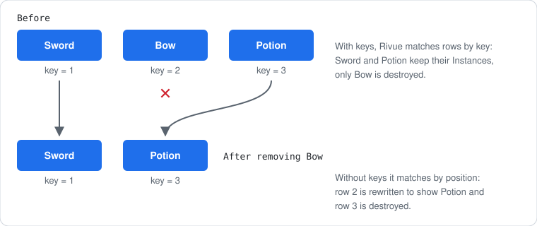

[Docs](../README.md) › [Guide](../GUIDE.md) › **3. Describing UI**

# 3. Describing UI with h()

**You'll learn:** how `h()` describes Instances, what each kind of prop does, and how to render
conditions and lists.

## One call per Instance

```lua
h("Frame", { Size = UDim2.fromScale(1, 1), cornerRadius = 8 }, {
	h("TextLabel", { Text = "Inventory" }),
	h("TextButton", { Text = "Close", onClick = close }),
})
```

`h(type, props, children)`:

- **type**: a ClassName (`"Frame"`), a component, or a component's registered name (`"ItemRow"`).
- **props**: properties, events, modifiers, `class`, `key`, `ref` (table below).
- **children**: a list, a single vnode, or a string.

## What a prop can be

| You write | Rivue does |
|---|---|
| `Size = ...`, `Text = ...` | sets the Instance property (camelCase `size` works too) |
| `onClick = fn`, `onMouseEnter = fn` | connects the event (`onClick` works on any button) |
| `onSizeChanged = fn`, `onTextChanged = fn` | calls `fn(newValue)` when that property changes |
| `cornerRadius = 8`, `padding = 12`, `stroke = color`, `aspectRatio = 1` | creates the UICorner / UIPadding / UIStroke / UIAspectRatioConstraint |
| `gradient = { top, bottom, rotation = 90 }`, `scale = 1.2`, `sizeLimit = { max = size }`, `textSizeLimit = { min = 12, max = 32 }` | creates the UIGradient / UIScale / UISizeConstraint / UITextSizeConstraint |
| `layout = "vertical"`, `flex = "fill"` | creates the list/grid layout and flex items, see [chapter 6](06-styling-and-layout.md) |
| `class = "card"` | applies named styles, see [chapter 6](06-styling-and-layout.md) |
| `vFocus = true`, `vShow = open` | applies a directive, see [chapter 5](05-forms-and-input.md) |
| `key = item.id` | identifies a list item (below) |
| `ref = "input"` | gives setup access to the Instance, see [useTemplateRef()](../api/component.md#usetemplateref) |

Children can be a list, a single vnode, or a string (which sets `Text` on a label or button).
Lists can hold other lists and `nil`, which is what makes conditions and loops work.

## Conditions

Render functions are plain Luau, so a condition is an `if` expression. `Rivue.hIf` is shorthand:

```lua
render = function(ctx)
	return h("Frame", { layout = "vertical" }, {
		h("TextLabel", { Text = "Inventory" }),
		if ctx.loading then h("TextLabel", { Text = "Loading..." }) else nil,
		Rivue.hIf(ctx.isEmpty, h("TextLabel", { Text = "Nothing here yet" })),
	})
end,
```

To hide something without destroying it, keep it and set `vShow = condition`.

## Lists and keys

`Rivue.hFor(list, fn)` maps a list to vnodes, and its result goes straight into a children list:

```lua
h("ScrollingFrame", { layout = "vertical" }, {
	Rivue.hFor(ctx.items, function(item)
		return h("TextLabel", { key = item.id, Text = item.name })
	end),
})
```

**Give every list item a `key`** that belongs to the item (an id, not its position). Keys are how
Rivue knows which Instance is which when the list changes:



Without keys, every row after a removal gets patched, and state inside a row component (a hover,
a typed value) ends up on the wrong item.

---

**Try it:** [Inventory example](../../examples/components/Inventory.luau) (a long keyed list)
**Reference:** [h()](../api/render-function.md#h) · [Element props](../api/render-function.md#element-props) ·
[hIf()](../api/render-function.md#hif) · [hFor()](../api/render-function.md#hfor)

[← 2. State](02-state.md) · [Guide contents](../GUIDE.md) · [4. Components →](04-components.md)
