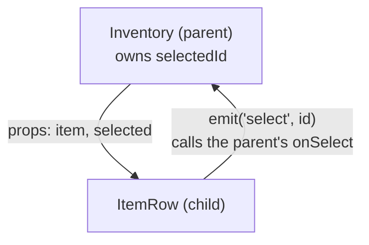
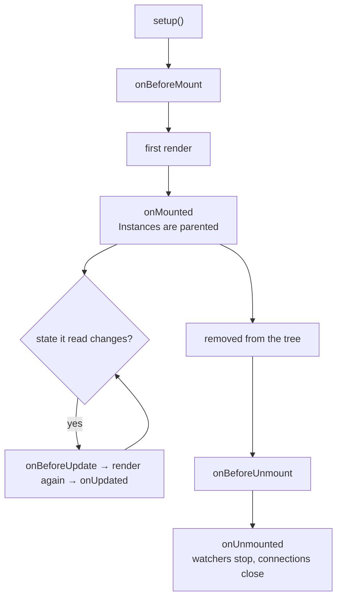

[Docs](../README.md) › [Guide](../GUIDE.md) › **4. Components**

# 4. Components, props, events and slots

One big render function gets hard to read fast. This chapter splits UI into components and covers
how they talk to each other, how to hand UI to one, and when each lifecycle hook runs.

## Props down, events up

Split UI into components the way you'd split code into functions. Data goes down as props.
Requests come back up as events. A child never changes its own props; it asks the parent, and the
parent decides.



```lua
local ItemRow = Rivue.defineComponent({
	name = "ItemRow",
	props = {
		item = { type = "table", required = true },
		selected = { type = "boolean", default = false },
	},
	emits = { "select" },

	render = function(ctx)
		return h("TextButton", {
			class = { "row", ctx.selected and "row-selected" },
			Text = ctx.item.name,
			onClick = function()
				ctx.emit("select", ctx.item.id)
			end,
		})
	end,
})

local Inventory = Rivue.defineComponent({
	name = "Inventory",
	components = { ItemRow = ItemRow }, -- lets render write h("ItemRow")
	props = { items = { type = "table", required = true } },

	setup = function()
		return { selectedId = Rivue.ref(nil) }
	end,

	render = function(ctx)
		return h("Frame", { layout = "vertical" }, {
			Rivue.hFor(ctx.items, function(item)
				return h("ItemRow", {
					key = item.id,
					item = item,
					selected = ctx.selectedId == item.id,
					onSelect = function(id)
						ctx.selectedId = id -- assigning a returned ref sets it
					end,
				})
			end),
		})
	end,
})
```

`props` lists what a component accepts. Types can be Luau ones (`"number"`) or Roblox ones
(`"UDim2"`), and in Studio Rivue warns when a required prop is missing or the type is wrong.
`emits` lists the events: `ctx.emit("select", id)` calls the parent's `onSelect(id)`.

Anything you pass that isn't declared, like `Position`, `LayoutOrder` or `class`, goes to the
component's root element. So `h("ItemRow", { item = item, LayoutOrder = 3 })` puts the row in
third place without `ItemRow` doing anything.

Want autocomplete? Annotate setup's parameter, `setup = function(props: Props, ctx)`, and typos in
prop names become type errors.

## Slots: passing UI into a component

Panels, cards and modals wrap UI that comes from their parent. Plain array children become the
default slot, and named functions become named slots:

```lua
local Card = Rivue.defineComponent({
	name = "Card",
	render = function(ctx)
		return h("Frame", { class = "card", layout = { gap = 8 } }, {
			ctx.renderSlot("header"),
			ctx.renderSlot("default"),
			Rivue.hIf(ctx.hasSlot("footer"), h("Frame", nil, ctx.renderSlot("footer"))),
		})
	end,
})

h(Card, nil, {
	header = function()
		return h("TextLabel", { Text = "Shop" })
	end,
	default = function()
		return h(ShopList)
	end,
})
```

The child can hand data back to a slot, too: `ctx.renderSlot("row", { item = item })`. That's
called a scoped slot.

## Lifecycle



Register hooks at the top of `setup`; calling one later errors. Anything that needs the real
Instances, like `AbsoluteSize`, focus or a tween, belongs in `onMounted`.

Cleanup is mostly automatic. Watchers, `onHeartbeat` connections and `queueJob` jobs from setup stop
on their own, but a `:Connect()` you wrote yourself needs an `onUnmounted`
([chapter 7](07-effects-and-animation.md) has more).

---

**Try it:** [Modal example](../../examples/components/Modal.luau) (named slots, events) ·
[Tabs example](../../examples/components/Tabs.luau) (a slot per tab)
**Reference:** [props](../api/component.md#props) · [emits](../api/component.md#emits) ·
[components](../api/component.md#components) · [Slots](../api/component.md#slots) ·
[Lifecycle hooks](../api/lifecycle.md)

[← 3. Describing UI](03-describing-ui.md) · [Guide contents](../GUIDE.md) · [5. Forms and input →](05-forms-and-input.md)
