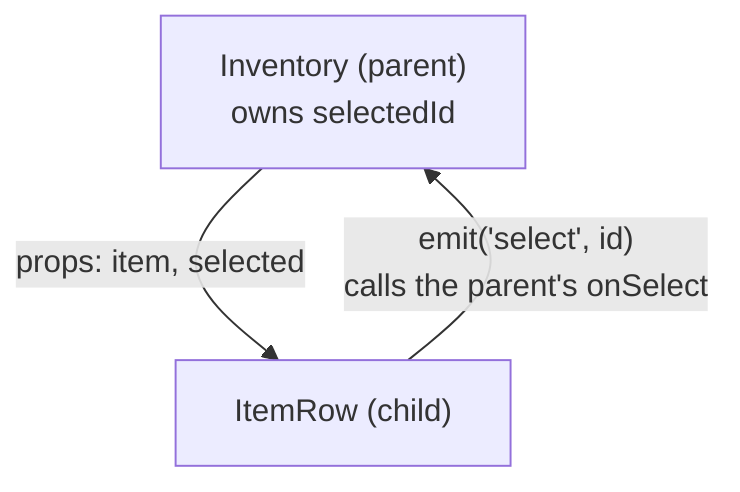
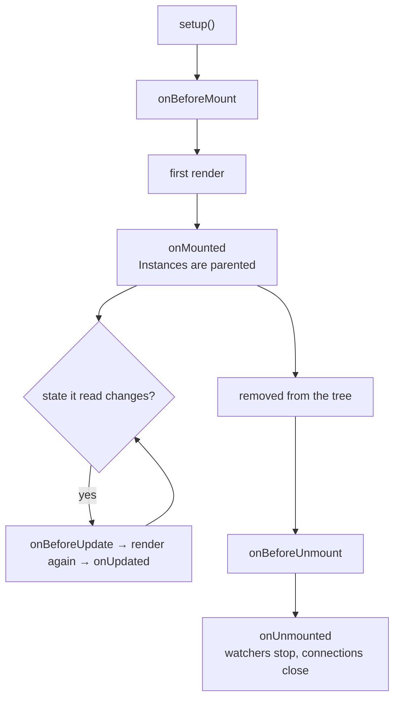

[Docs](../README.md) › [Guide](../GUIDE.md) › **4. Components**

# 4. Components, props, events and slots

**You'll learn:** how components talk to each other, how to pass UI into one, and when each
lifecycle hook runs.

## Props down, events up

Split UI into components the way you split code into functions. A parent passes **props** down;
a child sends **events** up. A child never changes its props: it asks the parent to.



```lua
local ItemRow = Rivue.defineComponent({
	name = "ItemRow",
	props = {
		item = { type = "table", required = true },
		selected = { type = "boolean", default = false },
	},
	emits = { "select" },

	render = function(ctx)
		return h("TextButton", {
			class = { "row", ctx.selected and "row-selected" },
			Text = ctx.item.name,
			onClick = function()
				ctx.emit("select", ctx.item.id)
			end,
		})
	end,
})

local Inventory = Rivue.defineComponent({
	name = "Inventory",
	components = { ItemRow = ItemRow }, -- lets render write h("ItemRow")
	props = { items = { type = "table", required = true } },

	setup = function()
		return { selectedId = Rivue.ref(nil) }
	end,

	render = function(ctx)
		return h("Frame", { layout = "vertical" }, {
			Rivue.hFor(ctx.items, function(item)
				return h("ItemRow", {
					key = item.id,
					item = item,
					selected = ctx.selectedId == item.id,
					onSelect = function(id)
						ctx.selectedId = id -- assigning a returned ref sets it
					end,
				})
			end),
		})
	end,
})
```

- **`props`** declares what a component accepts. In Studio, Rivue warns when a required prop is
  missing or has the wrong type. Types can be Luau types (`"number"`) or Roblox ones (`"UDim2"`).
- **`emits`** declares events. `ctx.emit("select", id)` calls the parent's `onSelect(id)`.
- **Undeclared props** (`Position`, `LayoutOrder`, `class`, ...) are passed on to the component's
  root element, so `LayoutOrder = 3` in `h("ItemRow", { item = item, LayoutOrder = 3 })` ends up on
  the row's root.
- **Typed props:** annotate setup's parameter, `setup = function(props: Props, ctx)`, to get
  autocomplete and type errors on typos.

## Slots: passing UI into a component

Wrappers like panels, cards and modals take UI from their parent. Array children are the
**default slot**; named functions are **named slots**:

```lua
local Card = Rivue.defineComponent({
	name = "Card",
	render = function(ctx)
		return h("Frame", { class = "card", layout = { gap = 8 } }, {
			ctx.renderSlot("header"),
			ctx.renderSlot("default"),
			Rivue.hIf(ctx.hasSlot("footer"), h("Frame", nil, ctx.renderSlot("footer"))),
		})
	end,
})

h(Card, nil, {
	header = function()
		return h("TextLabel", { Text = "Shop" })
	end,
	default = function()
		return h(ShopList)
	end,
})
```

A slot function can also receive data from the child, `ctx.renderSlot("row", { item = item })`,
which is a **scoped slot**.

## Lifecycle



- Register hooks at the top of `setup`. They can't be called later.
- Use `onMounted` for anything that needs the real Instances: `AbsoluteSize`, focus, tweens.
- Watchers, `onHeartbeat` connections and `queueJob` jobs created in setup are cleaned up for you.
  Your own `:Connect()` calls need an `onUnmounted`. See [chapter 7](07-effects-and-animation.md).

---

**Try it:** [Modal example](../../examples/components/Modal.luau) (named slots, events) ·
[Tabs example](../../examples/components/Tabs.luau) (a slot per tab)
**Reference:** [props](../api/component.md#props) · [emits](../api/component.md#emits) ·
[components](../api/component.md#components) · [Slots](../api/component.md#slots) ·
[Lifecycle hooks](../api/lifecycle.md)

[← 3. Describing UI](03-describing-ui.md) · [Guide contents](../GUIDE.md) · [5. Forms and input →](05-forms-and-input.md)
