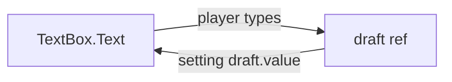

[Docs](../README.md) › [Guide](../GUIDE.md) › **5. Forms and input**

# 5. Forms and input

Text boxes are where state flows both ways: the player changes it, and so does your code. This
chapter covers binding them, shortcuts, and the small helpers for focus, clicks outside, dragging
and gamepad selection.

## Binding a TextBox

`model` ties a TextBox to a ref. Typing updates the ref, and setting the ref updates the box. In
`render(ctx)` you pass the ref's name, as a string:

```lua
local NameForm = Rivue.defineComponent({
	name = "NameForm",
	emits = { "submit" },

	setup = function(_, ctx)
		local draft = Rivue.ref("")
		return {
			draft = draft,
			submit = function()
				ctx.emit("submit", draft.value)
				draft.value = "" -- clears the box
			end,
		}
	end,

	render = function(ctx)
		return h("TextBox", {
			model = "draft",
			PlaceholderText = "Your name",
			onFocusLost = function(enterPressed)
				if enterPressed then
					ctx.submit()
				end
			end,
		})
	end,
})
```



Why a string? Because `ctx.draft` is already the ref's value, so `model = ctx.draft` would bind to
a plain string and nothing would update. Outside `render(ctx)` you pass the ref itself:
`model = draftRef`.

`modelModifiers` changes what gets stored, the same way Vue's `.trim`, `.number` and `.lazy` do:

```lua
h("TextBox", { model = "username", modelModifiers = { trim = true } }) -- "  Ada " → "Ada"
h("TextBox", { model = "amount", modelModifiers = { number = true } }) -- "42" → 42
h("TextBox", { model = "search", modelModifiers = { lazy = true } }) -- updates on focus lost
```

## Keyboard and gamepad shortcuts

Escape to close a menu, B on a controller: `Rivue.useKeybind` binds keys or gamepad buttons for as
long as the component is mounted.

```lua
setup = function(_props, ctx)
	Rivue.useKeybind({ Enum.KeyCode.Escape, Enum.KeyCode.ButtonB }, function()
		ctx.emit("close")
	end)
	return {}
end,
```

You don't unbind it yourself. If it should only work some of the time, pass
`{ enabled = someRef }`.

## model on your own components

Your own components can take `model` too. For that, a component reads `modelValue` and emits
`"update:modelValue"`, and `Rivue.defineModel()` does both for you, handing back a plain ref:

```lua
local useModel = Rivue.defineModel()

local Toggle = Rivue.defineComponent({
	name = "Toggle",
	setup = function(props, ctx)
		return { on = useModel(props, ctx) }
	end,
	render = function(ctx)
		return h("TextButton", {
			Text = if ctx.on then "ON" else "OFF",
			onClick = function()
				ctx.on = not ctx.on
			end,
		})
	end,
})

h(Toggle, { model = musicEnabled })
```

## Directives

Directives are small behaviours you switch on with a `v` prop:

| Prop | Does |
|---|---|
| `vFocus = true` | focuses a TextBox when the value turns on |
| `vShow = open` | toggles `Visible` without destroying the element |
| `vClickOutside = close` | calls `close` when the player clicks or taps outside the element |
| `vSelect = true` | selects the element for gamepad navigation |
| `vDrag = true` | makes it draggable with mouse or touch |

Need one that isn't here? Register it with
[`app:directive()`](../api/application.md#appdirective).

---

**Try it:** [TodoList example](../../examples/components/TodoList.luau) (`model = "draft"`) ·
[Modal example](../../examples/components/Modal.luau) (`vClickOutside`)
**Reference:** [Element props: model](../api/render-function.md#element-props) ·
[defineModel()](../api/component.md#definemodel) · [Directives](../api/directives.md)

[← 4. Components](04-components.md) · [Guide contents](../GUIDE.md) · [6. Styling and layout →](06-styling-and-layout.md)
