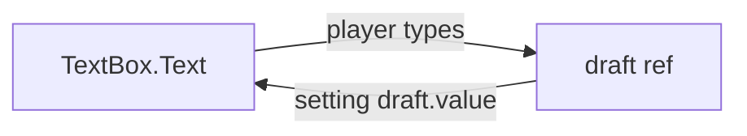

[Docs](../README.md) › [Guide](../GUIDE.md) › **5. Forms and input**

# 5. Forms and input

**You'll learn:** two-way binding for text boxes and your own components, and the directives
that handle focus, clicks outside, dragging and gamepad selection.

## Binding a TextBox

`model` binds a TextBox to state both ways: typing updates the ref, and setting the ref updates
the box. In `render(ctx)`, pass the **name** of a ref that setup returned:

```lua
local NameForm = Rivue.defineComponent({
	name = "NameForm",
	emits = { "submit" },

	setup = function(_, ctx)
		local draft = Rivue.ref("")
		return {
			draft = draft,
			submit = function()
				ctx.emit("submit", draft.value)
				draft.value = "" -- clears the box
			end,
		}
	end,

	render = function(ctx)
		return h("TextBox", {
			model = "draft",
			PlaceholderText = "Your name",
			onFocusLost = function(enterPressed)
				if enterPressed then
					ctx.submit()
				end
			end,
		})
	end,
})
```



Why a name? `ctx.draft` is the ref's *value* (a string), so `model = ctx.draft` would bind to a
plain string. Outside `render(ctx)`, pass the ref itself: `model = draftRef`.

## model on your own components

A component supports `model` by reading `modelValue` and emitting `"update:modelValue"`.
`Rivue.defineModel()` does both and gives you a ref:

```lua
local useModel = Rivue.defineModel()

local Toggle = Rivue.defineComponent({
	name = "Toggle",
	setup = function(props, ctx)
		return { on = useModel(props, ctx) }
	end,
	render = function(ctx)
		return h("TextButton", {
			Text = if ctx.on then "ON" else "OFF",
			onClick = function()
				ctx.on = not ctx.on
			end,
		})
	end,
})

h(Toggle, { model = musicEnabled })
```

## Directives

Directives add behaviour to an element with `v` props:

| Prop | Does |
|---|---|
| `vFocus = true` | focuses a TextBox when the value turns on |
| `vShow = open` | toggles `Visible` without destroying the element |
| `vClickOutside = close` | calls `close` when the player clicks or taps outside the element |
| `vSelect = true` | selects the element for gamepad navigation |
| `vDrag = true` | makes it draggable with mouse or touch |

You can register your own with [`app:directive()`](../api/application.md#appdirective).

---

**Try it:** [TodoList example](../../examples/components/TodoList.luau) (`model = "draft"`) ·
[Modal example](../../examples/components/Modal.luau) (`vClickOutside`)
**Reference:** [Element props: model](../api/render-function.md#element-props) ·
[defineModel()](../api/component.md#definemodel) · [Directives](../api/directives.md)

[← 4. Components](04-components.md) · [Guide contents](../GUIDE.md) · [6. Styling and layout →](06-styling-and-layout.md)
