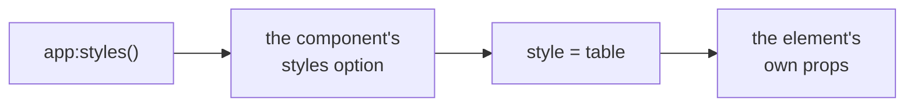
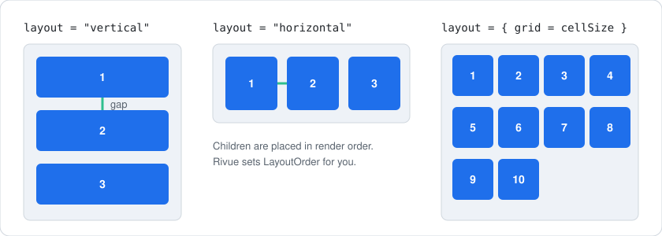
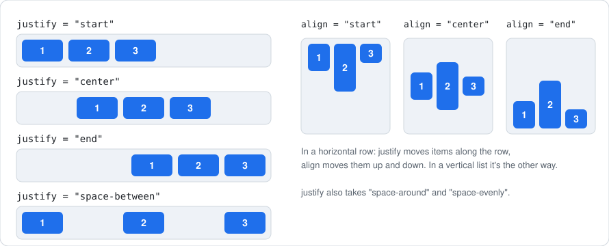

[Docs](../README.md) › [Guide](../GUIDE.md) › **6. Styling and layout**

# 6. Styling and layout

**You'll learn:** how to keep colours and sizes out of your render functions, how to lay elements
out without positions, and how to adapt to phones, consoles and desktops.

## Style classes

Inline colours, fonts and sizes bury a render function's structure. Name them once as **style
classes** and refer to them with `class`, like CSS:

```lua
-- UI/styles.luau
return {
	panel = { BackgroundColor3 = Color3.fromRGB(25, 25, 25), cornerRadius = 8, padding = 12 },
	button = { Size = UDim2.fromOffset(120, 36), TextSize = 16, cornerRadius = 6 },
	active = { BackgroundColor3 = Color3.fromRGB(60, 120, 220) },
}

-- UI.client.luau
Rivue.createApp(App):styles(require(UI.styles)):mountToPlayerGui(player)

-- In any render
h("TextButton", { class = { "button", ctx.isActive and "active" }, Text = "Play" })
```

When several sources set the same property, the later one wins:



- `class` takes a name, a list (`{ "button", "active" }`, later wins) or a map
  (`{ active = isActive }`, applied in alphabetical order).
- Styles used by one component go in its `styles = { ... }` option.
- State-driven values can stay inline: the element's own props always win.

### Hover, pressed, selected and disabled

Like CSS's `:hover` and `:active`, a class can say how an element looks while the player interacts
with it:

```lua
button = {
	BackgroundColor3 = Color3.fromRGB(40, 40, 40),
	hover = { BackgroundColor3 = Color3.fromRGB(60, 60, 60) },
	pressed = { BackgroundColor3 = Color3.fromRGB(25, 25, 25) },
	selected = { BackgroundColor3 = Color3.fromRGB(60, 120, 220) }, -- gamepad selection
	disabled = { BackgroundTransparency = 0.5 },
},

h("TextButton", { class = "button", Text = "Buy", disabled = ctx.coins < price })
```

- Hover, pressed and selected are applied straight to the Instance when the input happens. They
  don't re-render anything.
- `disabled = true` applies the `disabled` variant, sets `Interactable = false`, and turns hover
  and pressed off.
- When several are active, pressed wins over hover, and hover over selected.

### Different devices

A class can also change per device, like a CSS media query:

```lua
panel = {
	Size = UDim2.fromOffset(600, 400),
	phone = { Size = UDim2.fromScale(1, 1) },
	console = { TextSize = 24 },
},
```

The device is `"phone"`, `"tablet"`, `"desktop"` or `"console"`, and `Rivue.useDevice()` returns
it as a ref. A touch screen whose short side is under 500 px is a phone, so a phone held
sideways still counts. Components that use a device variant re-render when the device changes.

## Layout without positions

Absolute positions break when text, screen size or content changes. The `layout` prop creates the
layout object for you, and the children are placed in the order you render them:



```lua
h("Frame", { class = "panel", layout = { gap = 8 } }, { -- vertical list, 8 px apart
	h("TextLabel", { Text = "Settings" }),
	h("Frame", { layout = { direction = "horizontal", justify = "space-between", align = "center" } }, {
		h("TextLabel", { Text = "Music", flex = "fill" }),
		h("TextButton", { class = "button", Text = "On" }),
	}),
})
```

`justify` places items along the layout's direction, `align` across it:



`flex` decides how a child shares the leftover space:


You can still add a `UIListLayout` or `UIGridLayout` child yourself when you need a property
`layout` doesn't cover. Rivue keeps `LayoutOrder` in render order either way.

## Different devices

```lua
setup = function()
	return {
		input = Rivue.useInputType(), -- "keyboard" | "gamepad" | "touch"
		viewport = Rivue.useViewportSize(), -- Vector2, follows resizes and rotation
		safeArea = Rivue.useSafeArea(), -- top bar and notch insets
	}
end,

render = function(ctx)
	local compact = ctx.input == "touch" or ctx.viewport.X < 700
	return h("Frame", {
		Size = if compact then UDim2.fromScale(1, 0.4) else UDim2.fromOffset(400, 300),
		Position = UDim2.fromOffset(0, ctx.safeArea.top),
	})
end,
```

For controllers, `vSelect = true` selects an element and `Rivue.useSelection()` reads and sets
the selected object.

---

**Try it:** [Tabs example](../../examples/components/Tabs.luau) (class maps, layout) ·
[Hud example](../../examples/components/Hud.luau) (input type and viewport) ·
[Demo app](../../src/shared/Demo) (app-wide styles)
**Reference:** [Element props: class, layout, flex](../api/render-function.md#element-props) ·
[styles option](../api/component.md#styles) · [app:styles()](../api/application.md#appstyles) ·
[Roblox composables](../api/roblox.md)

[← 5. Forms and input](05-forms-and-input.md) · [Guide contents](../GUIDE.md) · [7. Effects and animation →](07-effects-and-animation.md)
