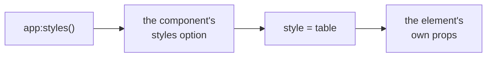
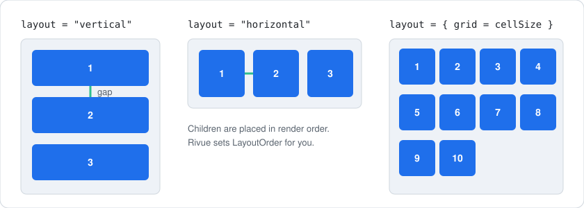
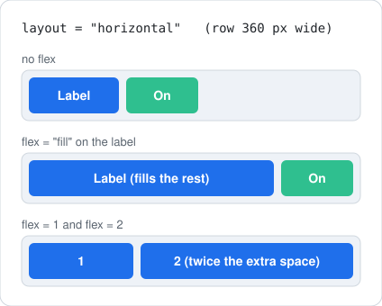
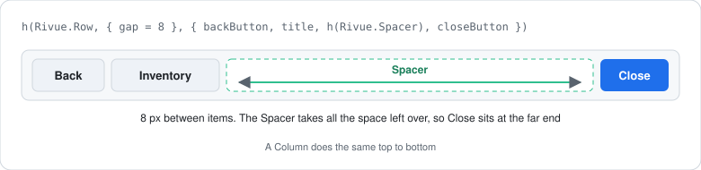

[Docs](../README.md) › [Guide](../GUIDE.md) › **6. Styling and layout**

# 6. Styling and layout

A render function full of `Color3.fromRGB` calls is hard to read and harder to restyle. This
chapter moves the looks into style classes, lays things out without hand-placed positions, and
makes the same UI work on a phone, a console and a desktop.

## Style classes

Give colours, fonts and sizes a name once, as a style class, and refer to them with `class`. If
you've written CSS, this will feel familiar:

```lua
-- UI/styles.luau
return {
	panel = { BackgroundColor3 = Color3.fromRGB(25, 25, 25), cornerRadius = 8, padding = 12 },
	button = { Size = UDim2.fromOffset(120, 36), TextSize = 16, cornerRadius = 6 },
	active = { BackgroundColor3 = Color3.fromRGB(60, 120, 220) },
}

-- UI.client.luau
Rivue.createApp(App):styles(require(UI.styles)):mountToPlayerGui(player)

-- In any render
h("TextButton", { class = { "button", ctx.isActive and "active" }, Text = "Play" })
```

When two places set the same property, the one further right here wins:



`class` takes a name, a list (`{ "button", "active" }`, where later entries win) or a map
(`{ active = isActive }`, applied alphabetically). Styles only one component uses can live in its
own `styles = { ... }` option. And values that follow state can stay inline, since the element's
own props always win anyway.

### Hover, pressed, selected and disabled

A class can also say how an element looks while the player is interacting with it, much like
`:hover` and `:active` in CSS:

```lua
button = {
	BackgroundColor3 = Color3.fromRGB(40, 40, 40),
	hover = { BackgroundColor3 = Color3.fromRGB(60, 60, 60) },
	pressed = { BackgroundColor3 = Color3.fromRGB(25, 25, 25) },
	selected = { BackgroundColor3 = Color3.fromRGB(60, 120, 220) }, -- gamepad selection
	disabled = { BackgroundTransparency = 0.5 },
},

h("TextButton", { class = "button", Text = "Buy", disabled = ctx.coins < price })
```

Hover, pressed and selected are written straight to the Instance as the input happens, so they
don't cost a re-render. `disabled = true` is a bit more: it applies the `disabled` variant, sets
`Interactable = false`, and switches hover and pressed off. If several are active at once, pressed
beats hover, and hover beats selected.

### Different devices

Classes can change per device too. Think media queries:

```lua
panel = {
	Size = UDim2.fromOffset(600, 400),
	phone = { Size = UDim2.fromScale(1, 1) },
	console = { TextSize = 24 },
},
```

There are four devices: `"phone"`, `"tablet"`, `"desktop"` and `"console"`. `Rivue.useDevice()`
gives you the current one as a ref. A touch screen counts as a phone when its short side is under
500 px, which keeps a phone held sideways a phone. When the device changes, components using a
device variant re-render.

## Layout without positions

Hand-placed positions break the moment a label wraps or the screen gets smaller. The `layout` prop
creates the layout object for you, and children show up in the order you render them:



```lua
h("Frame", { class = "panel", layout = { gap = 8 } }, { -- vertical list, 8 px apart
	h("TextLabel", { Text = "Settings" }),
	h("Frame", { layout = { direction = "horizontal", justify = "space-between", align = "center" } }, {
		h("TextLabel", { Text = "Music", flex = "fill" }),
		h("TextButton", { class = "button", Text = "On" }),
	}),
})
```

`justify` spaces items along the layout's direction. `align` lines them up across it:


And `flex` decides how a child shares whatever space is left over:



For the common cases there are shorter components. `Rivue.Row` lays its children left to right,
`Rivue.Column` top to bottom, and `Rivue.Spacer` soaks up the leftover space, which pushes
whatever comes after it to the far end:



```lua
h(Rivue.Row, { gap = 8, align = "center", Size = UDim2.new(1, 0, 0, 40) }, {
	h("TextButton", { class = "button", Text = "Back" }),
	h("TextLabel", { Text = "Inventory" }),
	h(Rivue.Spacer),
	h("TextButton", { class = "button", Text = "Close" }),
})
```

They take the same `gap`, `align`, `justify` and `wrap` as `layout`, and pass everything else to
their Frame.

If you need a property `layout` doesn't cover, add a `UIListLayout` or `UIGridLayout` child
yourself. Rivue keeps `LayoutOrder` in render order either way.

## Input type, screen size and safe area

Some decisions are too specific for a style class. For those, read the input type, screen size
and safe area directly in render:

```lua
setup = function()
	return {
		input = Rivue.useInputType(), -- "keyboard" | "gamepad" | "touch"
		viewport = Rivue.useViewportSize(), -- Vector2, follows resizes and rotation
		safeArea = Rivue.useSafeArea(), -- top bar and notch insets
	}
end,

render = function(ctx)
	local compact = ctx.input == "touch" or ctx.viewport.X < 700
	return h("Frame", {
		Size = if compact then UDim2.fromScale(1, 0.4) else UDim2.fromOffset(400, 300),
		Position = UDim2.fromOffset(0, ctx.safeArea.top),
	})
end,
```

Controllers need one more thing: something selected to start from. `vSelect = true` selects an
element, and `Rivue.useSelection()` reads or changes the current selection.

---

**Try it:** [Tabs example](../../examples/components/Tabs.luau) (class maps, layout) ·
[Hud example](../../examples/components/Hud.luau) (input type and viewport) ·
[Demo app](../../dev/Demo) (app-wide styles)
**Reference:** [Element props: class, layout, flex](../api/render-function.md#element-props) ·
[styles option](../api/component.md#styles) · [app:styles()](../api/application.md#appstyles) ·
[Roblox composables](../api/roblox.md)

[← 5. Forms and input](05-forms-and-input.md) · [Guide contents](../GUIDE.md) · [7. Effects and animation →](07-effects-and-animation.md)
