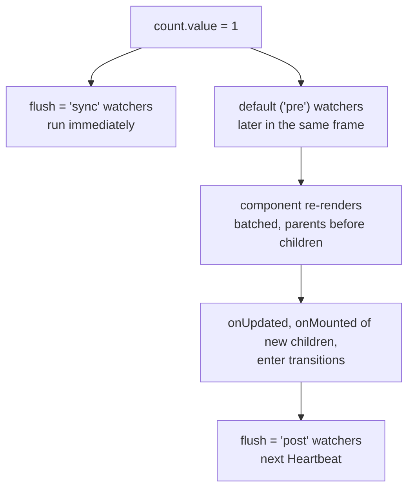

[Docs](../README.md) › [Guide](../GUIDE.md) › **7. Effects and animation**

# 7. Side effects, cleanup and animation

Not every piece of UI code describes UI. Some of it connects signals, polls the server or ticks a
timer. This chapter is about where that code lives, what cleans up after itself, the order things
run in after a change, and animation.

## Side effects live in setup

All of that goes in `setup`. Never in `render`, which can run many times a second:

```lua
setup = function(props)
	local elapsed = Rivue.ref(0)

	-- Run code when something changes
	Rivue.watch(function()
		return props.userId
	end, function(id)
		loadProfile(id)
	end, { immediate = true })

	-- Run code every frame, disconnected on unmount
	Rivue.onHeartbeat(function(dt)
		elapsed.value += dt
	end)

	-- Your own connections need cleanup
	local conn = workspace.ChildAdded:Connect(onChildAdded)
	Rivue.onUnmounted(function()
		conn:Disconnect()
	end)

	return { elapsed = elapsed }
end,
```

| Created in setup | Cleaned up on unmount? |
|---|---|
| `watch`, `watchEffect`, `computed` | yes |
| `onHeartbeat`, `onRenderStepped`, `onStepped` | yes |
| `queueJob`, `useTag`, `attributeRef` | yes |
| `something:Connect(...)` you wrote | **no**, disconnect it in `onUnmounted` |

The two watchers differ in what they track. `watch(source, callback)` only looks at `source`, and
calls `callback(new, old)` when it changes. `watchEffect(fn)` runs `fn` right away, then again
whenever anything it read changes.

## What runs when, after a change

Change five values in a row and each affected component still renders once. Rivue batches the
updates and runs them in this order:



So if you change state and immediately read an Instance, you'll see the old value.
`Rivue.nextTick()` yields until the re-renders have run.

## Animation

For things that appear and disappear, wrap the element in `Transition` and toggle it inside.
`from` describes the hidden state. The element tweens out of it when it appears, and back into it
before it's destroyed.

```lua
h(Rivue.Transition, {
	tweenInfo = TweenInfo.new(0.2),
	from = { BackgroundTransparency = 1, Position = UDim2.fromScale(0.5, 0.55) },
}, {
	Rivue.hIf(ctx.open, h("Frame", { Position = UDim2.fromScale(0.5, 0.5) })),
})
```

Lists get `TransitionGroup`, where keyed items tween in when they're added and out when they're
removed.

Then there are values that move, like a health bar sliding down. `useTween` and `useSpring` turn
state into an animated value you can bind to a prop:

```lua
setup = function(props)
	return {
		shown = Rivue.useSpring(function()
			return props.health / 100
		end),
	}
end,

render = function(ctx)
	return h("Frame", { Size = UDim2.fromScale(ctx.shown, 1) })
end,
```

---

**Try it:** [Hud example](../../examples/components/Hud.luau) (springs, attributeRef) ·
[Modal example](../../examples/components/Modal.luau) (Transition)
**Reference:** [watch()](../api/reactivity-core.md#watch) ·
[watchEffect()](../api/reactivity-core.md#watcheffect) · [Lifecycle hooks](../api/lifecycle.md) ·
[Update timing](../api/scheduler.md#update-timing) · [Transition](../api/builtins.md#transition) ·
[useSpring()](../api/roblox.md#usespring)

[← 6. Styling and layout](06-styling-and-layout.md) · [Guide contents](../GUIDE.md) · [8. Sharing state and the server →](08-state-and-server.md)
