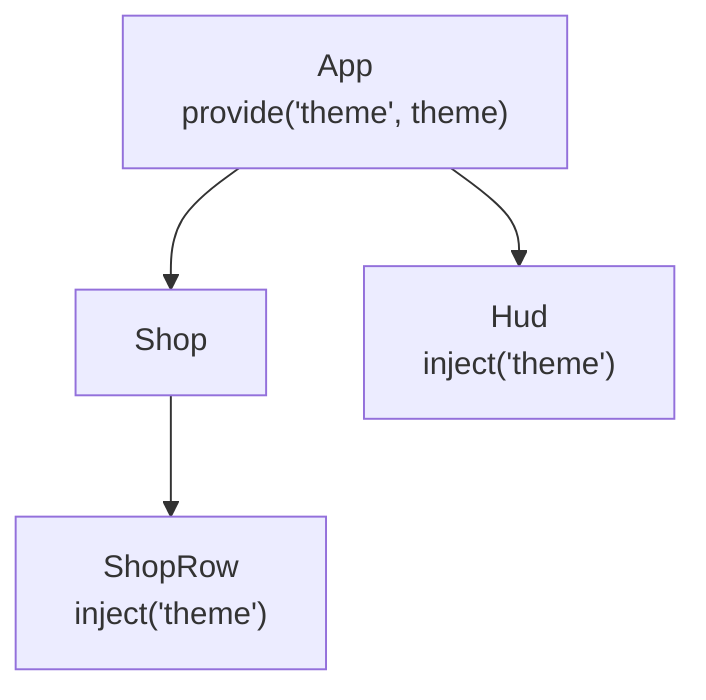
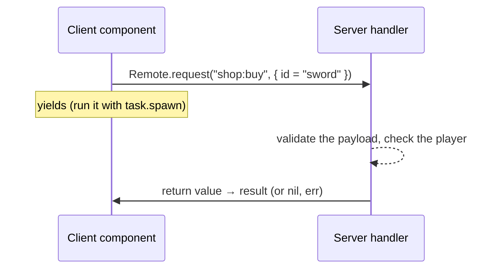

[Docs](../README.md) › [Guide](../GUIDE.md) › **8. Sharing state and the server**

# 8. Sharing state and talking to the server

**You'll learn:** how components far apart share state, and how to load and send data from a
component.

## Parent to descendants: provide / inject

Instead of passing a prop through every level, a parent provides a value and any descendant
injects it:



```lua
-- In App's setup
Rivue.provide("theme", Rivue.reactive({ accent = Color3.fromRGB(60, 120, 220) }))

-- In any descendant's setup
local theme = Rivue.inject("theme")
```

## Game-wide state: a store module

A module that returns reactive state works as a store. Every component that reads it updates
when it changes:

```lua
-- ReplicatedStorage/Stores/PlayerData.luau
local Rivue = require(game.ReplicatedStorage.Rivue)

local state = Rivue.reactive({ coins = 0, level = 1 })

local PlayerData = {}
PlayerData.state = Rivue.readonly(state) -- components read this

function PlayerData.addCoins(amount: number)
	state.coins += amount
end

return PlayerData
```

Keep the writes in the module's functions, so there's one place to look when a value is wrong.

## Talking to the server

[RivueRemote](../api/remote.md), a separate package you put next to Rivue, gives you
request/response and fire-and-forget calls over RemoteEvents, with
per-player rate limits on the server:



```lua
-- Server
local Remote = require(game.ReplicatedStorage.RivueRemote)
Remote.setupServer()
Remote.handle("shop:buy", function(player, payload)
	return ShopService.buy(player, payload.id) -- validate everything the client sends
end, { maxPerSecond = 5 })
```

In a component, call it off the render path and keep loading and error state:

```lua
-- At the top of the component's module
local Remote = require(game.ReplicatedStorage.RivueRemote)

setup = function()
	local items = Rivue.shallowRef(nil)
	local errorText = Rivue.ref(nil)

	Rivue.onMounted(function()
		task.spawn(function()
			local result, err = Remote.request("shop:list", nil)
			if result then
				items.value = result
			else
				errorText.value = err
			end
		end)
	end)

	return { items = items, errorText = errorText }
end,
```

---

**Try it:** [Shop example](../../examples/components/Shop.luau) (loading, errors, pending buys)
**Reference:** [provide()](../api/component.md#provide) · [inject()](../api/component.md#inject) ·
[readonly()](../api/reactivity-core.md#readonly) · [RivueRemote](../api/remote.md)

[← 7. Effects and animation](07-effects-and-animation.md) · [Guide contents](../GUIDE.md) · [9. Performance and debugging →](09-performance-and-debugging.md)
