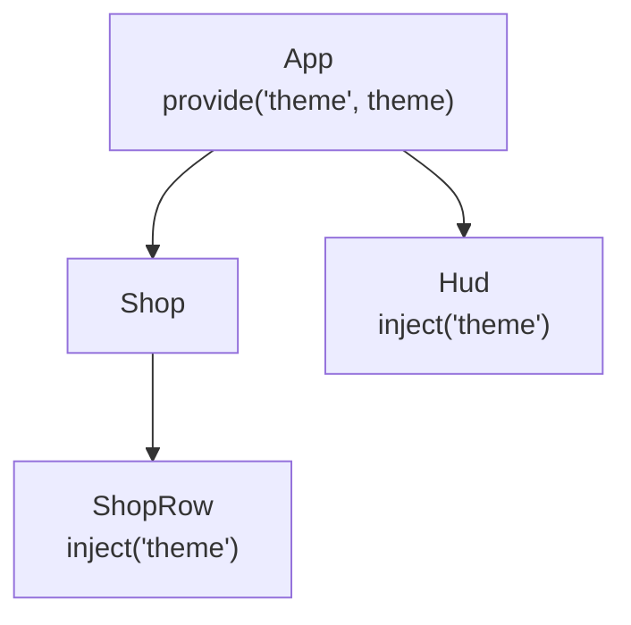
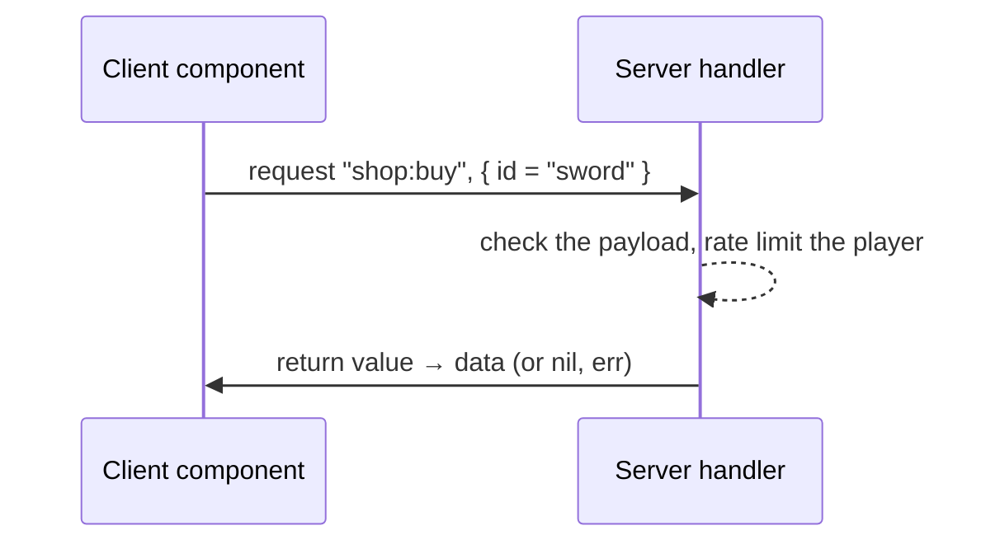

[Docs](../README.md) › [Guide](../GUIDE.md) › **8. Sharing state and the server**

# 8. Sharing state and talking to the server

Props work well between a parent and its child. They get tiring when a shop row five levels down
needs the theme, or when the HUD and the shop both show the same coins. This chapter covers both,
then the server.

## Parent to descendants: provide / inject

A parent can provide a value once, and any descendant can inject it, however deep:



```lua
-- In App's setup
Rivue.provide("theme", Rivue.reactive({ accent = Color3.fromRGB(60, 120, 220) }))

-- In any descendant's setup
local theme = Rivue.inject("theme")
```

## Game-wide state: a store module

For state the whole game shares, a plain module is enough. Return reactive state from it, and any
component that reads it updates when it changes:

```lua
-- ReplicatedStorage/Stores/PlayerData.luau
local Rivue = require(game.ReplicatedStorage.RivueUI)

local state = Rivue.reactive({ coins = 0, level = 1 })

local PlayerData = {}
PlayerData.state = Rivue.readonly(state) -- components read this

function PlayerData.addCoins(amount: number)
	state.coins += amount
end

return PlayerData
```

Components read `PlayerData.state` and call `PlayerData.addCoins`. Since only the module's own
functions write to it, a wrong value has one place to look.
[Chapter 14](14-state-architecture.md) goes further.

## Talking to the server

Rivue itself only does UI. Server calls go through [RivueRemote](../api/remote.md), a separate
package you install next to it. A request goes to a named handler on the server and yields until
the reply comes back:



On the server, every handler checks its payload before using it, because a client can send
anything. `Remote.schema` builds that check from a short spec:

<!-- server -->
```lua
local Remote = require(game.ReplicatedStorage.RivueRemote)
Remote.setupServer()

Remote.handle("shop:buy", function(player, payload)
	return ShopService.buy(player, payload.id)
end, {
	check = Remote.schema({ id = "string 1..32" }),
	maxPerSecond = 5,
	exclusive = true, -- a second buy while the first is still running gets "busy"
})
```

In a component, `Remote.useRequest` sends the request when the component mounts and gives you
`data`, `loading` and `error` as refs:

```lua
local Remote = require(game.ReplicatedStorage.RivueRemote)

local ShopList = Rivue.defineComponent({
	name = "ShopList",
	setup = function()
		local list = Remote.useRequest("shop:list", { initial = {} })
		return { items = list.data, loading = list.loading, error = list.error, retry = list.refresh }
	end,
	render = function(ctx)
		if ctx.loading then
			return h("TextLabel", { Text = "Loading..." })
		elseif ctx.error then
			return h("TextButton", { Text = "Couldn't load the shop. Retry", onClick = ctx.retry })
		end
		return h("TextLabel", { Text = `{#ctx.items} items` })
	end,
})
```

Outside a component, `Remote.request(name, payload)` returns `(data, nil)` or `(nil, err)`. It
yields, so call it from a spawned thread. `Remote.fire` sends without waiting for a reply.

### When the server has news

The server can push events to one player with `Remote.send` or to everyone with `Remote.sendAll`.
The client listens with `Remote.on`, which disconnects on unmount when you call it in setup:

```lua
setup = function()
	local announcement = Rivue.ref("")
	Remote.on("Announcement", function(text)
		announcement.value = text
	end)
	return { announcement = announcement }
end,
```

For a value the client should always see the latest of, like coins or the round phase, use
replicated state instead of events. The server owns it, and players who join late get the current
value:

<!-- server -->
```lua
local coins = Remote.state("coins", 0)
game.Players.PlayerAdded:Connect(function(player)
	coins.setFor(player, 100)
end)
```

```lua
-- client, in setup: a read-only ref that follows the server
local coins = Remote.useState("coins", 0)
```

---

**Try it:** [Shop example](../../examples/components/Shop.luau) (useAsync, errors and retry, pending buys)\
**Reference:** [provide()](../api/component.md#provide) · [inject()](../api/component.md#inject) ·
[readonly()](../api/reactivity-core.md#readonly) · [RivueRemote](../api/remote.md) ·
[Remote.useRequest()](../api/remote.md#remoteuserequest) · [Remote.state()](../api/remote.md#remotestate)

[← 7. Effects and animation](07-effects-and-animation.md) · [Guide contents](../GUIDE.md) · [9. Performance and debugging →](09-performance-and-debugging.md)
