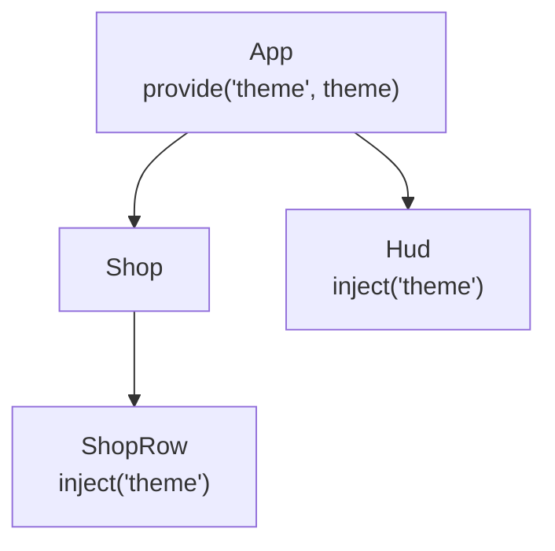
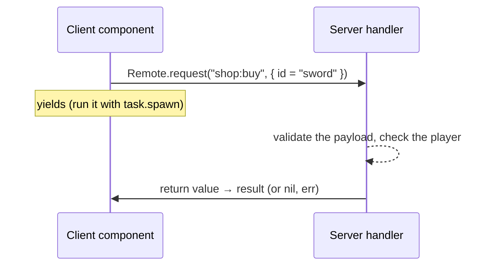

[Docs](../README.md) › [Guide](../GUIDE.md) › **8. Sharing state and the server**

# 8. Sharing state and talking to the server

Props are fine between a parent and its child. They get tiring when the shop row five levels down
needs the theme, or when the HUD and the shop both show the same coins. This chapter covers both
cases, plus loading data from the server.

## Parent to descendants: provide / inject

A parent can provide a value once, and any descendant can inject it, however deep:



```lua
-- In App's setup
Rivue.provide("theme", Rivue.reactive({ accent = Color3.fromRGB(60, 120, 220) }))

-- In any descendant's setup
local theme = Rivue.inject("theme")
```

## Game-wide state: a store module

For state the whole game shares, a plain module is enough. Return reactive state from it, and any
component that reads it updates when it changes:

```lua
-- ReplicatedStorage/Stores/PlayerData.luau
local Rivue = require(game.ReplicatedStorage.RivueUI)

local state = Rivue.reactive({ coins = 0, level = 1 })

local PlayerData = {}
PlayerData.state = Rivue.readonly(state) -- components read this

function PlayerData.addCoins(amount: number)
	state.coins += amount
end

return PlayerData
```

Only the module's own functions write to it. When a value is wrong, that's the one place to look.

## Talking to the server

Rivue itself only does UI. For the server there's [RivueRemote](../api/remote.md), a separate
package you put next to it. It does request/response and fire-and-forget calls over RemoteEvents,
lets the server push events to clients, and has per-player rate limits on the server:



```lua
-- Server
local Remote = require(game.ReplicatedStorage.RivueRemote)
Remote.setupServer()
Remote.handle("shop:buy", function(player, payload)
	return ShopService.buy(player, payload.id)
end, {
	maxPerSecond = 5,
	-- The client can send anything, so reject a bad payload before the handler sees it
	check = function(payload)
		return type(payload) == "table" and type(payload.id) == "string"
	end,
})
```

`Remote.request` yields, so a component calls it from a spawned thread and keeps the result and
any error in state:

```lua
-- At the top of the component's module
local Remote = require(game.ReplicatedStorage.RivueRemote)

setup = function()
	local items = Rivue.shallowRef(nil)
	local errorText = Rivue.ref(nil)

	Rivue.onMounted(function()
		task.spawn(function()
			local result, err = Remote.request("shop:list", nil)
			if result then
				items.value = result
			else
				errorText.value = err
			end
		end)
	end)

	return { items = items, errorText = errorText }
end,
```

---

**Try it:** [Shop example](../../examples/components/Shop.luau) (useAsync, errors and retry, pending buys)
**Reference:** [provide()](../api/component.md#provide) · [inject()](../api/component.md#inject) ·
[readonly()](../api/reactivity-core.md#readonly) · [RivueRemote](../api/remote.md)

[← 7. Effects and animation](07-effects-and-animation.md) · [Guide contents](../GUIDE.md) · [9. Performance and debugging →](09-performance-and-debugging.md)
