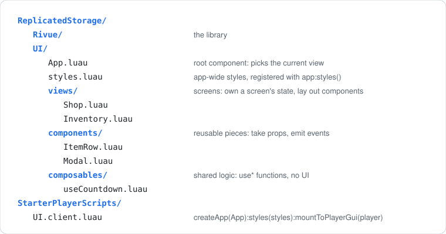
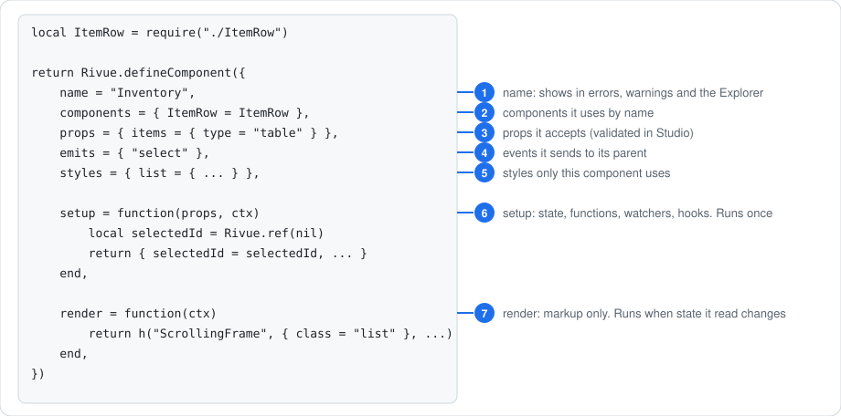

[Docs](../README.md) › [Guide](../GUIDE.md) › **10. Organising a project**

# 10. Organising a project

**You'll learn:** where files go once you have more than one screen, the order to write a
component's parts in, and when to split a component.

## Folders by role



Each folder has one job:

- **`views/`** are screens: Shop, Inventory, Settings. A view owns that screen's state and lays
  out components. It has little markup of its own.
- **`components/`** are reusable pieces: rows, cards, buttons, modals. They take props, emit
  events, and only keep their own UI state (is this open, is this hovered).
- **`composables/`** hold logic that several components share, as `use*` functions: timers,
  loading data, input handling. They return state and functions, never UI.
- **`styles.luau`** holds the app-wide style classes from [chapter 6](06-styling-and-layout.md).

Put **one component per ModuleScript**, named after the component (`ItemRow.luau` holds
`name = "ItemRow"`). Inside `UI/`, require by path relative to the file:

```lua
local ItemRow = require("./ItemRow") -- a sibling
local Modal = require("../components/Modal") -- from views/
local Rivue = require(game.ReplicatedStorage.Rivue) -- another service: by Instance
```

The [demo app](../../src/shared/Demo) in this repo is laid out this way.

## Anatomy of a component

Write a component's parts in the same order every time, so any file reads the same way:



You won't need every part in every component. A small one might only have `name`, `props` and
`render`.

## Split before it gets deep

A render function that does everything ends up long and deeply nested, and it re-renders as a
whole whenever anything changes. Pull pieces out into components once a render passes about
**40 lines or 4 levels of nesting**:


```lua
render = function(ctx)
	return h("Frame", { class = "window", layout = { gap = 12 } }, {
		h("ShopHeader", { coins = ctx.coins }),
		h("ProductList", { products = ctx.products, onBuy = ctx.buy }),
		h("ShopFooter"),
	})
end,
```

## Share logic with composables

Stateful logic used by several components goes in `composables/` as a `use*` function called
from `setup`. [Chapter 12](12-writing-composables.md) covers writing them.

---

**Try it:** [Demo app](../../src/shared/Demo) (views, components, app styles) · the `rcomponent`,
`rview` and `rcomposable` snippets in `.vscode/rivue.code-snippets` scaffold these files
**Reference:** [defineComponent()](../api/component.md#definecomponent) ·
[components option](../api/component.md#components)

[← 9. Performance and debugging](09-performance-and-debugging.md) · [Guide contents](../GUIDE.md) · [11. Style rules →](11-style-rules.md)
