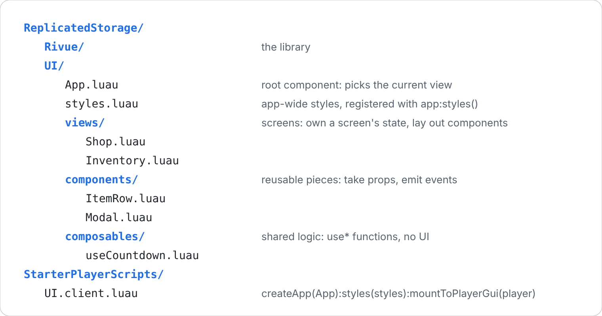
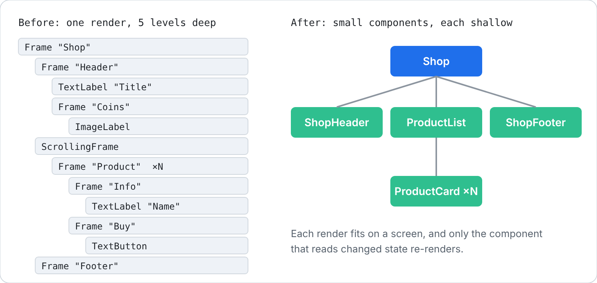

[Docs](../README.md) › [Guide](../GUIDE.md) › **10. Organising a project**

# 10. Organising a project

One screen fits in one file. By the third screen you'll want some structure, so here's the one
these docs use: where files go, the order a component's parts go in, and when to split one up.

## Folders by role



Each folder has one job. `views/` holds the screens (Shop, Inventory, Settings). A view owns its
screen's state and arranges components, with little markup of its own. The components themselves
live in `components/`: rows, cards, buttons, modals. They take props, emit events, and only keep
their own UI state, like whether they're open or hovered.

Logic that several components share goes in `composables/` as `use*` functions, such as a timer,
a data loader or input handling. Those return state and functions, never UI. Finally,
`styles.luau` holds the app-wide style classes from [chapter 6](06-styling-and-layout.md).

Keep one component per ModuleScript, named after it, so `ItemRow.luau` holds
`name = "ItemRow"`. Inside `UI/`, require by path, relative to the file:

```lua
local ItemRow = require("./ItemRow") -- a sibling
local Modal = require("../components/Modal") -- from views/
local Rivue = require(game.ReplicatedStorage.RivueUI) -- another service: by Instance
```

The [demo app](../../dev/Demo) in this repo is laid out this way.

## Anatomy of a component

If every component lists its parts in the same order, you can open any file and know where to
look:


Most components skip some of these. A small one might only have `name`, `props` and `render`.

## Split before it gets deep

A render function that does everything gets long and deeply nested, and it re-renders as a whole
whenever anything in it changes. A rough rule: once a render passes 40 lines or 4 levels of
nesting, pull pieces out into components.



```lua
render = function(ctx)
	return h("Frame", { class = "window", layout = { gap = 12 } }, {
		h("ShopHeader", { coins = ctx.coins }),
		h("ProductList", { products = ctx.products, onBuy = ctx.buy }),
		h("ShopFooter"),
	})
end,
```

## Share logic with composables

When two components need the same stateful logic, move it into `composables/` as a `use*`
function and call it from both setups. [Chapter 12](12-writing-composables.md) is all about
writing those.

---

**Try it:** [Demo app](../../dev/Demo) (views, components, app styles) · the `rcomponent`,
`rview` and `rcomposable` snippets in `.vscode/rivue.code-snippets` scaffold these files
**Reference:** [defineComponent()](../api/component.md#definecomponent) ·
[components option](../api/component.md#components)

[← 9. Performance and debugging](09-performance-and-debugging.md) · [Guide contents](../GUIDE.md) · [11. Style rules →](11-style-rules.md)
