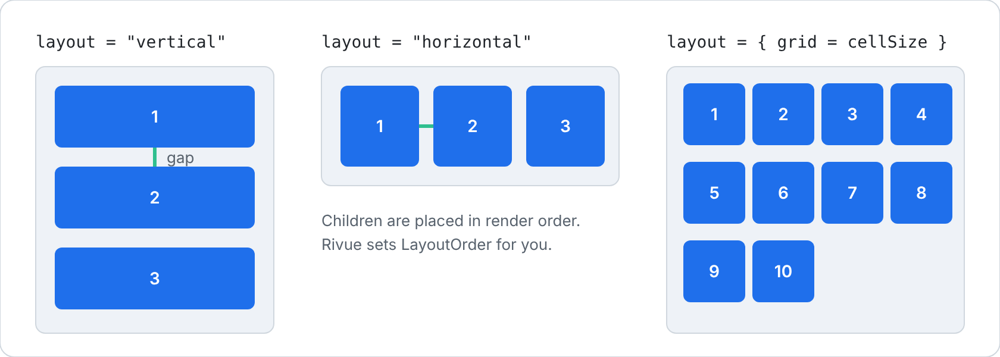

[Docs](../README.md) › [Guide](../GUIDE.md) › **11. Style rules**

# 11. Style rules

These are the habits the rest of the docs follow, each with the reason for it. Break a "must" and
you'll get a real bug sooner or later. The "should" rules are about keeping a big project easy to
read.

## At a glance

| | Rule | Because |
|---|---|---|
| **Must** | [Key every list item](#key-every-list-item) | otherwise rows get rewritten and state lands on the wrong item |
| **Must** | [Read state in render, not setup](#read-state-in-render-not-setup) | only reads during render are tracked |
| **Must** | [Edit lists with Rivue.array](#edit-lists-with-rivuearray) | `table.*` skips the proxy, so nothing updates |
| **Must** | [Emit, don't change props](#emit-dont-change-props) | props belong to the parent |
| **Must** | [Keep render free of side effects](#keep-render-free-of-side-effects) | render can run many times a second |
| **Must** | [Clean up your own connections](#clean-up-your-own-connections) | Rivue only cleans up what it created |
| **Must** | [Name every component](#name-every-component) | errors and the Explorer show `<Anonymous>` otherwise |
| Should | [Put visuals in style classes](#put-visuals-in-style-classes) | the structure stays visible |
| Should | [Lay out with layout, not positions](#lay-out-with-layout-not-positions) | positions break when content changes |
| Should | [Use setup + render](#use-setup--render) | logic and markup stay apart, no `.value` |
| Should | [Declare props and emits](#declare-props-and-emits) | Studio checks them for you |
| Should | [Use model and v props](#use-model-and-v-props) | less wiring, fewer mistakes |

## Must

### Key every list item

Keys tell Rivue which Instance belongs to which item ([chapter 3](03-describing-ui.md#lists-and-keys)).
An index won't do, because it changes the moment the list does. Use something the item owns.

```lua
-- ✗ No key, or the index as key
Rivue.hFor(items, function(item, index)
	return h("ItemRow", { key = index, item = item })
end)

-- ✓ The item's own id
Rivue.hFor(items, function(item)
	return h("ItemRow", { key = item.id, item = item })
end)
```

### Read state in render, not setup

Copy a value in `setup` and you've taken a snapshot. It won't update, ever.

```lua
-- ✗ Copied once
setup = function(props)
	local title = props.title
	return { title = title }
end,

-- ✓ Read where it's used
render = function(ctx)
	return h("TextLabel", { Text = ctx.title })
end,
```

### Edit lists with Rivue.array

```lua
-- ✗ Silently does nothing on a reactive list
table.insert(state.todos, todo)

-- ✓
Rivue.array.push(state.todos, todo)
Rivue.array.removeWhere(state.todos, function(t)
	return t.done
end)
```

### Emit, don't change props

State changes where it lives. If a child wants something changed, it asks with an event and lets
the parent do it.

```lua
-- ✗ The parent's next render overwrites this anyway
onClick = function()
	ctx.selected = true
end

-- ✓
emits = { "select" },
-- ...
onClick = function()
	ctx.emit("select", ctx.item.id)
end
```

### Keep render free of side effects

Render runs whenever its state changes. During an animation that can be every frame. Change state
in there and you get loops; call the server and you get duplicate requests.

```lua
-- ✗
render = function(ctx)
	Remote.fire("seen", nil)
	return h("Frame")
end,

-- ✓
setup = function()
	Rivue.onMounted(function()
		Remote.fire("seen", nil)
	end)
	return {}
end,
```

### Clean up your own connections

Watchers, computeds, `onHeartbeat` and `useTag` stop with the component. Your own `:Connect()`
calls keep going until you disconnect them.

```lua
-- ✗ Keeps firing after the component is gone
workspace.ChildAdded:Connect(onAdded)

-- ✓
local conn = workspace.ChildAdded:Connect(onAdded)
Rivue.onUnmounted(function()
	conn:Disconnect()
end)
```

### Name every component

You'll see `name` everywhere: in errors (`Error in render of <ItemRow> in <Inventory>`), in
warnings, in `printTree()` and in the Explorer. Without one, errors just say `<Anonymous>`.

```lua
Rivue.defineComponent({ name = "ItemRow", setup = setup, render = render })
```

## Should

### Put visuals in style classes

Five lines of colours and fonts make it hard to see what the render function is actually building.

```lua
-- ✗
h("TextButton", {
	Size = UDim2.fromOffset(110, 34),
	BackgroundColor3 = Color3.fromRGB(70, 110, 220),
	TextColor3 = Color3.new(1, 1, 1),
	Font = Enum.Font.GothamBold,
	cornerRadius = 6,
	Text = "Buy",
})

-- ✓
h("TextButton", { class = "button", Text = "Buy" })
```

Values that follow state can stay inline (`Visible = ctx.open`). For variants, combine classes,
like `class = { "button", danger and "button-danger" }`.

### Lay out with layout, not positions



```lua
-- ✗ Breaks as soon as a label wraps
h("TextLabel", { Position = UDim2.fromOffset(10, 10) }),
h("TextBox", { Position = UDim2.fromOffset(10, 50) }),

-- ✓
h("Frame", { layout = { gap = 8 }, padding = 10 }, {
	h("TextLabel"),
	h("TextBox"),
})
```

### Use setup + render

Return state from `setup` and write markup in `render(ctx)`. You skip all the `.value`, and each
half reads on its own. For a component of a few lines, returning a render function from `setup` is
fine too.

### Declare props and emits

Studio validates declared props. Declared emits keep `on*` listeners out of the attributes that
get passed to the root. Annotate setup's parameter and you get autocomplete too:

```lua
type Props = { item: Item, selected: boolean }

setup = function(props: Props, ctx)
	-- props.selcted is now a type error
end,
```

### Use model and v props

```lua
-- ✗
h("TextBox", {
	Text = draft.value,
	onTextChanged = function(text)
		draft.value = text
	end,
})

-- ✓
h("TextBox", { model = "draft", vFocus = true })
```

## Naming

| Thing | Style | Example |
|---|---|---|
| Component, and its file | PascalCase | `ItemRow`, `ItemRow.luau` |
| Composable | camelCase starting with `use` | `useCountdown` |
| Event | camelCase | `emit("select")` → `onSelect` |
| Style class | pick camelCase or kebab-case and stick to it | `primaryButton` or `"button-primary"` |

## Tooling

The repo has VS Code snippets in `.vscode/rivue.code-snippets`: `rcomponent`, `rview`,
`rcomposable`, `rstyles`, `rwatch` and `rcomputed`. Copy the file into your own project's
`.vscode/` to use them. Formatting is StyLua with the repo's `.stylua.toml`, and types come from
luau-lsp with the Roblox definitions.

One catch with strict mode: the old Luau type solver can't type mixed children lists like
`{ header, Rivue.hFor(...) }`. Either use `--!strict` for logic and composables and `--!nonstrict`
for files with render functions, or switch to the new solver and use `--!strict` everywhere.

---

That's the core of Rivue. From here, keep the [API reference](../API.md) open while you build, and
look at the [examples](../../examples) when you want to see a feature in a real component. Chapters
12–16 go further, into reusable composables, bigger apps, performance and testing.

[← 10. Organising a project](10-organising-a-project.md) · [Guide contents](../GUIDE.md) · [12. Writing composables →](12-writing-composables.md)
