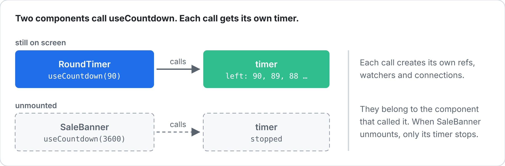
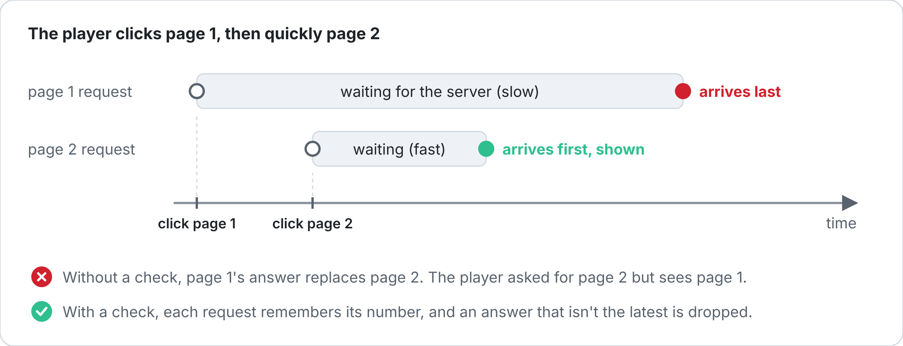

[Docs](../README.md) › [Guide](../GUIDE.md) › **12. Writing composables**

# 12. Writing composables

When two components need the same logic, put it in a composable: a `use*` function called from
`setup`. This chapter builds a countdown step by step, then covers cleanup, a debounced ref and
loading data.

## From component to composable

Start with a round timer:

```lua
local RoundTimer = Rivue.defineComponent({
	name = "RoundTimer",
	setup = function()
		local left = Rivue.ref(90)
		Rivue.onHeartbeat(function(dt)
			left.value = math.max(0, left.value - dt)
		end)
		return { left = left }
	end,
	render = function(ctx)
		return h("TextLabel", { Text = tostring(math.ceil(ctx.left)) })
	end,
})
```

When a sale banner needs the same countdown, move it into a composable:

```lua
-- UI/composables/useCountdown.luau
local function useCountdown(seconds: number)
	local left = Rivue.ref(seconds)
	Rivue.onHeartbeat(function(dt)
		left.value = math.max(0, left.value - dt)
	end)
	return left
end
```

Both components call it in `setup`:

```lua
-- RoundTimer
setup = function()
	return { left = useCountdown(90) }
end,

-- SaleBanner
setup = function()
	return { left = useCountdown(3600) }
end,
```



Whatever a composable creates during `setup` belongs to the component that called it, and stops
when that component unmounts. Each call also makes new state. Two components that need the same
state, rather than the same logic, need a store instead ([chapter 14](14-state-architecture.md)).

## Accept a ref, not only a number

If the round length is a ref, `useCountdown(roundLength.value)` reads it once and never notices
when it changes. Accept a number, a ref or a getter (`MaybeRefOrGetter`) instead, and read it with
`Rivue.toValue()`:

```lua
local function useCountdown(seconds: Rivue.MaybeRefOrGetter<number>)
	local left = Rivue.ref(Rivue.toValue(seconds))

	-- When the caller's value changes, start counting from the new value
	Rivue.watch(function()
		return Rivue.toValue(seconds)
	end, function(value)
		left.value = value
	end)

	Rivue.onHeartbeat(function(dt)
		left.value = math.max(0, left.value - dt)
	end)

	return left
end
```

`toValue` unwraps a ref, calls a getter, and passes plain values through. Used inside the `watch`
source, it also tracks the read, so all three of these work:

```lua
useCountdown(90) -- a fixed number
useCountdown(roundLength) -- a ref: restarts when it changes
useCountdown(function() -- a prop: restarts when the parent passes a new one
	return props.seconds
end)
```

## Return the ref itself

Return the ref, not its `.value`. A returned `.value` is a number that never changes:

```lua
setup = function()
	return { left = useCountdown(90) } -- ✓ the ref: render sees it count down
	-- return { left = useCountdown(90).value } -- ✗ the number 90, forever
end,
render = function(ctx)
	return h("TextLabel", { Text = tostring(math.ceil(ctx.left)) }) -- ctx.left reads the ref for you
end,
```

With several values, return a table of refs and functions, like
`{ data = data, loading = loading, refresh = refresh }`.

## Clean up your own connections

Watchers, computeds and `onHeartbeat` stop by themselves. Your own `:Connect()` calls don't, so
disconnect them in `Rivue.onScopeDispose`:

```lua
local function usePartTouched(part: BasePart)
	local touching = Rivue.ref(false)

	local began = part.Touched:Connect(function()
		touching.value = true
	end)
	local ended = part.TouchEnded:Connect(function()
		touching.value = false
	end)

	Rivue.onScopeDispose(function()
		began:Disconnect()
		ended:Disconnect()
	end)

	return touching
end
```

`onUnmounted` would only work inside a component. `onScopeDispose` also works when the composable
runs in a store or in a test's [`effectScope`](../api/reactivity-advanced.md#effectscope).

## A debounced ref with customRef

`customRef` lets you decide when a ref tells its readers it changed. This one waits until the
player stops typing, for a search box:

```lua
local function useDebounced<T>(initial: T, delaySeconds: number)
	local value = initial
	local pending: thread? = nil

	return Rivue.customRef(function(track, trigger)
		return {
			get = function()
				track() -- whoever reads it will update when it changes
				return value
			end,
			set = function(new)
				-- A new key press cancels the one before it
				if pending then
					task.cancel(pending)
				end
				pending = task.delay(delaySeconds, function()
					value = new
					pending = nil
					trigger() -- now tell everything that read it
				end)
			end,
		}
	end)
end
```

It works anywhere a ref does, `model` included:

```lua
setup = function()
	local search = useDebounced("", 0.3)
	Rivue.watch(search, function(text)
		print("searching for", text) -- once, 0.3 s after the last key press
	end)
	return { search = search }
end,
render = function()
	return h("TextBox", { model = "search", PlaceholderText = "Search items" })
end,
```

## Loading data

A loader needs data, loading and error refs, plus a way to load again. The awkward part is answers
that arrive out of order, when the player switches pages faster than the server replies:



`Rivue.useAsync` handles that: it keeps only the newest answer, and it holds a surrounding
`Suspense` on its fallback until the data arrives. For RivueRemote calls, `Remote.useRequest` wraps
it and puts request errors in `error`:

```lua
local Remote = require(game.ReplicatedStorage.RivueRemote)

local function useShopPage(page: Rivue.Ref<number>)
	local shop = Remote.useRequest("shop:list", { payload = { page = page.value }, initial = {} })
	Rivue.watch(page, function(value)
		shop.run({ page = value }) -- a late answer for the old page is dropped
	end)
	return shop
end
```

For async work that isn't a Remote call, pass your own function to `useAsync`:

```lua
-- in setup: the player's headshot, for an avatar ImageLabel
local thumbnail = Rivue.useAsync(function(userId: number)
	return game.Players:GetUserThumbnailAsync(userId, Enum.ThumbnailType.HeadShot, Enum.ThumbnailSize.Size100x100)
end, { args = { props.userId } })
```

---

**Try it:** [Shop example](../../examples/components/Shop.luau) (useAsync with a retry button)

**Reference:** [toValue()](../api/reactivity-utilities.md#tovalue) ·
[customRef()](../api/reactivity-advanced.md#customref) ·
[onScopeDispose()](../api/reactivity-advanced.md#onscopedispose) · [watch()](../api/reactivity-core.md#watch) ·
[useAsync()](../api/component.md#useasync) · [Remote.useRequest()](../api/remote.md#remoteuserequest)

[← 11. Style rules](11-style-rules.md) · [Guide contents](../GUIDE.md) · [13. Component patterns →](13-advanced-components.md)
