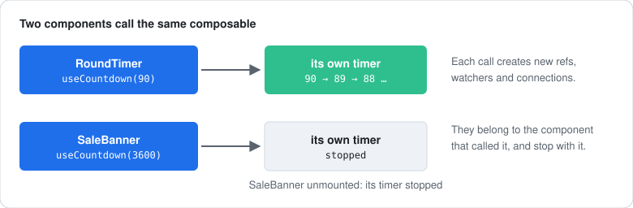
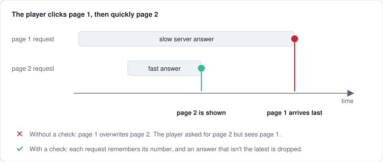

[Docs](../README.md) › [Guide](../GUIDE.md) › **12. Writing composables**

# 12. Writing composables

Sooner or later two components need the same logic. A composable is how you share it: a `use*`
function called from `setup`. This chapter writes a few, from a simple countdown to a data loader
that copes with slow answers.

## From component to composable

Start with a round timer:

```lua
local RoundTimer = Rivue.defineComponent({
	name = "RoundTimer",
	setup = function()
		local left = Rivue.ref(90)
		Rivue.onHeartbeat(function(dt)
			left.value = math.max(0, left.value - dt)
		end)
		return { left = left }
	end,
	render = function(ctx)
		return h("TextLabel", { Text = tostring(math.ceil(ctx.left)) })
	end,
})
```

Now a sale banner needs the same countdown. Move it out into a composable:

```lua
-- UI/composables/useCountdown.luau
local function useCountdown(seconds: number)
	local left = Rivue.ref(seconds)
	Rivue.onHeartbeat(function(dt)
		left.value = math.max(0, left.value - dt)
	end)
	return left
end
```

Both components call it in `setup`:

```lua
-- RoundTimer
setup = function()
	return { left = useCountdown(90) }
end,

-- SaleBanner
setup = function()
	return { left = useCountdown(3600) }
end,
```



Whatever a composable creates during `setup` belongs to the component that called it, and stops
when that component unmounts. Each call makes new state, too. Two components that need the same
state, rather than the same logic, want a store instead ([chapter 14](14-state-architecture.md)).

## Accept a ref, not only a number

Say the round length is a ref. `useCountdown(roundLength.value)` reads it once and never notices
when it changes. The fix is to accept a number, a ref or a getter (`MaybeRefOrGetter`) and read it
with `Rivue.toValue()`:

```lua
local function useCountdown(seconds: Rivue.MaybeRefOrGetter<number>)
	local left = Rivue.ref(Rivue.toValue(seconds))

	-- When the caller's value changes, start counting from the new value
	Rivue.watch(function()
		return Rivue.toValue(seconds)
	end, function(value)
		left.value = value
	end)

	Rivue.onHeartbeat(function(dt)
		left.value = math.max(0, left.value - dt)
	end)

	return left
end
```

`toValue` unwraps a ref, calls a getter, and passes plain values through. Used inside the `watch`
source, it also tracks the read, so all three of these work:

```lua
useCountdown(90) -- a fixed number
useCountdown(roundLength) -- a ref: restarts when it changes
useCountdown(function() -- a prop: restarts when the parent passes a new one
	return props.seconds
end)
```

## Return the ref itself

Hand back the ref itself. Return `.value` and the caller gets a number that never changes:

```lua
setup = function()
	return { left = useCountdown(90) } -- ✓ the ref: render sees it count down
	-- return { left = useCountdown(90).value } -- ✗ the number 90, forever
end,
render = function(ctx)
	return h("TextLabel", { Text = tostring(math.ceil(ctx.left)) }) -- ctx.left reads the ref for you
end,
```

With several values, return a table of refs and functions, like
`{ data = data, loading = loading, refresh = refresh }`.

## Clean up your own connections

Watchers, computeds and `onHeartbeat` stop by themselves. Your own `:Connect()` calls don't, so
disconnect them in `Rivue.onScopeDispose`:

```lua
local function usePartTouched(part: BasePart)
	local touching = Rivue.ref(false)

	local began = part.Touched:Connect(function()
		touching.value = true
	end)
	local ended = part.TouchEnded:Connect(function()
		touching.value = false
	end)

	Rivue.onScopeDispose(function()
		began:Disconnect()
		ended:Disconnect()
	end)

	return touching
end
```

Why not `onUnmounted`? It only works inside a component. `onScopeDispose` also works when the
composable runs in a store or in a test's [`effectScope`](../api/reactivity-advanced.md#effectscope).

## A debounced ref with customRef

With `customRef` you decide when a ref tells its readers it changed. Here's a debounced one, for a
search box:

```lua
local function useDebounced<T>(initial: T, delaySeconds: number)
	local value = initial
	local pending: thread? = nil

	return Rivue.customRef(function(track, trigger)
		return {
			get = function()
				track() -- whoever reads it will update when it changes
				return value
			end,
			set = function(new)
				-- A new key press cancels the one before it
				if pending then
					task.cancel(pending)
				end
				pending = task.delay(delaySeconds, function()
					value = new
					pending = nil
					trigger() -- now tell everything that read it
				end)
			end,
		}
	end)
end
```

Anywhere a ref works, this works, `model` included:

```lua
setup = function()
	local search = useDebounced("", 0.3)
	Rivue.watch(search, function(text)
		print("searching for", text) -- once, 0.3 s after the last key press
	end)
	return { search = search }
end,
render = function()
	return h("TextBox", { model = "search", PlaceholderText = "Search items" })
end,
```

## Loading server data

A loader gives back data, loading and error refs, plus a refresh function. The tricky part is
answers that arrive out of order:



Number each request, and drop any answer that isn't for the latest one:

```lua
local Remote = require(game.ReplicatedStorage.RivueRemote)

local function useRemoteData(action: string, payload: Rivue.MaybeRefOrGetter<any>?)
	local data = Rivue.shallowRef(nil) -- replaced as a whole, so no need to track inside it
	local loading = Rivue.ref(false)
	local errorText = Rivue.ref(nil :: string?)
	local latest = 0

	local function refresh()
		latest += 1
		local mine = latest -- this request's number
		loading.value = true
		errorText.value = nil

		task.spawn(function()
			local result, err = Remote.request(action, Rivue.toValue(payload))
			if mine ~= latest then
				return -- a newer request was made while this one was waiting
			end
			loading.value = false
			if err then
				errorText.value = err
			else
				data.value = result
			end
		end)
	end

	-- Load now, and again whenever the payload changes (another page, a new filter)
	Rivue.watch(function()
		return Rivue.toValue(payload)
	end, refresh, { immediate = true })

	return { data = data, loading = loading, errorText = errorText, refresh = refresh }
end
```

Here it is driving a paged shop screen:

```lua
setup = function()
	local page = Rivue.ref(1)
	local shop = useRemoteData("shop:list", function()
		return { page = page.value }
	end)
	return {
		page = page, -- set ctx.page = 2 and the next page loads
		items = shop.data,
		loading = shop.loading,
		errorText = shop.errorText,
		retry = shop.refresh,
	}
end,
```

Writing this once shows how the request numbering works. In your own code, `Rivue.useAsync` does
the same job: data, loading and error refs, only the newest answer kept, and it holds a
surrounding `Suspense` on its loading screen until the data arrives:

```lua
local shop = Rivue.useAsync(function(page: number)
	return Remote.request("shop:list", { page = page })
end, { args = { 1 } })

shop.run(2) -- load page 2; a late answer for page 1 is dropped
```

See [useAsync()](../api/navigation.md#useasync).

---

**Reference:** [toValue()](../api/reactivity-utilities.md#tovalue) ·
[customRef()](../api/reactivity-advanced.md#customref) ·
[onScopeDispose()](../api/reactivity-advanced.md#onscopedispose) · [watch()](../api/reactivity-core.md#watch)

[← 11. Style rules](11-style-rules.md) · [Guide contents](../GUIDE.md) · [13. Component patterns →](13-advanced-components.md)
