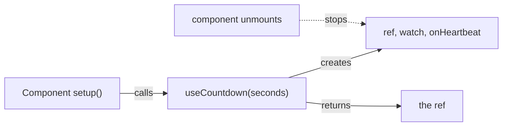

[Docs](../README.md) › [Guide](../GUIDE.md) › **12. Writing composables**

# 12. Writing composables

**You'll learn:** how to turn logic you've written twice into a `use*` function: what it should
take, what it should return, and how it cleans up after itself.

A composable is a plain function, called from `setup`, that creates state, watchers and
connections and hands back refs. Rivue's own `useSpring`, `useInputType` and `attributeRef` are
composables. Since they run inside `setup`, everything they create is stopped when the component
unmounts.



## Take anything that holds a value

Accept a plain value, a ref or a getter, and read it with `Rivue.toValue()`. Callers can then pass
whatever they have, and the composable follows it when it's reactive.

```lua
-- composables/useCountdown.luau
local function useCountdown(seconds: Rivue.MaybeRefOrGetter<number>)
	local left = Rivue.ref(Rivue.toValue(seconds))

	-- Start over when the caller's value changes
	Rivue.watch(function()
		return Rivue.toValue(seconds)
	end, function(value)
		left.value = value
	end)

	Rivue.onHeartbeat(function(dt)
		left.value = math.max(0, left.value - dt)
	end)

	return left
end

-- Any of these work
useCountdown(90)
useCountdown(roundLength) -- a ref
useCountdown(function()
	return props.seconds
end)
```

## Return refs, not values

Return the ref itself, so callers keep reactivity. In `render(ctx)` it's unwrapped for you:

```lua
setup = function()
	return { left = useCountdown(90) } -- ✓ the ref
	-- return { left = useCountdown(90).value } -- ✗ a number, frozen at 90
end,
render = function(ctx)
	return h("TextLabel", { Text = tostring(math.ceil(ctx.left)) })
end,
```

Return several values as a table of refs and functions:
`return { data = data, loading = loading, refresh = refresh }`.

## Clean up what you start

Watchers, computeds and `onHeartbeat` connections made inside a composable are cleaned up with the
component. For anything else, register cleanup with `Rivue.onScopeDispose`. Unlike
`onUnmounted`, it also works when the composable is used outside a component, inside an
[`effectScope`](../api/reactivity-advanced.md#effectscope).

```lua
local function usePartTouched(part: BasePart)
	local touching = Rivue.ref(false)
	local began = part.Touched:Connect(function()
		touching.value = true
	end)
	local ended = part.TouchEnded:Connect(function()
		touching.value = false
	end)
	Rivue.onScopeDispose(function()
		began:Disconnect()
		ended:Disconnect()
	end)
	return touching
end
```

## A value that waits: customRef

`customRef` lets you decide when a ref updates. A debounced search box only searches once the
player stops typing:

```lua
local function useDebounced<T>(initial: T, delaySeconds: number)
	local value = initial
	local pending: thread? = nil
	return Rivue.customRef(function(track, trigger)
		return {
			get = function()
				track()
				return value
			end,
			set = function(new)
				if pending then
					task.cancel(pending)
				end
				pending = task.delay(delaySeconds, function()
					value = new
					pending = nil
					trigger() -- now everything that read it updates
				end)
			end,
		}
	end)
end

-- setup: return { search = useDebounced("", 0.3) }
-- render: h("TextBox", { model = "search" })
```

## Loading data, the full version

Loading from the server needs a loading state, an error, a way to retry, and protection from
answers that arrive out of order:

```lua
local function useRemoteData(action: string, payload: Rivue.MaybeRefOrGetter<any>?)
	local data = Rivue.shallowRef(nil) -- replaced wholesale, no need for deep reactivity
	local loading = Rivue.ref(false)
	local errorText = Rivue.ref(nil :: string?)
	local latest = 0

	local function refresh()
		latest += 1
		local mine = latest
		loading.value = true
		errorText.value = nil
		task.spawn(function()
			local result, err = Rivue.Remote.request(action, Rivue.toValue(payload))
			if mine ~= latest then
				return -- a newer request was made, ignore this answer
			end
			loading.value = false
			if err then
				errorText.value = err
			else
				data.value = result
			end
		end)
	end

	-- Load now, and again whenever the payload changes (a new page, a new filter)
	Rivue.watch(function()
		return Rivue.toValue(payload)
	end, refresh, { immediate = true })

	return { data = data, loading = loading, errorText = errorText, refresh = refresh }
end
```

```lua
-- In a component
setup = function()
	local page = Rivue.ref(1)
	local shop = useRemoteData("shop:list", function()
		return { page = page.value }
	end)
	return { shop = shop.data, loading = shop.loading, retry = shop.refresh, page = page }
end,
```

## Rules of thumb

- **Name it `use…`**, and call it at the top of `setup`, not in render or a callback.
- **No UI inside.** A composable returns state and functions; components decide how to show them.
- **One job each.** `useInventory` and `useCountdown`, not `useShopScreen`.
- **Shared state is a store, not a composable.** A composable creates fresh state per call. If two
  components need the *same* state, see [chapter 14](14-state-architecture.md).

---

**Reference:** [toValue()](../api/reactivity-utilities.md#tovalue) ·
[customRef()](../api/reactivity-advanced.md#customref) ·
[onScopeDispose()](../api/reactivity-advanced.md#onscopedispose) · [watch()](../api/reactivity-core.md#watch)

[← 11. Style rules](11-style-rules.md) · [Guide contents](../GUIDE.md) · [13. Advanced component patterns →](13-advanced-components.md)
